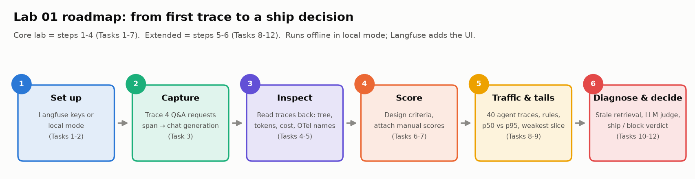
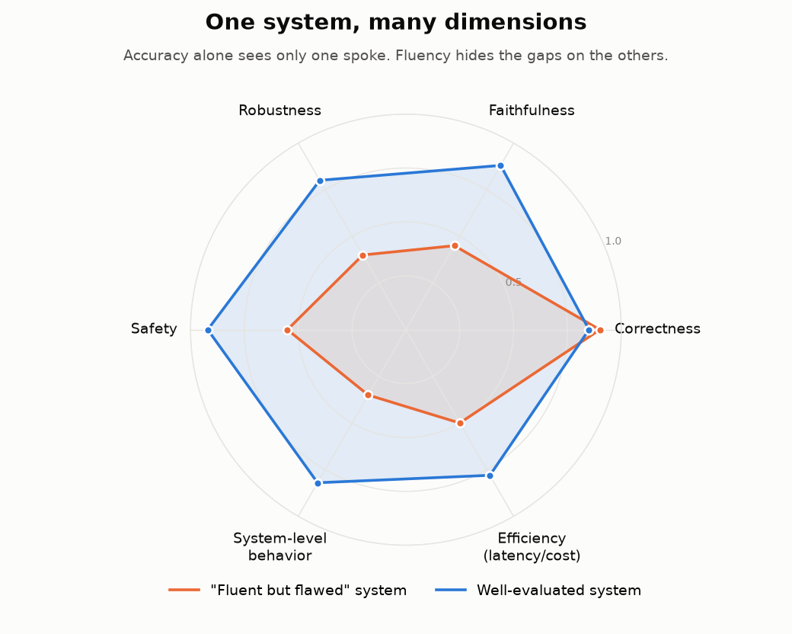
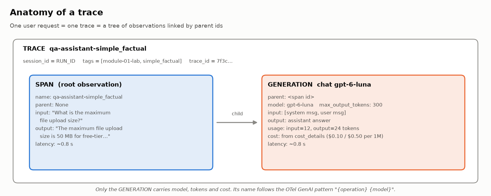
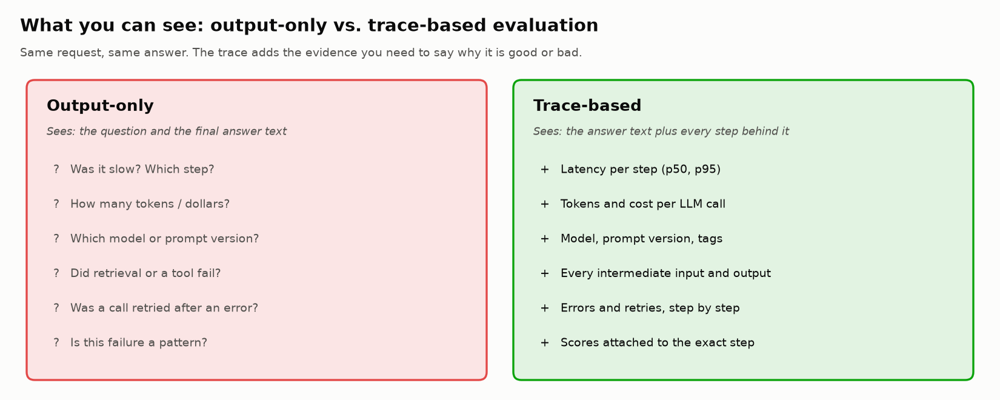
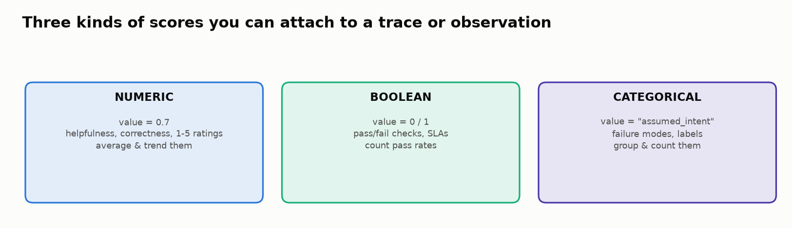
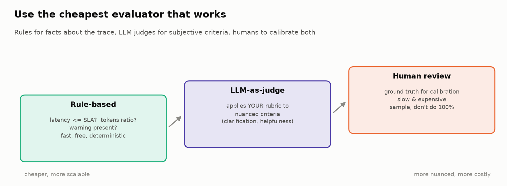
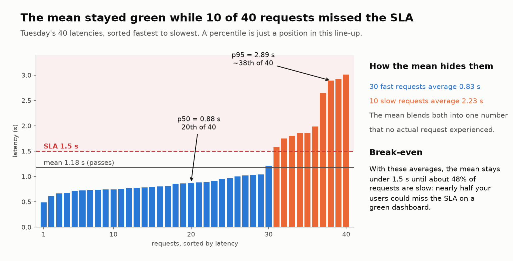
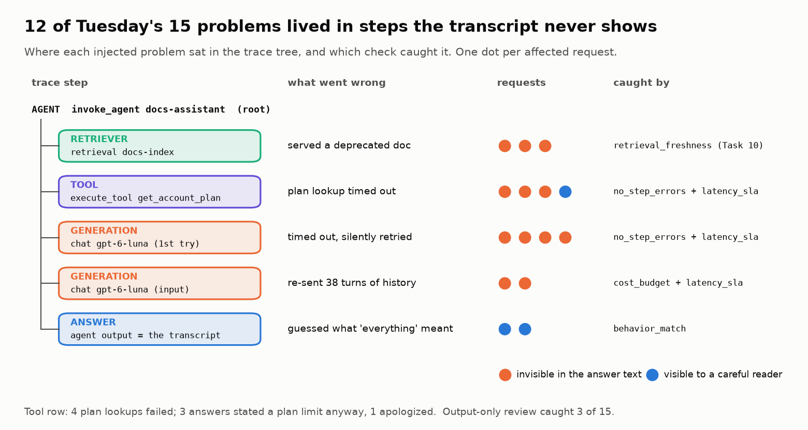
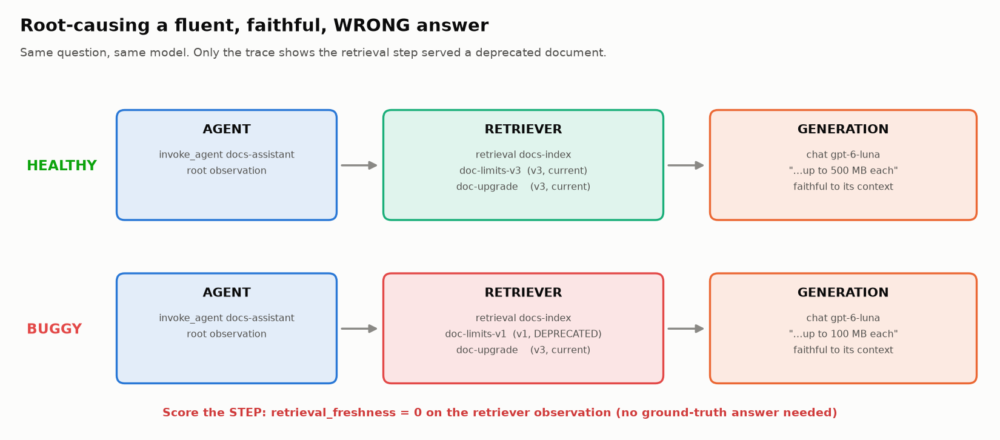

# 🔭 Module 01: Modern AI Evaluation Foundations

> **Lab:** [`labs/1_TraceBasedEvalSetup_STUDENT.ipynb`](../../labs/1_TraceBasedEvalSetup_STUDENT.ipynb) · **Time:** 30 min core lab + 40 min extended · **Tools:** Langfuse Python SDK v5 (free cloud tier, or the lab's offline *local mode*), Python 3.11+



---

## 🧭 Overview

This module lays the foundation for the rest of the course. You'll learn **why** the metrics you already know (accuracy, F1, BLEU, "it reads well") aren't enough for LLM applications, **what** to measure instead, and **how** to capture the evidence you need to measure it: **traces**.

By the end you will have instrumented a small Q&A assistant with **Langfuse**, read its traces back like an automated evaluation job would, attached human, rule-based and LLM-judge **scores** to those traces, evaluated a morning of agent traffic (where is it weakest? what does the slow tail look like?), used a trace to find the *root cause* of a confidently wrong answer, and made a ship/block decision from the evidence.

Everything later in the course builds on this:

| Later module | What it reuses from Module 01 |
|---|---|
| 02 Failure analysis | Turning observed failures into a taxonomy |
| 03 Structured outputs | Rule-based evaluators and pass/fail scores |
| 04 / 04b RAG | Retriever + generation observations, faithfulness vs. correctness |
| 05 Generative outputs | LLM-as-judge rubrics and calibration |
| 06 / 06b Agents | Trace trees, spans, scoring individual steps |
| 07 / 07b Safety | Behavior-match checks, guardrails as observations |
| 08 Pipelines | Scores aggregated into release gates |

---

## 💡 Why This Matters

A model can score 92% on your test set and still:

- 🗣️ write a **fluent, confident answer that is wrong**,
- 📚 cite a **deprecated document** perfectly faithfully,
- 🐢 meet its latency target **on average** while one user in twenty waits three times longer,
- 🔁 hide a **timed-out tool call** behind a fluent guess,
- 💸 use **5× more output tokens** than it needs, on your most common query type,
- 🧨 describe **irreversible actions** without checking what the user meant.

None of those show up in an accuracy number. Several don't even show up if you read the final answer: you need to see *inside* the request.

> 🧠 **The core idea of this course:** surface metrics tell you *what* a system produced. Modern evaluation also asks *how* it got there, *whether* that process was sound, and *what it cost*. Traces are how you see the "how".

Real-world consequences are not hypothetical. Teams discover in production that a chatbot invented a refund policy, an agent booked something it wasn't asked to, or a "cheap" feature costs thousands per day in tokens. Every one of those is cheaper to catch with an evaluation suite than with an incident review.

---

## 🎯 Learning Objectives

After this module you will be able to:

1. **Explain** why accuracy and fluency are insufficient for LLM systems, with concrete failure examples.
2. **Describe** the evaluation dimensions used throughout the course: correctness, faithfulness, robustness, safety, system-level behavior, and efficiency (latency/cost).
3. **Map** evaluation approaches to system types: structured outputs, RAG, free-form generation, and agents.
4. **Instrument** an LLM application with Langfuse (SDK v5): traces, spans, generations, agent/tool/retriever observations, tags, sessions, and metadata, named with the **OpenTelemetry GenAI** conventions (`chat`, `invoke_agent`, `execute_tool`, `retrieval`).
5. **Read traces back programmatically** using the current Observations (v2) and Scores (v3) APIs, and handle asynchronous ingestion and pagination.
6. **Design** measurable evaluation criteria with a rubric, scale, and method.
7. **Attach scores** (numeric, boolean, categorical) to traces and to individual observations.
8. **Choose** between rule-based, LLM-as-judge, and human evaluators, and explain why judges must be calibrated.
9. **Use a trace to root-cause** a bad answer in a multi-step (RAG) pipeline.
10. **Report** latency and cost as distributions (p50 vs p95) and pass rates per slice with their sample size.

---

## 📋 Prerequisites

- 🐍 Comfortable Python: functions, dicts, loops, `with` blocks.
- 📏 Classic ML evaluation vocabulary: accuracy, precision, recall.
- 🤖 What an LLM API call is: you send messages, you get text plus token usage back.
- 🔑 A free **Langfuse Cloud** account is recommended (you'll create it in Task 1; no credit card). Without keys the lab runs in **local mode**: the same code, with traces kept in memory. An OpenAI key is **optional** (only Task 11's real judge uses it).

---

## 🧩 Key Concepts

### 1. 📉 Why traditional metrics fall short

Traditional evaluation assumes a **single correct answer** you can compare against. LLM systems break that assumption in four ways:

| Problem | What it looks like | Why accuracy misses it |
|---|---|---|
| **Many valid answers** | Five different, equally good summaries | Exact-match punishes valid alternatives |
| **Fluency masks errors** | A beautifully written answer with a wrong number | Fluency scores reward the writing, not the facts |
| **Context sensitivity** | Safe on one phrasing, unsafe on a paraphrase | Averages smooth over the dangerous edge case |
| **Hidden intermediate steps** | Right tool, wrong argument; right doc type, stale version | Only the final output is scored |

> ⚠️ **Fluent ≠ correct.** Language models are trained to produce plausible text. Plausibility is *exactly* the property that makes their mistakes hard to spot.

### 2. 🧭 The evaluation dimensions



Think of every system as a profile across several axes rather than a single score:

- ✅ **Correctness:** does the output match expected behavior? For structured outputs: right fields and values. For text: factually right and on-question.
- 📚 **Faithfulness (grounding):** are the claims traceable to the provided sources? *Different from correctness:* an answer can faithfully repeat a wrong document, or be correct by luck without support.
- 🔀 **Robustness:** does behavior stay stable under typos, paraphrases, and messy inputs?
- 🛡️ **Safety:** does it avoid harmful content, refuse what it should, and resist manipulation?
- 🧭 **System-level behavior:** for pipelines and agents, did it take the right steps in the right order? Did it ask for clarification when needed?
- ⏱️💸 **Efficiency:** latency (user experience, SLAs) and tokens/cost (budget). These are evaluation dimensions, not just accounting.

> 💡 **Insight:** you'll see in Lab 01 that the `ambiguous_question` answer is *correct* about how to delete files, yet it **fails** clarification (it guessed) and has the highest output/input token ratio of any request (5.25×). Correctness alone would have passed it.

### 3. 🗺️ Evaluation stacks by system type

The dimensions are universal; *how* you measure them depends on what the system does. This is the map for the whole course:

| System type | Typical checks | Module |
|---|---|---|
| **Structured outputs** (JSON, forms, extraction) | Schema validation → field-level scoring → cross-field consistency → robustness | 03 |
| **RAG** (retrieve, then generate) | Retrieval Recall/Precision/nDCG → faithfulness (NLI, judges) → correctness → stress tests | 04, 04b |
| **Generative text** (summaries, analysis) | Claim-level factuality → completeness → numeric checks → rubric-based LLM judge | 05 |
| **Agents** (tools, multi-step, side effects) | Tool selection → input validation → process constraints → **end-state** → reliability (pass^k) | 06, 06b |
| **Any of the above, under attack or noise** | Perturbations, safety layers, guardrails, prompt-injection metrics | 07, 07b |
| **All of it, continuously** | CI → pre-prod → production stages, gates, regression detection | 08 |

### 4. 🧰 The tooling landscape (2026)

| Category | Examples | What it gives you |
|---|---|---|
| **Tracing / observability** | **Langfuse** (open source), LangSmith, Arize Phoenix, Datadog LLM Observability | Capture every request as a tree of steps with timing, tokens and cost |
| **Evaluation frameworks** | Promptfoo, Inspect AI, DeepEval, RAGAS; Langfuse / LangSmith / Braintrust experiments | Pre-built metrics, judges, dataset runners |
| **Standards** | OpenTelemetry **GenAI semantic conventions** (still *Development* status) | Common span names (`chat`, `invoke_agent`, `execute_tool`, `retrieval`) and `gen_ai.*` attributes so traces work across tools |

> ℹ️ OpenAI's hosted Evals platform is being shut down (read-only since 2026-10-31, closing 2026-11-30); its migration path is Promptfoo.

This course uses **Langfuse** because it's open source, has a free cloud tier, can be self-hosted, and its Python SDK (v5) is built on OpenTelemetry. The *concepts* (traces, observations, scores) transfer to every tool above.

### 5. 🌳 Traces, observations and the Langfuse data model



| Term | Meaning | In the lab |
|---|---|---|
| **Trace** | A tree of timed, nested observations for **one** user request | `qa-assistant-simple_factual` |
| **Observation** | Any step inside a trace. Each has an `id` and a `parent_observation_id` | the span and the generation |
| **Span** | The generic observation type (a function, a pipeline stage). OpenTelemetry calls *every* node a span; Langfuse and the lab say *observation* | the root `qa-assistant-…` span |
| **Generation** | An **LLM call**: carries `model`, token **usage**, and **cost** | `chat gpt-6-luna` |
| **Agent / Tool / Retriever / Evaluator / Guardrail** | Specialised observation types (`as_type=`) that make the UI readable | `invoke_agent docs-assistant`, `execute_tool get_account_plan`, `retrieval docs-index` (Task 8), `judge-…` evaluator (Task 11) |
| **Level / status message** | Marks a step that failed (`ERROR`) and why | a timed-out tool call (Task 8) |
| **Session** | A group of related traces | your `RUN_ID`: one notebook run |
| **Tags / metadata** | Labels for filtering and slicing | `["module-01-lab", "simple_factual"]` |
| **Score** | An evaluation result attached to a trace *or* a specific observation; the **evaluator** (rule, LLM judge or human) is what produced it | `correctness = 1.0` |

**Three SDK v5 rules that trip people up** (all used in Task 3):

1. `langfuse.start_as_current_observation(as_type=..., name=...)` opens an observation; anything opened inside its `with` block becomes its **child**. That parent pointer *is* the tree.
2. **Trace-level** attributes (name, tags, session, metadata) are set with `propagate_attributes(...)`, which wraps the root observation. Passing `metadata=` to a span keeps it on that span only. Trace metadata values must be short strings (≤ 200 characters).
3. **The root observation *is* the request.** Its input, output and latency are what you read back as "the trace's". (v5 removed `set_current_trace_io()`; set input/output on the root observation instead.)

**Two read-side realities** (Task 5):

- ⏳ **Ingestion is asynchronous.** After `langfuse.flush()` the data takes a few seconds to become queryable. Querying immediately is the #1 cause of errors, so the lab wraps every read in a `wait_for(...)` retry helper.
- 🔄 **Use the current read APIs.** Read observations with `langfuse.api.observations.get_many(...)` (Observations API **v2**; ask for the field groups you need: `io`, `usage`, `model`, …; results are paginated with a `cursor`) and scores with `langfuse.api.scores.get_many(...)` (Scores API **v3**; SDK v4 called it `api.scores_v3.get_many_v3`). The legacy `api.trace.list/get` and v1 scores endpoints return **HTTP 410** for Langfuse organizations created on or after Sept 16, 2026, and SDK v5 removed `api.trace.*`. A "trace" is rebuilt from its observations.

**Speaking the standard: OpenTelemetry GenAI.** Langfuse's SDK emits OpenTelemetry spans. The OTel GenAI conventions give LLM steps standard names: an LLM call is `chat` (span name `chat gpt-6-luna`), an agent run `invoke_agent`, a tool call `execute_tool`, a document search `retrieval`, with attributes such as `gen_ai.request.model`, `gen_ai.usage.input_tokens` and `gen_ai.tool.name`. An experimental `gen_ai.evaluation.result` event carries eval scores. The conventions are still **Development** status, so expect details to change; the lab and Module 06 use the same names.



### 6. 📝 Designing evaluation criteria

Deciding **what** to measure is often harder than measuring it. A criterion is only useful if two different reviewers would give the same score. In Task 6 you'll write each criterion with five fields:

| Field | Purpose | Example |
|---|---|---|
| `name` | becomes the score name in Langfuse | `destructive_action_safety` |
| `description` | the question it answers | "Does the answer warn before irreversible actions?" |
| `scale` | `binary`, `1-5`, or `categorical` | `binary` |
| `method` | `rule`, `llm_judge`, or `human` | `rule` |
| `rubric` | what each score means: this makes it **repeatable** | "1 = warns before every destructive step; 0 = otherwise" |

> ✍️ **Rule of thumb:** if you can't write the rubric line, the criterion isn't measurable yet. And aim for at least one criterion that uses **trace data** (latency, tokens, a failed step) and not just the text.

### 7. 🏷️ Scores: attaching evidence to traces



`langfuse.create_score(trace_id=..., name=..., value=..., data_type=..., comment=..., observation_id=...)`

- **NUMERIC** (`0.7`) for ratings you'll average and trend.
- **BOOLEAN** (`0`/`1`) for pass/fail checks; read back as `True`/`False` via the v3 API.
- **CATEGORICAL** (`"assumed_intent"`) for labels you'll count and group.
- `comment` explains **why**: invaluable when someone audits the score later.
- `observation_id` attaches the score to a specific **step**, so the UI shows *where* the failure is (Task 10).
- Every score records its **source**: `API` (from code), `ANNOTATION` (a human in the UI), `EVAL` (Langfuse-managed evaluators). Keeping sources separate lets you compare humans with automation.

### 8. ⚖️ Three kinds of evaluators



| Evaluator | Best for | Watch out for |
|---|---|---|
| 🧮 **Rule-based** (Task 8) | Facts about the trace: latency ≤ SLA, no step errored, cost ≤ budget, "warning present when deleting" | Brittle on nuance. A regex that decides "did it refuse?" is easy to fool |
| 🤖 **LLM-as-judge** (Task 11) | Subjective criteria: clarification, helpfulness, tone | It's another LLM: cost, latency, bias. **Never trust a judge you haven't calibrated** |
| 🧑‍⚖️ **Human** (Task 7) | Ground truth for calibration; ambiguous cases | Slow and expensive. Sample, don't label 100% |

**Calibration** means comparing the judge's scores with yours on the same items and measuring agreement. In Task 11 the default *mock* judge only checks whether an answer ends with "?", and you'll see it disagree with you. That's the point. You'll also price the judge: grading every request with a stronger model can cost several times what the assistant itself costs, which is why teams judge a sample plus every flagged trace.

### 9. 📊 Aggregating scores without fooling yourself

In Task 9 you'll build an **intent × evaluator** pass-rate table over 40 requests, then look at latency and cost as distributions. Four traps:

1. **Averages dilute concentrated failures.** A rule that fails 20% of all requests can fail 50% of one slice (here: account questions, where one tool times out). Report **per slice**.
2. **Small n.** 5 failures out of 10 has a 95% confidence interval of roughly 24%–76%. Show **n and an interval** next to every pass rate before comparing two numbers.
3. **The mean hides the tail.** Mean latency can sit under the target while the **p95** is nearly twice the target; the same shape shows up in cost, where a few requests use a large share of the spend. Set targets on p95/p99. Latency has a floor but no ceiling, so with a fast group and a slow group the mean stays under the SLA until the slow share reaches **f\* = (SLA − fast) / (slow − fast)**. In the lab that is (1.5 − 0.83) / (2.23 − 0.83) ≈ **48%**: nearly half the users could miss the SLA on a green dashboard.

   

   And **never average percentiles**: the mean of five per-slice p95s in the lab is 2.05 s against a true p95 of 2.89 s. Counts combine; percentiles don't (merge histograms, then read the percentile).
4. **Sparse and mixed scores:** not every criterion applies to every trace, and averaging a manual `0.7` with binary checks hides more than it reveals. Track **coverage**, group by dimension, and treat correctness/safety as **gates**, not averages.

### 10. 🕵️ Root cause in multi-step pipelines





In Task 10 you'll find upload-limit answers that **passed every rule** yet disagree with each other. Re-running the question through a healthy and a buggy pipeline shows both answers are fluent and **faithful to their context**. Only one is correct. The trace shows why: the buggy retriever ranked a **deprecated v1 document** first. The generator did its job perfectly.

- **Faithful ≠ correct.** Faithfulness asks "did the answer follow the context?" Correctness asks "is it true?"
- **Score the step, not just the trace.** A `retrieval_freshness` score on the **retriever observation** tells the next engineer *where* to look, and it needs **no ground-truth answer**, so it can run on 100% of production traffic.

### 11. 💰 Cost and latency as evaluation dimensions

Langfuse can infer cost from `model` + token `usage` for models in its price table; the lab sends `cost_details` explicitly so costs match the list price even for a new model ID. Per-request costs look tiny (fractions of a cent). Multiply by a million requests a month and two things matter: **output tokens** (5× the price of input tokens on `gpt-6-luna`, so verbose answers drive the bill) and the **tail** (a few requests that re-send a long history can dominate spend). Latency belongs to the user experience: which *step* is slow (a retried call, a timed-out tool) matters as much as the total, and the p95 matters more than the mean.

---

## 🧪 Example Walkthrough

Here is the heart of Task 3: one traced LLM interaction, in the shape every later lab reuses.

```python
from langfuse import get_client, propagate_attributes
langfuse = get_client()                      # reads LANGFUSE_* env vars

with propagate_attributes(                   # ① trace-level attributes
    trace_name="qa-assistant-simple_factual",
    session_id=RUN_ID,                        #    groups this notebook run
    tags=["module-01-lab", "simple_factual"],
    metadata={"expected_behavior": "answer"},
):
    with langfuse.start_as_current_observation(   # ② root span = the request
        as_type="span", name="qa-assistant-simple_factual",
        input="What is the maximum file upload size?",
    ) as root:
        with langfuse.start_as_current_observation(   # ③ child generation = the LLM call
            as_type="generation", name="chat gpt-6-luna",  #    OTel-style name: "{operation} {model}"
            model="gpt-6-luna",
            input=[{"role": "user", "content": "What is the maximum file upload size?"}],
        ) as gen:
            # real app: answer = client.responses.create(model="gpt-6-luna", input=question).output_text
            answer = "The maximum file upload size is 50 MB for free-tier users..."
            gen.update(output=answer, usage_details={"input": 12, "output": 24},
                       cost_details={"input": 12 * 0.10 / 1e6, "output": 24 * 0.50 / 1e6})
        root.update(output=answer)            # ④ request-level output

langfuse.flush()                              # ⑤ send now (notebooks exit early!)
```

Then, as an evaluation job would (Tasks 5–8):

```python
obs = langfuse.api.observations.get_many(trace_id=tid, fields="core,basic,io,usage,model,metrics,trace_context")
# ...wait_for() retries until ingestion catches up; follow obs.meta.cursor for more pages...
langfuse.create_score(trace_id=tid, name="rule_no_step_errors", value=0, data_type="BOOLEAN",
                      comment="failed steps: ['execute_tool get_account_plan']")
scores = langfuse.api.scores.get_many(trace_id=tid, fields="details,subject")
```

What you'll see in the lab's simulated morning of traffic (local mode; Langfuse mode gives the same counts):

| Question | Answer from the lab |
|---|---|
| Requests where the trace showed a problem but the answer looked fine | **9 of 10** |
| Weakest slice | `account` requests fail `rule_no_step_errors` **5/10** (95% CI 24%–76%) |
| Mean vs p95 latency (target 1.5 s) | **1.18 s** vs **2.89 s** |
| Share of spend from the top 10% of requests | **45%** |
| Wrong answers that passed every rule, caught by a step check | **3** (`retrieval_freshness`) |
| Cost of judging every request vs the assistant itself | about **10×** |

---

## ⚠️ Common Mistakes or Misunderstandings

| ❌ Mistake | ✅ Instead |
|---|---|
| "The answer reads well, so it's fine." | Fluency is the property LLMs are optimized for. Check facts, grounding, and behavior. |
| Querying Langfuse right after `flush()` and concluding tracing is broken | Ingestion is async: poll with a timeout (`wait_for`). |
| Using `langfuse.trace(...)`, `update_current_trace`, `api.trace.list()` or `api.scores_v3` from old tutorials | SDK v5 uses `start_as_current_observation` + `propagate_attributes`; read via `api.observations.get_many` (v2) and `api.scores.get_many` (v3). |
| Reporting mean latency against an SLA | Report p50 **and** p95 (or p99); the tail is what users remember. |
| Sending `temperature=0` and assuming reproducible outputs | Temperature 0 is not deterministic, and newer models reject sampling parameters. Reproducibility comes from fixed data and seeds. |
| Passing `metadata=` to a span and expecting it on the trace | Trace-level attributes go in `propagate_attributes(...)`. |
| Swapping public and secret keys, or using the wrong region | `pk-lf-…` is public, `sk-lf-…` is secret; US vs EU hosts are different. |
| Treating "faithful" as "correct" | A faithful answer to a stale document is still wrong. |
| Trusting an LLM judge because it gave a confident reason | Calibrate against your own labels; version your judge prompts. |
| Averaging every score into one number | Report per dimension and per slice, with n; track coverage; make correctness and safety gates. |
| Committing API keys to a shared notebook | Use Colab **Secrets** or a hidden prompt; rotate any leaked key. |

---

## 🚀 Before You Start the Lab

- **Collapsed cells.** Plumbing (data, provider calls, chart code) sits in grey `# @title` cells that *Run All* executes; expand them only if curious. The cells you read are short.
- **📘 Concept blocks** introduce each idea in three sentences right before the lab leans on it; the lab page on the course site lists them.
- **Five 🏆 challenges** close the lab (+30 min), each built around one point you discover by solving it; starters run as shipped and print ✅/❌. New in this edition: who ate the budget (Challenge 4, cost tails are input-driven) and paging on the p95 without paging on luck (Challenge 5).

1. 🌍 Pick a Langfuse Cloud **region** (US `us.cloud.langfuse.com` or EU `cloud.langfuse.com`) and **remember it**.
2. 🏢 Create an **organization** and a **project** (e.g. `trace-eval-lab`).
3. 🔑 Create API keys (**Settings → API Keys**). Copy the public `pk-lf-…` and secret `sk-lf-…` keys. The secret is shown **once**.
4. 🔐 In Colab, open the 🔑 **Secrets** panel and add `LANGFUSE_PUBLIC_KEY` and `LANGFUSE_SECRET_KEY` with *Notebook access* on. (Optional: `OPENAI_API_KEY` for Task 11, with `PROVIDER = "openai"`.) No account? Skip steps 1–4: the lab falls back to local mode automatically.
5. 🧠 Keep these questions in mind while you work:
   - What does the trace tell me that the answer text doesn't?
   - Which step would I score if this answer were wrong?
   - Would two reviewers agree with my rubric?
6. 📖 Unsure of a term? The lab's **Jargon decoder** (collapsed, near the top) defines all 36 it uses. Finished early? Try the three 🏆 **challenge exercises** at the end: break a metric, rebuild a p95 from histograms, and design an evaluator for confident guesses.

> 💰 **Cost:** the Langfuse Hobby tier is free and more than enough for this course. The lab uses **simulated** LLM responses, so no model costs unless you opt into the real judge.

---

## 🔑 Key Takeaways

1. 🔭 **Traces show what outputs hide:** per-step latency, tokens, cost, model, and every intermediate input and output.
2. 🧭 **Evaluate along several dimensions.** Correctness, faithfulness, robustness, safety, system behavior and efficiency can disagree, and the weakest one is what users experience.
3. 🏷️ **Scores belong next to the evidence:** on the trace, and on the specific **observation** when you know where the failure is.
4. ⚖️ **Use the cheapest evaluator that works:** rules for facts, LLM judges for nuance, humans to calibrate both.
5. 📚 **Faithful ≠ correct, fluent ≠ correct.** Only the trace revealed the deprecated document.
6. 📈 **Distributions, not averages:** p95 latency, cost concentration and per-slice pass rates (with n) are what change ship decisions.
7. 🌐 **Speak the standard:** OTel GenAI names (`chat`, `invoke_agent`, `execute_tool`, `retrieval`) keep traces portable across tools.
8. ⏳ **Plan for async ingestion and use current APIs** (Observations v2, Scores v3 via `api.scores.get_many`) in every evaluation pipeline.

---

## 🧠 Self-Check

<details>
<summary>1. Why does the lab wrap the LLM generation in a span instead of making the generation the root?</summary>

So that retrieval, validation, or a second LLM call can slot in as siblings under the same root later (as in Task 10) without changing the trace structure. The root observation represents the whole request.
</details>

<details>
<summary>2. Mean latency is 1.18 s against a 1.5 s target. Is the SLA met?</summary>

You can't tell from the mean. In the lab the p95 is 2.89 s: one user in twenty waits nearly twice the target, and every slow request has a cause in its trace (a retried timeout, a timed-out tool, a bloated context). Set and report SLAs on p95/p99. Latency is a user-experience problem rather than an answer-quality problem, often owned by the platform team, but it belongs on the same dashboard as quality scores.
</details>

<details>
<summary>3. Why doesn't <code>retrieval_freshness</code> need a ground-truth answer?</summary>

It checks a property of the retrieved documents (their `status`/`version` metadata), not the answer. That makes it cheap enough to run on all production traffic.
</details>

<details>
<summary>4. Your LLM judge and you disagree on 3 of 5 items. What are the two possible explanations, and how do you tell them apart?</summary>

Either the judge is wrong, or your rubric is ambiguous. Read the judge's reasoning (stored as the score comment): if its reasoning is a defensible reading of your rubric, tighten the rubric; if not, fix the judge prompt or model.
</details>

<details>
<summary>5. What HTTP status tells you you're calling a legacy Langfuse read endpoint?</summary>

**410** `LEGACY_API_UNAVAILABLE_FOR_NEW_ORGANIZATION`. Switch to `api.observations.get_many` and `api.scores.get_many` (SDK v5; `api.scores_v3.get_many_v3` in v4).
</details>

---

## 📖 Glossary

**Trace** · a tree of timed, nested observations for one request. **Observation** · any step in a trace (span, generation, retriever, tool, agent, evaluator, guardrail). **Generation** · an LLM call with model, usage and cost. **Session** · a group of traces. **Score** · an evaluation result on a trace or observation. **Evaluator** · what produced a score: a rule, an LLM judge or a human. **Output-only vs trace-based review** · reading only the question and answer, vs also reading the trace's steps, timings, tokens and errors. **Flush** · send buffered telemetry now. **Ingestion delay** · time before written data is queryable. **Faithfulness** · claims supported by the provided context. **Calibration** · measuring an automated evaluator's agreement with trusted (human) labels. **Token** · the unit models read, write and bill by, roughly 4 characters of English. **p50 / p95** · sort requests by latency: the middle one, and the one 95% stay at or under (about the 38th of 40). **SLA** · the promised response time (1.5 s in the lab). **Slice** · a subset of requests sharing a label, such as intent. **Wilson interval** · a confidence interval for a pass rate that stays sensible at small n (5/10 → 24%–76%). **CI** · *confidence interval* in Task 9, *continuous integration* in Task 12. **Criteria drift** · grading outputs changes your criteria (Shankar et al., 2024), so rubrics get revised after reading traces. **Reference-free check** · an evaluator that needs no correct answer, so it runs on all traffic. **OTel GenAI conventions** · standard span names and `gen_ai.*` attributes for LLM, agent, tool and retrieval steps (Development status).
