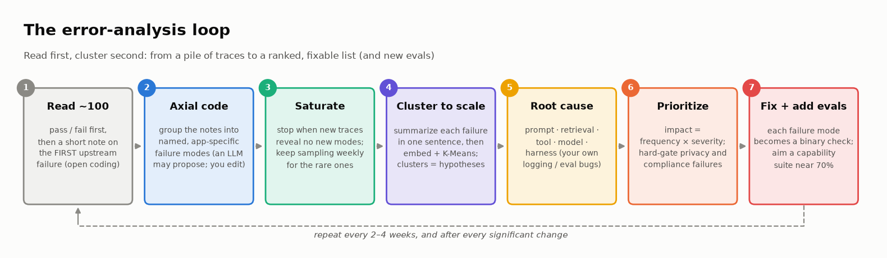
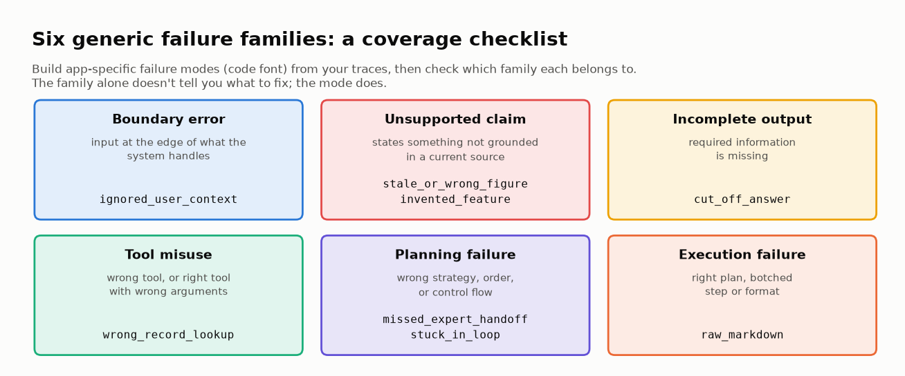
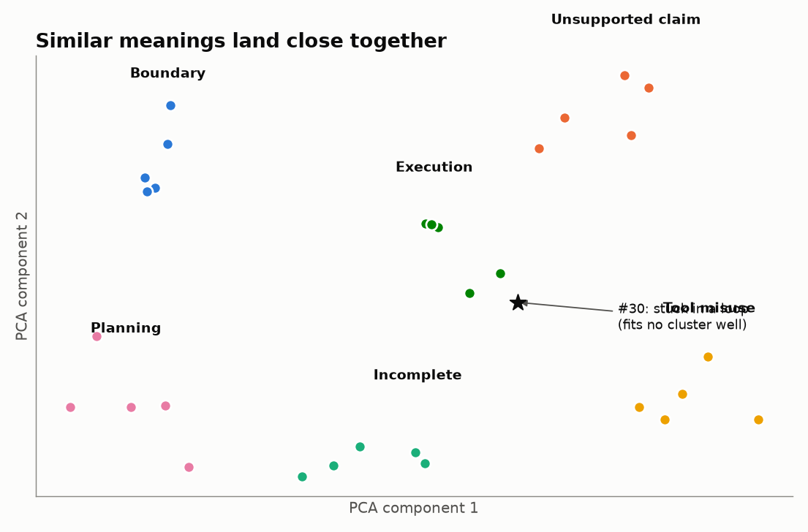
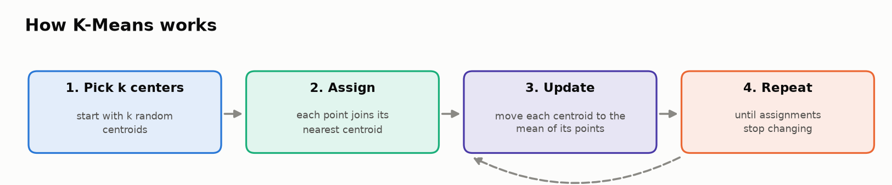
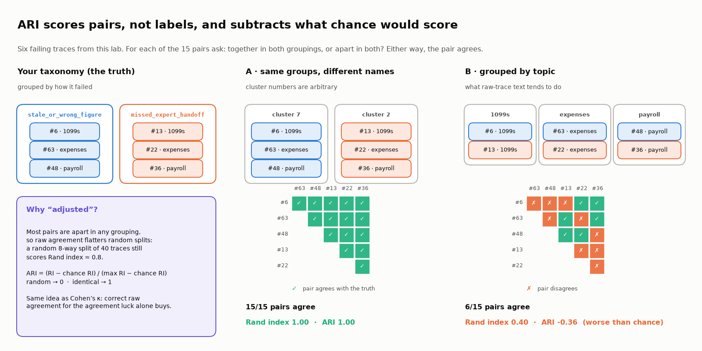
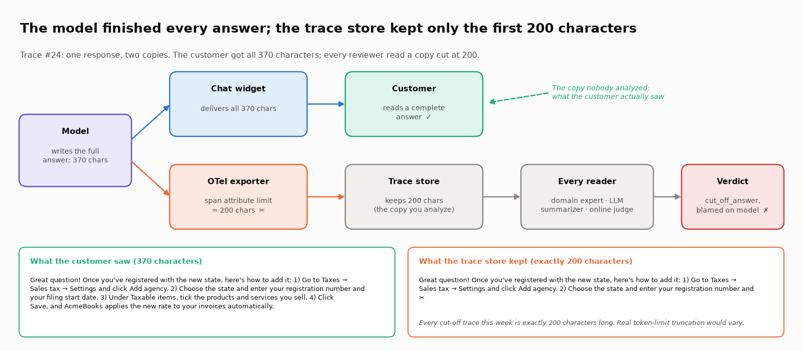
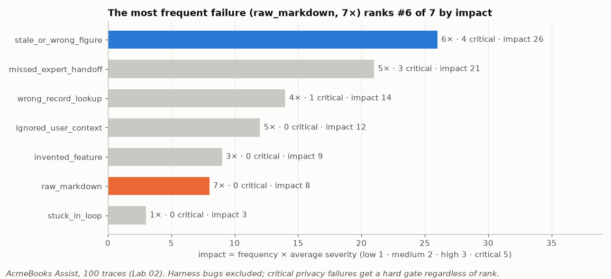

# 🔍 Module 02: Failure Mode Analysis

> **Lab:** [`labs/02-failure-analysis-lab.ipynb`](../../labs/02-failure-analysis-lab.ipynb) · **Time:** 40–45 min core · **Tools:** `pandas`, `sentence-transformers`, `scikit-learn` · **Keys needed:** none (optional OpenAI/Anthropic key for live summaries)



---

## 🧭 Overview

Module 01 gave you a way to *see* what an AI system did. This module answers the next question: **when it goes wrong, what kinds of wrong are there, why do they happen, and which kind do we fix first?**

You'll take 100 traces from a fictional bookkeeping assistant, **AcmeBooks Assist**, whose automated checks pass every single one, and run the error-analysis loop most eval teams use in 2026:

1. 📖 **Read** traces. Give each a pass/fail, and write a short free-text note on the first thing that went wrong (**open coding**).
2. 🏷️ **Group** the notes into a few named, app-specific failure modes (**axial coding**), and map them to six generic **failure families**.
3. 📉 **Stop reading** when new traces stop revealing new modes (**theoretical saturation**).
4. 🔬 **Scale with clustering**, used as a helper: summarize each failure in one sentence, then embed and cluster with K-Means, and measure how well that recovers your taxonomy.
5. 🧭 **Attribute** each failure to a root cause: prompt, retrieval, tool, model, or **harness** (your own logging/eval setup).
6. 📊 **Prioritize** by **impact = frequency × severity**, decide what to fix first, and turn the failure modes into an eval suite.

---

## 💡 Why This Matters

Production failures don't arrive labeled. They arrive as traces, thumbs-downs, and escalations: hundreds of slightly different conversations that fail in overlapping ways. Teams without a method tend to fix **whichever bug was reported last, or sounds scariest**, or to trust a dashboard that measures the wrong things.

Error analysis replaces that with evidence:

- 🗂️ **Structure:** "We have 7 kinds of product failure, not 40 bugs."
- 🧭 **Ownership:** "Most of them are prompt and retrieval problems, not model problems."
- 🎯 **Prioritization:** "This *kind* costs the most, so we fix it first."
- 🔁 **Better evaluation:** every failure mode you name becomes a check you can run. *If you can't name a failure mode, you won't build an evaluator that detects it.*

> 🧠 **Insight:** the method here reappears in Module 06 (agent root causes, first upstream failure) and Lab 06b (naming failure modes from transcripts). It's the bridge between "something went wrong" and "here's the test that catches it".

---

## 🎯 Learning Objectives

After this module you will be able to:

1. **Open-code** raw traces: pass/fail first, then a short note on the *first upstream failure*.
2. **Axial-code** notes into an app-specific failure taxonomy, and map it to the six failure families (boundary, unsupported claim, incomplete output, tool misuse, planning, execution).
3. **Use theoretical saturation** to decide when to stop reading, and estimate what a sample of *n* traces can miss.
4. **Explain** what text embeddings and K-Means do, and **compare** clustering raw traces with clustering failure summaries using the adjusted Rand index (ARI) and purity.
5. **Attribute root causes** (prompt / retrieval / tool / model / harness), and rule out harness bugs before blaming the model.
6. **Prioritize** with an impact score, recognize when a critical failure needs a hard gate regardless of rank, and judge an eval suite's pass rate (≈70% beats 100% for a capability suite).

---

## 📋 Prerequisites

- ✅ Module 01 (what traces and scores are).
- 🐼 Basic `pandas`: DataFrames, `groupby`, filtering.
- 📐 A rough idea of vectors and "distance between points". (No linear algebra needed beyond that.)

---

## 🧩 Key Concepts

### 1. 📖 Read before you cluster: open coding

**Open coding** means reading traces one by one and writing a short free-text note about what went wrong, *before* you have categories. The practitioner method popularized by Hamel Husain and Shreya Shankar (their evals FAQ, updated 2026) goes like this:

- Start with about **100 diverse traces**. Annotate at least the first 30 yourself.
- Give the whole trace a **pass/fail** first. Then, for failures, note the **first upstream failure**: the earliest thing that went wrong. Errors compound, and fixing the upstream error often fixes everything downstream.
- **Don't delegate open coding to an LLM.** It doesn't know your policies, your deadlines, or that your chat widget can't render markdown.
- Appoint one domain expert as the **"benevolent dictator"** who makes final calls. Add more annotators (and measure agreement with Cohen's κ) only when you need to.

| ❌ Weak note | ✅ Strong note |
|---|---|
| "Hallucination." | "Claimed a 'Crypto Sync' integration; search returned nothing, so it filled the gap." |
| "Wrong answer." | "Said 1099-NEC is due Feb 28 (it's Jan 31). Retrieval returned the old 1099-MISC article." |

**Why read first?** Shankar et al. (2024) observed *criteria drift*: people's evaluation criteria changed as they graded outputs. You can't fully specify good criteria before you look at outputs. Reading is where the criteria come from.

> 🧪 In the lab, the existing automated checks (non-empty, no leaked card numbers, polite tone, length) pass **all 100** traces. Ten minutes of reading the first 15 fails **7**, and those 7 notes already describe 5 different problems.

### 2. 🏷️ Axial coding: from notes to a taxonomy

**Axial coding** groups open codes that share a **mechanism** (how it failed), not a **topic** (what it was about), and names each group with something specific enough to act on. An LLM can *propose* groupings of your notes; you review and edit them.

The lab's codebook has 8 app-specific failure modes. The **six failure families** from earlier versions of this module are still useful, as a **coverage checklist**:



| Failure family | Mechanism | App-specific mode in the lab | Typical evaluator |
|---|---|---|---|
| 🌐 **Boundary error** | Input at the edge of what the system handles | `ignored_user_context` (Ontario user gets US sales-tax rules) | Robustness / perturbation tests (Module 07) |
| 🤥 **Unsupported claim** | Not grounded in a current source | `stale_or_wrong_figure`, `invented_feature` | Factuality / faithfulness checks (Modules 04, 05) |
| ✂️ **Incomplete output** | Required information missing | `cut_off_answer` (but see Concept 5!) | Completeness checks |
| 🔧 **Tool misuse** | Wrong tool, or right tool with wrong arguments | `wrong_record_lookup` (invoice number sent to the customer tool) | Tool input validation (Module 06) |
| 📋 **Planning failure** | Wrong strategy, order, or control flow | `missed_expert_handoff`, `stuck_in_loop` | Process constraints, trajectory checks |
| ⚡ **Execution failure** | Right plan, botched step or format | `raw_markdown` (markdown shown raw in a plain-text widget) | Format / end-state checks |

> ⚠️ The family alone doesn't tell you what to fix. `stale_or_wrong_figure` and `invented_feature` are both "unsupported claims", but the first is mostly a retrieval-freshness fix and the second mostly a model/prompt fix. **Name app-specific modes; use the families to check coverage.**

### 3. 📉 Theoretical saturation: when to stop reading

Plot "distinct failure modes seen" against "traces read". The curve climbs fast, then flattens. When new traces stop revealing new modes, you've reached **theoretical saturation**, and you can stop this review cycle.

In the lab, 7 of 8 modes appear by trace 31, and the next 51 traces add none. A "stop after 20 quiet traces" rule would stop at trace 51, and miss the 8th mode (`stuck_in_loop`), which appears once, at trace 83.

The math of rare modes: the chance a mode with prevalence *p* shows up at least once in *n* traces is **1 − (1 − p)ⁿ**. For p = 1% and n = 100 that's only **63%**. Saturation tells you the *common* modes are covered, not that rare ones don't exist. So:

- Review about **100 fresh traces per cycle** (every 2–4 weeks), and **10–20 traces a week** between cycles.
- Do a quick review of 20–50 outputs after every significant change.
- Add **targeted sampling** (thumbs-down, escalations, long conversations) for rare, high-severity modes.

**Rule of three:** to see a 1-in-N failure at least once with 95% confidence, read about **3N** traces (because −ln 0.05 ≈ 3). A 1-in-200 cross-account leak needs ~600 random traces, or ~120 from a sample where it's 5× more common.

### 4. 🔬 Clustering as a helper: summarize, then embed

An **embedding model** maps text to a vector such that **similar meanings land close together**. The lab uses `all-MiniLM-L6-v2` (384 numbers per sentence).



**K-Means** splits vectors into **k** groups around **centroids** (group averages). In the lab: `KMeans(n_clusters=k, random_state=SEED, n_init=50)` with k = the number of failure modes, so the comparison is fair.



The key question is **what you embed**:

| Input | What the clusters find (lab result) |
|---|---|
| Raw trace text (user message + response) | **Topic.** ARI vs. topic 0.34; ARI vs. your failure modes **0.01** (random) |
| One-sentence LLM **failure summary** ("how did it fail?") | **Failure mode.** ARI vs. your failure modes **0.65** (purity 85%) |

Raw text is dominated by topic words (payroll, invoice, 1099), so that's what the geometry captures. The lab measures it with **cosine similarity** (1 = vectors point the same way, 0 = unrelated): in raw text, pairs that share a *topic* sit closer (0.26) than pairs that share a *failure* (0.20). Summaries flip it (0.29 vs 0.68). Summarizing first is the hybrid Anthropic's **Clio** uses: an LLM extracts a *facet* per conversation, facets are embedded and clustered with K-Means, an LLM names the clusters, and humans review them. Clio reports 94% accuracy reconstructing ground-truth categories on synthetic data, and lists its own failure modes, including rare behaviors that escape detection.

- **Adjusted Rand index (ARI):** for every pair of items, do both groupings treat it the same way (together in both, or apart in both)? The share of agreeing pairs is the **Rand index**; ARI rescales it so 1.0 = identical and 0 = no better than chance (it can dip below 0). The adjustment matters: most pairs are "apart" in any 8-way split, so the lab's useless raw-trace clustering still scores an unadjusted Rand index of 0.78.



- **Purity:** the share of items that belong to their cluster's most common label. 1.0 = every cluster is a single mode. It rewards many tiny clusters, so read it next to ARI.
- **K-Means depends on its random start.** With `SEED = 0`, the lab's summary ARI is 0.83 instead of 0.65. Check that a cluster survives a different seed before you trust it.

> 💡 Clusters are **hypotheses for a human editor**, not the taxonomy. And you could only measure any of this because you had human axial codes to compare against.

### 5. 🧭 Root-cause attribution, and the harness

A failure mode says **what** went wrong. A root cause says **where the fix goes**:

| Root cause | The fix goes into… |
|---|---|
| `prompt` | System prompt, instructions, output-format spec |
| `retrieval` | Index, chunking, freshness, query rewriting |
| `tool` | Tool schema, argument validation, access scoping |
| `model` | Model choice, fine-tuning, reasoning budget |
| `harness` | **Your own** logging, tracing, eval, or test setup. Not the product at all |

One symptom can have several root causes (in the lab, `stale_or_wrong_figure` splits 4 retrieval / 2 model), so the same mode may need two different fixes.

**The harness is a legitimate root cause.** In the lab, `cut_off_answer` (the most frequent mode, 9 traces) was first attributed to the model. Every one of those responses was exactly **200 characters** long: the tracing exporter truncated span attributes at 200 characters. Customers received complete answers of 343–418 characters. The expert and the LLM summarizer both read the corrupted trace and believed it.



**The tell is the shape of the lengths.** A model that runs out of output tokens stops at a token count, and tokens map to a varying number of characters, so real truncations scatter. Identical character lengths point to a character limit, and characters are what loggers count. Transluce's Docent (2025) found the same class of problem in public agent benchmarks: a task that needed internet access the agent didn't have, and a task whose answer was exposed in the Dockerfile.

> ✅ **Before blaming the model, rule out the harness:** logging/attribute limits, timeouts, missing tool access, broken graders.

### 6. 📊 Impact scoring: what to fix first



```
impact(mode) = Σ severity weight over its traces = frequency × average severity
weights: low 1 · medium 2 · high 3 · critical 5      (harness bugs excluded from customer impact)
```

Three lessons from the lab:

1. **The most frequent failure is not the most important.** `raw_markdown` is the most frequent product failure (7×) but ranks #6 of 7. `stale_or_wrong_figure` (6×, 4 critical: wrong tax deadlines and rates) ranks #1.
2. **Some failures need a hard gate regardless of rank.** One trace emailed another company's invoice to them. That's a privacy incident, not a backlog item.
3. **Severity weights are a team decision.** Write them down; changing `critical` from 5 to 10 can reorder the roadmap.

### 7. 🧪 From failure modes to an eval suite (and the 70% rule)

Each product failure mode becomes one **binary check**. On the lab's 100 traces, the new suite passes **69%** (95% CI 59–77%) after the harness fix, versus **100%** for the old checks.

Husain & Shankar's rule of thumb: for a **capability** suite, about **70%** is healthier than 100%. A suite that always passes isn't measuring anything hard. When a check sits near 100% after fixes land, **graduate** it to the regression suite that gates CI.

---

## 🧪 Example Walkthrough

The core of the lab in a few lines (data loading omitted):

```python
# 1. Open + axial coding produce one row per failing trace
#    columns: trace_id, topic, user_msg, response, open_code, failure_mode, root_cause, severity

# 2. Saturation: distinct modes seen after each trace
seen, curve = set(), []
for mode in df["failure_mode"]:
    if isinstance(mode, str): seen.add(mode)
    curve.append(len(seen))

# 3. Raw text vs. failure summaries, scored against the human taxonomy
from sentence_transformers import SentenceTransformer
from sklearn.cluster import KMeans
from sklearn.metrics import adjusted_rand_score
emb = SentenceTransformer("all-MiniLM-L6-v2")
k = fails["failure_mode"].nunique()
for name, text in [("raw", fails.user_msg + " " + fails.response), ("summary", fails.summary)]:
    labels = KMeans(k, random_state=42, n_init=50).fit_predict(emb.encode(text.tolist(), normalize_embeddings=True))
    print(name, adjusted_rand_score(fails.failure_mode, labels))

# 4. Rule out the harness: are the "cut-off" answers all the same length?
print(df.loc[df.failure_mode == "cut_off_answer", "response"].str.len().unique())   # [200]

# 5. Impact on product failures only
w = {"low": 1, "medium": 2, "high": 3, "critical": 5}
product = fails[fails.root_cause != "harness"]
impact = product.groupby("failure_mode")["severity"].apply(lambda s: s.map(w).sum()).sort_values(ascending=False)
```

What the numbers look like in the verified run:

| Step | Result |
|---|---|
| Automated checks | 100/100 pass |
| Expert read of 100 traces | 40 fail, 8 failure modes |
| Saturation | 7 of 8 modes by trace 31; the 8th at trace 83 |
| Clustering, ARI vs. taxonomy | raw traces 0.01 · failure summaries 0.65 |
| Root cause `model` | 17 → 8 after the harness fix (9 were a 200-char tracing limit) |
| Fix first | `stale_or_wrong_figure` (impact 26), then `missed_expert_handoff` (21) |
| New failure-mode suite | 69% pass (95% CI 59–77%) |

---

## ⚠️ Common Mistakes or Misunderstandings

| ❌ Mistake | ✅ Instead |
|---|---|
| Clustering before anyone reads a trace | Read and open-code 20–100 traces first; clustering comes after |
| Letting an LLM do the open coding | Let an LLM *propose* groupings of your notes; a domain expert writes the notes and makes the final call |
| Noting every problem in a trace | Note the **first upstream failure**; downstream errors usually follow from it |
| Embedding raw traces to find failure modes | Raw text clusters by topic. Summarize the failure first, then embed |
| Treating clusters as the taxonomy | Clusters are hypotheses: merge, split, rename. Check they survive a different seed |
| Starting from a generic taxonomy | Build app-specific modes from data; use the six families as a coverage check |
| Blaming the model for the biggest bucket | Verify first. Logging limits, timeouts, and grader bugs can manufacture failures |
| Ranking by count | Rank by frequency × severity, and hard-gate critical privacy/compliance failures |
| Celebrating a 100% pass rate | For a capability suite, ~70% means the suite has headroom and signal |
| Reporting a stratified sample's failure rate as the production rate | If you oversampled thumbs-downs, say so; the rate is biased upward |

---

## 🚀 Before You Start the Lab

- ⏬ The first run downloads `all-MiniLM-L6-v2` (~90 MB). That's normal and takes under a minute on Colab.
- 🗒️ In Task 3 you'll write open codes for 15 traces (about 6 minutes). The **reviewer's cheat sheet** in the lab tells you the policies and facts a domain expert knows.
- 🔮 Each task asks you to **predict** before running. Write your guess down; the surprises are the point.
- 🎯 Be ready to defend your "fix first" choice in one sentence to a manager who doesn't want a list of 40 bugs.

---

## 🔑 Key Takeaways

1. 📖 **Read first, cluster second.** Open coding by a domain expert is where evaluation criteria come from.
2. 🏷️ **Name app-specific failure modes**, and use the six failure families as a coverage check.
3. 📉 **Stop at saturation, keep sampling weekly.** A 1-in-100 mode appears in 100 traces only 63% of the time.
4. 🔬 **Summarize, then embed and cluster.** Raw traces cluster by topic; clusters are hypotheses for a human editor.
5. 🧭 **Failure mode ≠ root cause, and `harness` is a root cause.** Rule out your own logging/eval setup before blaming the model.
6. 📊 **Impact = frequency × severity** sets the order of work; critical privacy/compliance failures get a hard gate.
7. 🧪 **Every mode becomes a check.** A capability suite near 70% has signal; one at 100% isn't testing anything hard.

---

## 🧠 Self-Check

<details>
<summary>1. Your team wants to skip reading and run K-Means on 50,000 raw conversations. What do you expect, and what would you do instead?</summary>

Raw-text clusters mostly group by **topic** (what users asked about), not by failure mechanism. In the lab, raw-trace ARI against the human taxonomy was 0.01. Read and open-code ~100 traces first, build a taxonomy, then generate a one-sentence failure summary per trace, embed and cluster *those*, and have a human review the clusters against the taxonomy.
</details>

<details>
<summary>2. After 40 traces you've found 6 failure modes, and the last 25 traces added nothing new. Should you stop?</summary>

You've likely reached saturation for *common* modes, so you can stop this cycle. But a mode with 1% prevalence has only a 1 − 0.99⁴⁰ ≈ 33% chance of appearing in 40 traces. Keep reading 10–20 fresh traces a week, and sample thumbs-downs and escalations to catch rare, high-severity modes.
</details>

<details>
<summary>3. Nine "incomplete answer" failures were all attributed to the model. What would you check before upgrading the model?</summary>

Whether the harness created them: Are the responses all the same length (a logging or attribute limit)? Did a timeout cut them? Does the delivered output (what the customer saw) match the trace? In the lab, all nine were exactly 200 characters: a tracing limit. Customers saw full answers.
</details>

<details>
<summary>4. A failure mode is the most frequent one in your sample. Is it the one to fix first?</summary>

Not necessarily. Rank by frequency × severity. In the lab, `raw_markdown` was the most frequent product failure but ranked #6 of 7 by impact; `stale_or_wrong_figure` (fewer traces, mostly critical) ranked #1. Separately, any critical privacy or compliance failure gets a hard gate regardless of rank.
</details>

<details>
<summary>5. Your new capability suite passes 100% of cases. Good news?</summary>

Probably not. A capability suite that always passes isn't testing anything hard, and gives you no hill to climb. Around 70% is a healthier sign. Checks that sit at ~100% after fixes belong in the regression suite that gates CI.
</details>

---

## 📖 Glossary

**Open coding** · free-text notes on what went wrong, written while reading traces, before categories exist. **Axial coding** · grouping open codes into named failure modes. **First upstream failure** · the earliest error in a trace; fix it first. **Benevolent dictator** · the one domain expert who makes final labeling calls. **Theoretical saturation** · the point where new traces stop revealing new failure modes. **Criteria drift** · evaluation criteria changing as you grade outputs (Shankar et al., 2024). **Failure family** · one of six generic categories (boundary, unsupported claim, incomplete, tool misuse, planning, execution). **Embedding** · a vector representation of text where similar meanings are close. **K-Means** · clustering into k groups around centroids. **Facet / failure summary** · a one-sentence LLM description of one aspect of a trace (here: how it failed). **ARI (adjusted Rand index)** · agreement between two groupings; 1 = identical, ≈ 0 = random. **Rand index** · share of item pairs two groupings treat the same way. **Cosine similarity** · how closely two vectors point the same way (1 = same, 0 = unrelated). **Purity** · share of items matching their cluster's majority label. **Root cause** · the layer where the fix goes: prompt, retrieval, tool, model, or harness. **Harness** · your own logging, tracing, eval, or test setup. **Impact score** · frequency × average severity. **Capability vs. regression suite** · a suite with headroom to climb (~70%) vs. one that gates CI (~100%).
