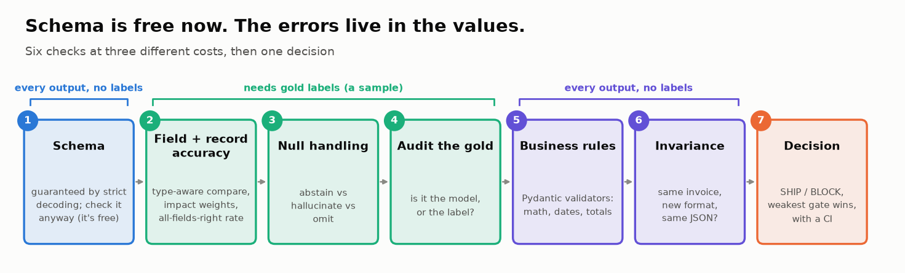
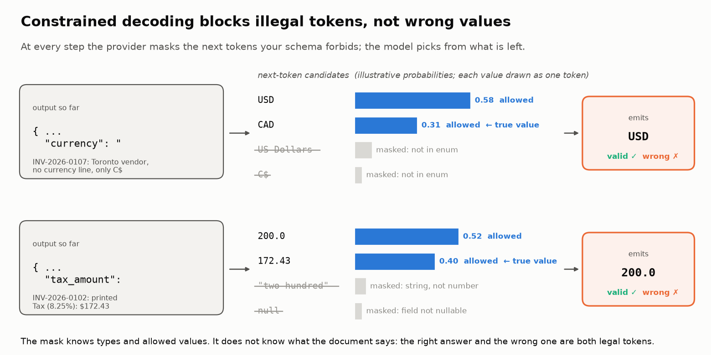
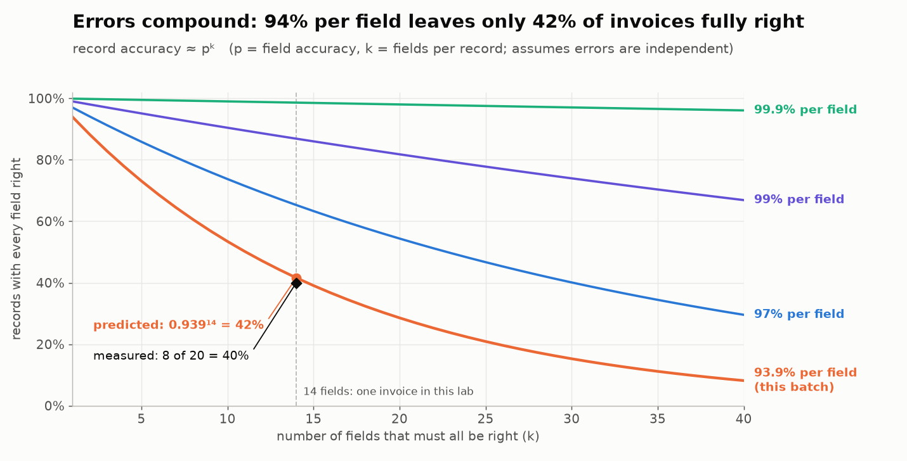
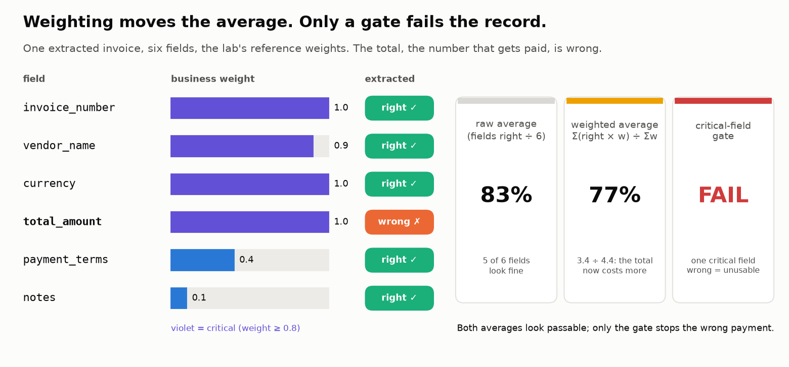
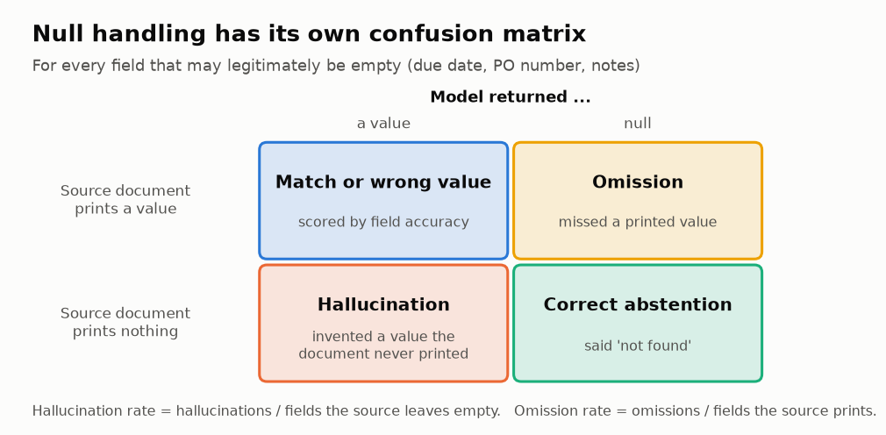
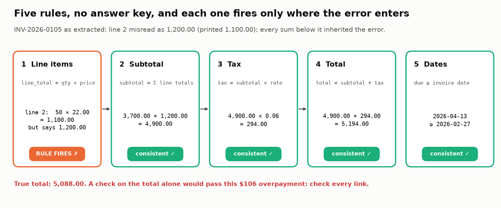

# 📋 Module 03: Evaluating Structured Outputs

> **Lab:** [`labs/03-structured-outputs-lab.ipynb`](../../labs/03-structured-outputs-lab.ipynb) · **Time:** 40–50 min · **Tools:** `pydantic`, `jsonschema`, `pandas` · **Keys needed:** none (live OpenAI / Anthropic calls are optional)



---

## 🧭 Overview

Many production LLM features don't produce prose. They produce **data**: JSON for an invoice, a tax form, a classification, an API call. That data feeds payments, ledgers and downstream code, so a mistake doesn't just read badly; it **does** something wrong.

Until recently, the hard part was getting valid JSON at all. In 2026 that is solved for API models: OpenAI, Anthropic and Gemini all offer **native structured outputs** that use constrained decoding, so the response matches your schema by construction. **The errors didn't go away. They moved into the values.**

In this module you'll evaluate an LLM that extracts invoices into JSON, with checks at three different costs:

| Check | Question | Needs gold labels? |
|---|---|---|
| 📐 **Schema validation** | Is the record well-formed? (≈100% with strict mode, so it's a health check) | ❌ No |
| 🎯 **Field + record accuracy** | Are the *values* right, field by field and invoice by invoice? | ✅ Yes |
| 🕳️ **Null handling** | When the document doesn't print a value, does the model say "not found" or invent one? | ✅ Yes |
| 🏷️ **Gold audit** | Is a disagreement the model's fault or the label's? | ✅ Yes (plus the source) |
| 🔗 **Business rules** | Do the fields agree with each other (math, dates)? | ❌ No |
| 🛡️ **Invariance tests** | Does the same invoice in a different format give the same JSON? | ❌ No |

…and then combine them into a **SHIP / SHIP WITH CAUTION / BLOCK** decision that carries its uncertainty.

---

## 💡 Why This Matters

> 🧾 *"100% schema-valid"* is the most reassuring and least informative number in structured-output evaluation.

In the lab's batch, every one of 20 strict-mode extractions is schema-valid and 94% of individual fields are right, yet **only 8 of 20 invoices are completely right**. One pays a Canadian invoice in US dollars, one overstates tax by $27.57, one carries a purchase-order number copied from a different invoice. Every one of them is well-typed, plausible and schema-valid.

The 2025–26 benchmarks say the same thing at scale: schema compliance near 100%, value accuracy 15–25 points lower, and fully-correct records as rare as 5–17% on hard documents. Evaluation now has to happen **at the value level**, and in fintech, tax and accounting products the values are the whole product.

---

## 🎯 Learning Objectives

After this module you will be able to:

1. **Produce** schema-guaranteed extractions with a Pydantic model and native structured outputs, and **explain** why schema validity is no longer a quality metric.
2. **Score** extractions at the **field** and **record** level with type-aware comparators and business-impact weights.
3. **Measure null handling**: correct abstention vs. hallucinated values vs. omissions.
4. **Audit the answer key** and separate model errors from gold-label errors.
5. **Encode** business rules as Pydantic validators that run on every output without labels, and **name** what they can't catch.
6. **Run invariance tests** that expose silent failures under harmless formatting changes.
7. **Turn** the evidence into a release decision with explicit gates and a confidence interval.

---

## 📋 Prerequisites

- ✅ Modules 01–02.
- 🧾 Reading JSON: objects, arrays, strings vs. numbers, `null`.
- 🐍 Python dicts, loops, f-strings. Pydantic `BaseModel` basics help but aren't required.

---

## 🧩 Key Concepts

### 1. 📐 Native structured outputs: the schema is guaranteed

With **constrained decoding**, the provider only lets the model generate tokens that keep the output valid against your schema. You define the schema once, usually as a Pydantic model, and the SDK does the rest:

```python
class Invoice(BaseModel):
    model_config = ConfigDict(extra="forbid")          # → additionalProperties: false
    invoice_number: str
    due_date: Optional[str] = Field(description="YYYY-MM-DD, or null if no due date is printed")
    currency: Literal["USD", "CAD", "GBP", "EUR"]
    line_items: list[LineItem]
    total_amount: float
    ...

# OpenAI Responses API
resp = client.responses.parse(model="gpt-6-luna", instructions=..., input=doc, text_format=Invoice)
invoice = resp.output_parsed

# Anthropic Messages API (no temperature: it returns HTTP 400 from API version 2026-10-21)
resp = client.messages.parse(model="claude-haiku-5-5", max_tokens=4096, messages=[...], output_format=Invoice)
if resp.stop_reason == "end_turn":
    invoice = resp.parsed_output
```



Under strict mode the model also writes keys **in schema order** (OpenAI documents this), so order your fields evidence-first: `line_items` before `subtotal` and `total_amount`.

Two consequences:

- **Schema validity is ~100% by construction**, so as a quality metric it carries no information. Keep it as a free pipeline-health gate (anything below 100% is a bug or a provider change). It still matters for open-weight models without grammar-constrained decoding and for very complex schemas.
- **The grammar enforces types, not meaning.** It can't know that `total = subtotal + tax`, that a due date can't precede the issue date, or that a vendor exists. That's what the later checks are for.

> 🧠 **Reason free, constrain late.** Whether strict schemas hurt reasoning is still debated (*Let Me Speak Freely?*, EMNLP 2024, vs. its rebuttal *Say What You Mean*; 2026 follow-ups find a real cost mainly for smaller and open models). The common fix: let the model reason unconstrained (or put a `reasoning` field *first*), then emit the constrained record. For copy-the-value extraction, constraining directly is fine.

### 2. 🎯 Field accuracy vs. record accuracy

Score every field against the gold label with a comparator that fits its type:

| Comparator | Fields | Why |
|---|---|---|
| **Equal to the cent** | money fields | $0.004 is rounding; $0.01 is a different invoice |
| **Normalised exact** | vendor name (casefold, strip punctuation, drop Inc/LLC/Ltd) | "Bayside Freight Partners" = "... LLC", but "TechParts **l**nc." ≠ "TechParts **I**nc." |
| **Order-insensitive** | line items | the same items in another order are not an error |
| **Normalised exact** | IDs, ISO dates, currency, terms | |
| **null vs value is always wrong** | any field | see concept 4 |

> ⚠️ **The fuzzy-match trap.** In the lab, the OCR typo "TechParts lnc." has a *higher* similarity to the gold name (0.929) than the legitimate "Bayside Freight Partners" has to "... LLC" (0.923). No similarity threshold can accept one and reject the other. Normalise first, then compare exactly.

Then report the batch at **two levels**:

- **Field accuracy:** right (invoice, field) slots ÷ all slots (20 × 14 = 280 in the lab).
- **Record accuracy:** invoices with *every* field right ÷ invoices.
- **Critical-record accuracy:** invoices with every *critical* field right ÷ invoices (see concept 3).

Per-field errors **compound**. At 94% per field across 14 fields, you'd expect about 0.94¹⁴ ≈ 42% of records to be fully right, and that's what the lab measures (40%). Field accuracy describes the model; record accuracy describes what your customers experience.



The same arithmetic sets targets: a 50-field form needs about **99.9% per field** to come out fully right 95% of the time (0.999⁵⁰ ≈ 0.95).

### 3. ⚖️ Impact weighting and critical fields



Not all fields matter equally. `weighted accuracy = Σ (correct × weight) / Σ weight`. Weights are **domain decisions**: a wrong `total_amount` pays the wrong amount; a wrong `invoice_date` can post an expense and its tax to the wrong period; a wrong `notes` field costs nothing.

A heavier weight still lets other fields "pay for" one wrong total, so also mark some fields **critical** and **gate** on them: a record counts as usable only if every critical field is right.

### 4. 🕳️ Null handling: abstain, hallucinate or omit



For fields that may legitimately be empty (due date, PO number, notes):

| Source prints… | Model returns… | Outcome |
|---|---|---|
| nothing | null | ✅ correct abstention |
| nothing | a value | 🚨 **hallucination** |
| a value | null | 🕳️ **omission** |

Report **hallucination rate** (hallucinations ÷ fields the source leaves empty) and **omission rate** (omissions ÷ fields the source prints) separately. A single accuracy number lets a model trade one for the other. In the lab, one due date is *computed* from the terms although the invoice says "Due on receipt", and one PO number is *copied from another invoice in the batch*. Both look completely real.

> ⚠️ **Make "not found" representable.** If a field is a required non-nullable string, constrained decoding gives the model no legal way to say "not printed"; inventing a value is the only valid output. In the lab, a non-nullable schema makes the correct answer unrepresentable for 8 of 20 invoices. Make absent-able fields nullable (or add an explicit `"NOT_FOUND"` value), and put absent values in your eval set.

### 5. 🏷️ Audit the gold

When the model and the label disagree, check the **source document** before blaming the model:

| Model value in the source? | Gold value in the source? | Verdict |
|---|---|---|
| no | yes | model error |
| yes | no | **label error**: fix the gold |
| both or neither | | ambiguous: a human (or a locale rule) decides |

In the lab, 2 of 17 "model errors" are label errors (a transposed total, a missed due date), and 2 are genuinely ambiguous: `04/03/2026` is 4 March in London and April 3 in Austin. Correcting the gold moves record accuracy from 40% to 50%. Cleanlab found erroneous or inconsistent ground truth in **every** public structured-output benchmark it examined.

### 6. 🔗 Business rules as Pydantic validators (no labels needed)



Encode rules that hold for every valid invoice and run them on **100% of traffic**:

```python
class CheckedInvoice(Invoice):
    @model_validator(mode="after")
    def _business_rules(self):
        issues = business_rule_issues(self)     # line math, subtotal, tax, total, due ≥ issue
        if issues:
            raise ValueError(" | ".join(issues))
        return self
```

Keep the schema you send to the provider plain, and validate with the subclass afterwards. Use a tolerance (one cent) for money math, and check **every** relationship. In the lab, a wrong line total propagates into subtotal, tax and total, which then agree with each other, so only the line-item rule fires.

> 🔎 **Rules catch arithmetic, not identity.** In the lab they flag 5 of the 10 broken invoices without any labels. The misses are a wrong vendor, a wrong currency, an invented PO and an invented due date: all perfectly self-consistent. Close that gap with **reference data**: vendor master, purchase-order lookup, currency from symbol plus vendor country.

### 7. 🛡️ Invariance (metamorphic) tests

Re-render the *same* invoice in harmless variants (US dates, day-first dates, no thousands separators, decimal comma, currency only as a symbol, reordered items, vendor in capitals) and assert the extraction **doesn't change**. No labels needed.

Each variant is ✅ invariant, 🔊 a **loud break** (a check fires) or 🔇 a **silent break** (values change, every check passes). In the lab, 2 of 3 breaks are silent: day-first dates turn 5 February into 2 May, and `C$` becomes USD. Assert *same JSON*, not *valid JSON*.

> 🔬 **Why date swaps survive testing.** Write every 2026 date day-first and read it month-first: on days 13–31 (221 days) the parse fails loudly; on days 1–12 (132 days, 36% of the year) you get a real but wrong date. A test set built from late-month dates never sees the silent failure, and a `due ≥ issue` rule catches only about half of the silent swaps on Net 30 invoices. Build date fixtures with day ≤ 12, and take date order from the vendor's country.

### 8. 🚦 From evidence to a decision

| Gate | Threshold |
|---|---|
| Schema validity | = 100% |
| Critical-record accuracy | ≥ 95%, and the 95% CI lower bound ≥ 90% |
| Hallucination rate on empty fields | ≤ 2% |
| Silent invariance breaks | 0 |

**The weakest gate decides.** With n = 20, report a Wilson confidence interval: the lab's 65% critical-record accuracy has a 95% CI of 43%–82%, and even a perfect run on 20 invoices only has a lower bound of 84%. The lab's verdict: **🛑 BLOCK**, with a concrete fix-first list.

---

## 🧪 Example Walkthrough

One invoice through every check (INV-2026-0105, Steel Works):

```python
out, gold, src = outputs["INV-2026-0105"], GOLD_FIXED["INV-2026-0105"], SOURCES["INV-2026-0105"]

# 1. Schema: valid (strict mode guarantees it)
schema_errors(out)                                   # → []

# 2. Field accuracy vs gold: 4 of 14 fields wrong, all critical
[f for f in FIELDS if not field_correct(f, out[f], gold[f])]
# → ['line_items', 'subtotal', 'tax_amount', 'total_amount']

# 3. Null handling: due date and PO are printed and extracted, notes match → nothing to flag

# 4. Gold audit: does the source support the model's subtotal?
supported("subtotal", out["subtotal"], src)          # → False  (source prints $4,800.00)
supported("subtotal", gold["subtotal"], src)         # → True   → 🤖 model error

# 5. Business rules: no labels needed
rule_check(out)   # → ['line 2: 50 × 22.00 = 1,100.00, not 1,200.00']
```

The record is schema-valid and its subtotal, tax and total agree with each other, yet one misread line total made four critical fields wrong. Only the line-item rule, or a gold label, can see it.

---

## ⚠️ Common Mistakes or Misunderstandings

| ❌ Mistake | ✅ Instead |
|---|---|
| "It's 100% schema-valid, so it's fine." | With strict mode that's guaranteed. Measure the values. |
| Reporting only field accuracy | Report record accuracy (all fields, and all critical fields) next to it. |
| Fuzzy-matching names with a similarity threshold | Normalise (case, punctuation, legal suffixes), then compare exactly. |
| Comparing lists position by position | Match line items by description; order is not an error. |
| Making every field required and non-nullable | Absent-able fields must be nullable, or the grammar forces a fabrication. |
| One accuracy number for empty fields | Hallucination rate and omission rate, separately. |
| Treating every disagreement as a model error | Check the source; some are label errors, some are ambiguous. |
| Putting business rules in the provider schema | Keep the schema plain; validate semantics with a Pydantic subclass afterwards. |
| Expecting rules to catch everything | Rules catch arithmetic; identity errors need reference data. |
| Testing only the formats in your eval set | Add invariance tests for every format your vendors use. |
| Sending `temperature=0` to Claude "for determinism" | It returns HTTP 400 on current API versions, and temperature 0 isn't deterministic anyway. Reproducibility comes from recorded outputs and fixed data. |
| Shipping on a point estimate from 20 examples | Attach a confidence interval; let the lower bound decide. |

---

## 🚀 Before You Start the Lab

- **Collapsed cells.** Plumbing (data, provider calls, chart code) sits in grey `# @title` cells that *Run All* executes; expand them only if curious. The cells you read are short.
- **📘 Concept blocks** introduce each idea in three sentences right before the lab leans on it; the lab page on the course site lists them.
- **Five 🏆 challenges** close the lab (+30 min), each built around one point you discover by solving it; starters run as shipped and print ✅/❌. New in this edition: a cross-record duplicate check (Challenge 4) and projecting accuracy onto the production invoice mix (Challenge 5).

- 🔌 Leave `PROVIDER = "mock"`. The lab replays recorded strict-mode extractions, so everyone sees the same numbers. Try a live provider afterwards if you have a key.
- ✍️ Task 4 (weights) and Task 8 (business rules) are yours to write; both fall back to reference versions until you finish, so *Run All* always works.
- 🔮 Each task starts with a **Predict** prompt, and Task 1 asks you to record five numeric guesses in `MY_PREDICTIONS`. A scorecard at the end grades them; the gap between guess and result is where the learning is.
- 🕵️ In Task 7 you play auditor: five model-vs-gold disagreements, and you decide model error, label error or ambiguous before the code does. In Task 10 a cost simulator prices three ways to run the extractor with your own cost assumptions.
- 💭 For Task 9, think like a vendor in another country, not like a test-writer.

---

## 🔑 Key Takeaways

1. 📐 **Schema validity is solved, so stop reporting it as quality.** Keep it as a free health gate.
2. 🎯 **Field accuracy flatters; record accuracy tells the truth.** Errors compound across fields.
3. 🕳️ **Absence is a value.** Make "not found" representable; measure hallucination and omission separately.
4. 🏷️ **Audit the answer key.** Some model errors are label errors; some cases are ambiguous.
5. 🔗 **Business rules run on every output**, and they catch arithmetic, not identity.
6. 🛡️ **Invariance tests find silent failures** that every other check misses.
7. 🚦 **The weakest gate decides, with a confidence interval.**

---

## 🧠 Self-Check

<details>
<summary>1. Your strict-mode extractor reports 100% schema validity. What does that tell you about quality?</summary>

Almost nothing. Constrained decoding makes schema validity true by construction. It tells you the pipeline is healthy; quality has to be measured on the values (field and record accuracy, null handling).
</details>

<details>
<summary>2. Field accuracy is 94% over 14 fields. Roughly what share of records would you expect to be fully correct?</summary>

If errors were independent, about 0.94¹⁴ ≈ 42%. Errors compound, which is why record accuracy must be reported alongside field accuracy.
</details>

<details>
<summary>3. The model returns a due date for an invoice that says "Due on receipt". What kind of error is this, and how do you measure it?</summary>

A hallucination: a value for a field the source leaves empty. Measure it as hallucination rate = hallucinations ÷ fields the source leaves empty, reported separately from omission rate.
</details>

<details>
<summary>4. The model says the total is 1,846.80, the gold label says 1,864.80, and the source prints 1,846.80. What do you do?</summary>

It's a label error: fix the gold and re-score. Always check the source before counting a disagreement against the model.
</details>

<details>
<summary>5. Why can't a "total = subtotal + tax" rule catch a CAD invoice booked as USD?</summary>

The record is internally consistent: every number agrees with every other. Identity errors (currency, vendor, PO) need reference data such as the vendor's country and a vendor master, not arithmetic rules.
</details>

<details>
<summary>6. Your critical-record accuracy is 19/20. Can you ship against a gate of "CI lower bound ≥ 90%"?</summary>

No. The 95% Wilson interval for 19/20 has a lower bound of about 76%. Even 20/20 only reaches about 84%; you need at least 35 labelled invoices for a perfect run to clear 90%.
</details>

---

## 📖 Glossary

**Constrained decoding** · generation restricted to tokens that keep the output valid against a schema. **Native structured outputs** · provider features that apply constrained decoding to your schema (OpenAI `responses.parse`, Anthropic `messages.parse` / `output_config.format`, Gemini response schemas). **Field accuracy** · share of (record, field) slots that are correct. **Record accuracy** · share of records with every field correct. **Critical-record accuracy** · share of records with every critical field correct. **Impact weighting** · weighting fields by business consequence. **Critical field** · a field whose error makes the record unusable. **Correct abstention** · returning null when the source prints nothing. **Hallucinated value** · a value for a field the source leaves empty. **Omission** · null for a field the source prints. **Label error** · a gold label that disagrees with the source. **Business rule / consistency check** · a relationship between fields that holds for every valid record. **Invariance (metamorphic) test** · a check that a meaning-preserving input change leaves the output unchanged. **Silent break** · a changed output that passes every check. **Wilson interval** · a confidence interval for a proportion that behaves well with small n. **Locale** · a country's date and number conventions (`04/03` is 4 March in London, April 3 in Austin). **Three-way match** · paying only when invoice, purchase order and goods receipt agree. **Vendor master** · the company's reference list of approved vendors (country, currency, bank details). **Payment terms** · when an invoice is due (*Net 30*: 30 days after the invoice date; *Due on receipt*: immediately). **CI (continuous integration)** · the automated tests that run on every code change; not the confidence interval.
