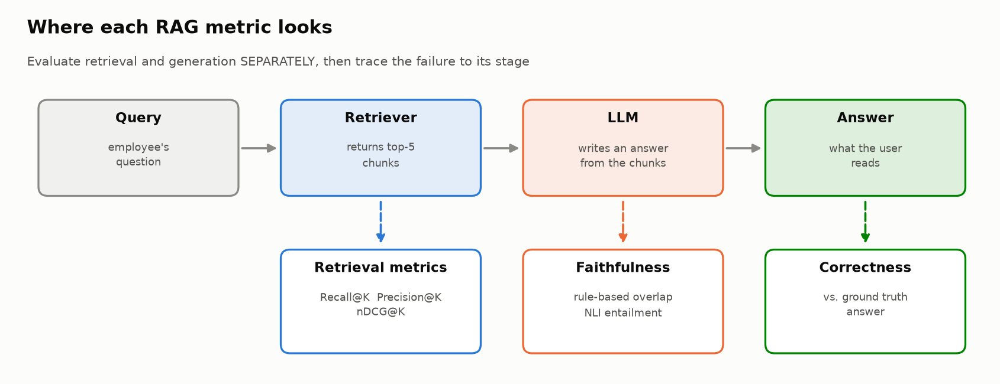
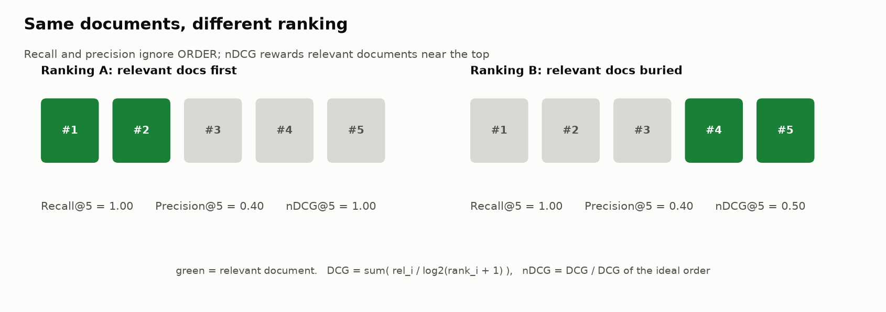
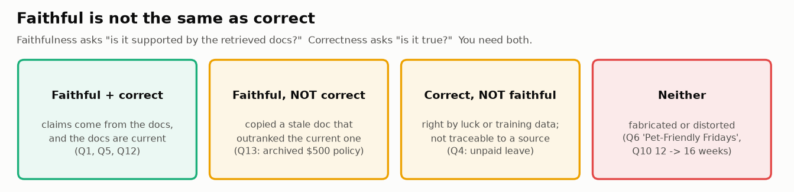
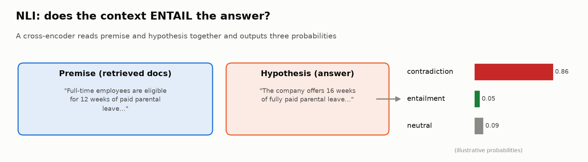
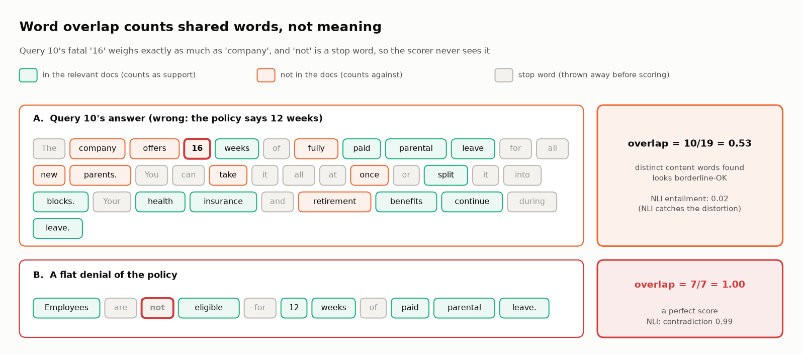
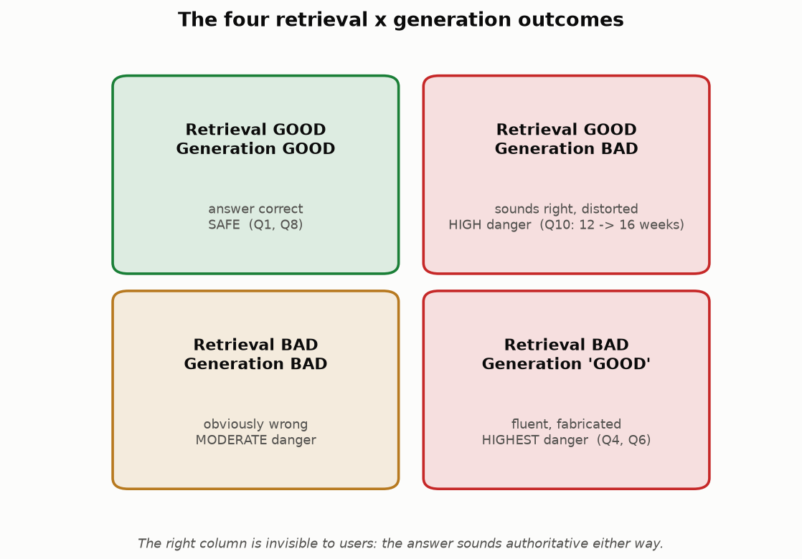
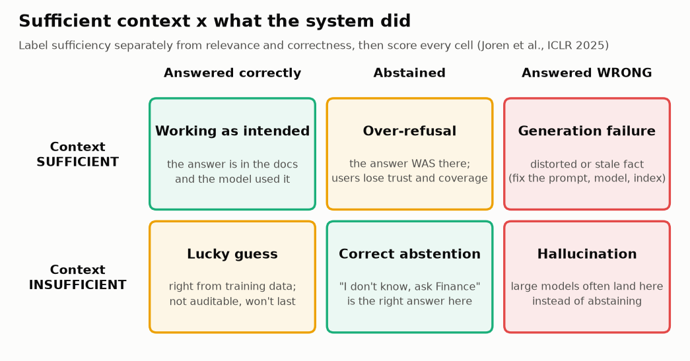
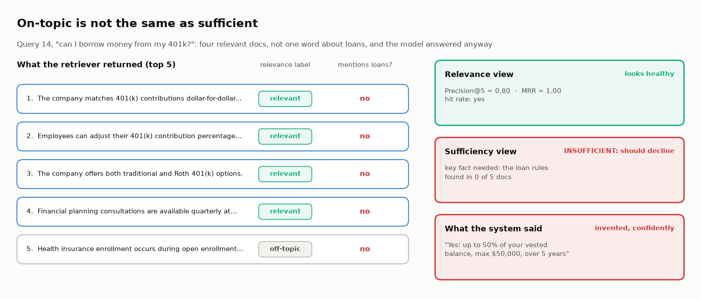
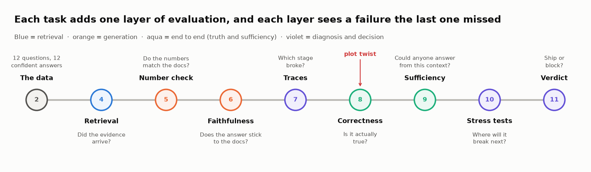

# 🔎📚 Module 04: Evaluating Retrieval-Augmented Systems (RAG)

> **Lab:** [`labs/04-rag-evaluation-lab.ipynb`](../../labs/04-rag-evaluation-lab.ipynb) · **Time:** 40–45 min · **Tools:** `sentence-transformers` (NLI cross-encoder), `pandas`, `matplotlib` · **Keys needed:** none
>
> **Supplemental lab:** [`labs/04b-production-rag-lab.ipynb`](../../labs/04b-production-rag-lab.ipynb) builds a real RAG pipeline on a vector database. See the [Module 04b handout](../module-04b/student-handout.md).



---

## 🧭 Overview

**Retrieval-Augmented Generation (RAG)** answers questions by first **retrieving** relevant documents and then asking an LLM to **generate** an answer from them. It's the most common architecture for "chat with your documents" products, and it has two places to fail instead of one.

In this module you'll evaluate a company-policy Q&A system on 12 offline queries plus a 4-query production sample:

1. 📏 Measure **retrieval** quality with Recall@K, Precision@K, nDCG and MRR, and decide which to headline.
2. 📝 Design **grounding** criteria, and automate one: a deterministic **number check**.
3. 🧪 Score **faithfulness** two ways (word overlap and an **NLI** entailment model) and measure each scorer's misses and false alarms.
4. 🔬 Combine everything into a per-query **trace analysis** that names the root cause.
5. ⚖️ Show that **faithful ≠ correct**: find the answer that passes every automated check and is still wrong.
6. 🧱 Label **context sufficiency**, score **abstention** in both directions, and report a **selective-answer metric** (accuracy when answering vs. coverage).
7. 💥 Design a **balanced stress-test suite** and make a ship/block call with `verdict()`.

---

## 💡 Why This Matters

Management's complaint in the lab scenario is the classic RAG complaint: *answers that "sound right but aren't."* Two of the 12 queries retrieved **zero** relevant documents, and the system still produced confident, detailed answers. One query retrieved excellent documents and the answer quietly changed **12 weeks of parental leave to 16**.

If you only look at final answers, both kinds of failure look identical: "wrong". But the fixes are completely different:

| Root cause | Fix |
|---|---|
| 🔍 Retrieval failed | Better embeddings, chunking, index coverage, query rewriting |
| ✍️ Generation failed | Prompt, model, grounding instructions, citation requirements, guardrails |
| 🔍➡️✍️ Retrieval failed *and* the model answered anyway | Both, plus an "I don't know" policy when evidence is weak |

> 🧠 **The core idea:** evaluate the two stages **separately**, then trace each failure to the stage that caused it.

---

## 🎯 Learning Objectives

After this module you will be able to:

1. **Compute and interpret** Recall@K, Precision@K and nDCG@K, and explain what each one is blind to.
2. **Define** grounding, faithfulness and correctness, and give an example where they disagree.
3. **Score faithfulness** with a rule-based overlap metric and an NLI cross-encoder, and explain the failure modes of each.
4. **Design** stress-test queries across four categories with expected failure modes.
5. **Diagnose** the root cause of a RAG failure from its retrieval and generation signals.
6. **Explain** why "retrieval failed but the answer sounds good" is the most dangerous RAG failure.
7. **Label context sufficiency**, distinguish it from relevance, and report coverage together with selective accuracy.
8. **Explain** why test sets written from the documents inflate scores.

---

## 📋 Prerequisites

- ✅ Modules 01–02 (traces; failure categories, especially *unsupported claims*).
- 🏗️ The RAG shape: query → retriever → top-K chunks → LLM → answer.
- 🐼 `pandas` basics; very light `numpy` (`log2`).

---

## 🧩 Key Concepts

### 1. 🏗️ The two halves of RAG

- **Retriever:** given a query, return the K most relevant chunks (usually by embedding similarity, sometimes hybrid with keyword search and a reranker).
- **Generator:** an LLM that should answer **only** from those chunks.

Every evaluation question maps to one half:

| Question | Half | Metric family |
|---|---|---|
| Did we fetch the right evidence? | Retrieval | Recall@K, Precision@K, nDCG@K, hit rate, MRR |
| Did the answer stick to the evidence? | Generation | Faithfulness / groundedness |
| Is the answer actually true and complete? | End-to-end | Correctness vs. ground truth |

### 2. 📏 Retrieval metrics

Each query in the lab has `relevance_labels`, e.g. `[0, 0, 1, 0, 0]` = "the third retrieved document is relevant". **Relevant** means a person judged the document on-topic for the question; it doesn't guarantee the document contains the answer (that's *sufficiency*, §8).

| Metric | Formula | Question | Blind to |
|---|---|---|---|
| **Recall@K** | relevant found in top K / total relevant | Did we find the evidence? | Noise and order |
| **Precision@K** | relevant in top K / K | How much is noise? | Missing evidence and order |
| **nDCG@K** | DCG / ideal DCG, with DCG = Σ relᵢ / log₂(i + 1) | Is the evidence near the **top**? | Nothing in this list, but harder to explain |
| **MRR** | 1 / rank of the first relevant doc (0 if none) | How far down is the **first** hit? | Everything after the first hit |



**Worked nDCG example** (Query 2, relevant doc at rank 3):

```
DCG  = 1 / log2(3 + 1) = 1 / 2      = 0.50
IDCG = 1 / log2(1 + 1) = 1 / 1      = 1.00      (ideal: relevant doc at rank 1)
nDCG = 0.50
```

The answer was right, but the retriever **buried** the evidence. With a smaller K, or a model that weights early context more, it would have been lost.

> ⚠️ **Important honesty note about Recall@5 in Lab 04.** The lab only labels the 5 retrieved documents, so it can't know about relevant documents the retriever *missed* elsewhere in the corpus. Its Recall@5 therefore means "of the relevant docs in the retrieved pool, how many are in the top 5", which with K = 5 is always 0 or 1. **True recall needs corpus-level labels**, which you'll have in Lab 04b (`relevant_doc_ids`). This is a common trap in real evaluations too: recall computed only over what the system returned can't see what it missed.

Verified results across all 12 queries: mean Recall@5 (a hit rate here) **0.83** (two complete misses: Q4, Q6), mean Precision@5 **0.40**, mean nDCG@5 **0.73**, MRR **0.72**.

> 🎯 **Which number to headline?** An LLM reads *all* K chunks; it doesn't stop at the first result like a person scanning search results. Q2 and Q3 had their evidence at rank 3 (MRR 0.33) and still got correct answers. Headline **recall@K at the K you actually pass to the model** (Anthropic's 2024 Contextual Retrieval study used K = 20); use precision, nDCG and MRR as tuning diagnostics.

### 3. 📚 Grounding, faithfulness and correctness



- **Grounding** (also **faithfulness**, groundedness or attribution): every claim in the answer is supported by the retrieved context, with nothing added or distorted. The lab says "grounding" in Task 5 and "faithfulness" from Task 6 on.
- **Correctness:** the answer is actually true (matches ground truth).

They can all disagree, in both directions. The lab has an example of each: **Q13** copies an *archived* handbook faithfully and is wrong (faithful, not correct); **Q4** guesses "unpaid" correctly with no supporting document (correct, not faithful). In Task 5 you'll write criteria that distinguish:

| ✅ Acceptable | ❌ Not acceptable |
|---|---|
| **Paraphrase:** "about three months" for "12 weeks" (borderline: be explicit in your rubric!) | **Distortion:** "16 weeks" for "12 weeks" |
| Combining two supported facts | **Fabrication:** "Pet-Friendly Fridays" with no source at all |
| Saying "I don't have that information" | **Unsupported additions:** helpful-sounding extras not in any doc |

### 4. 🧪 Two ways to score faithfulness



**Method 1, rule-based (word overlap):** what fraction of the answer's content words (after removing stop words) appear in the relevant documents?

- ✅ Fast, free, transparent.
- ❌ Fooled by shared vocabulary. Q10's distorted answer ("**16** weeks") still scores **0.53**, because "weeks", "parental", "leave" and "paid" all appear in the source.
- ❌ Deaf to negation. **Stop words** are a fixed list of very common words that are deleted before counting, and the list includes *not*. "Employees are **not** eligible for 12 weeks of paid parental leave" scores a perfect **1.00** against the doc that grants that leave.



**Method 2, NLI (Natural Language Inference):** a **cross-encoder** reads the premise (retrieved docs) and hypothesis (answer) *together* and outputs probabilities for **entailment**, **contradiction** and **neutral**.

- ✅ Understands meaning: Q10's entailment probability is **0.02**.
- ❌ Has its own blind spots. In the verified run, the small `nli-MiniLM2-L6-H768` model calls Q8's correct, multi-claim answer **neutral** (entailment 0.04) and flags Q2's reasonable paraphrase ("client dinner" ≈ "client entertainment") as a **contradiction** (0.59).

> 🔧 **Retest fix you should know about:** a cross-encoder outputs raw **logits** (unbounded numbers like 3.65 or −2.0) unless you request probabilities. The lab now calls `nli_model.predict(pairs, apply_softmax=True)`. Averaging logits with 0–1 metrics silently produced nonsense root causes in an earlier version of this lab. **Always check the range of a score before you combine it with others.**

| Query | Rule-based | NLI entailment | Takeaway |
|---|---|---|---|
| 1, 3, 5, 7, 9, 11 | 0.54–0.93 | 0.93–0.99 | Methods agree on faithful answers |
| 4, 6 | 0.00 | — (`no_context`) | No evidence at all |
| **10** | 0.53 | **0.02** | Only NLI catches the distortion |
| **8** | 0.82 | 0.04 (neutral) | NLI misses a *correct* answer |
| **2** | 0.64 | 0.31 (contradiction 0.59) | NLI false alarm |

**Start deterministic.** Before any model, check that every **number** in the answer (amounts, days, percentages) appears in the retrieved docs. In the lab, ten lines of regex flag exactly one of 12 answers: Q10's "16". In benefits, payroll and tax answers, numbers are the claims that hurt most.

**Evaluate your evaluator:** no scorer is perfect. On the lab's 9 known-faithful answers, NLI scores 3 below 0.5 (Q2, Q8, Q12: false alarms); word overlap misses 1 of 3 known-unfaithful answers (Q10). Report misses *and* false alarms (TPR/TNR) for any scorer before wiring it to an alert. Production systems combine signals, use **claim-level** scoring (split the answer into sentences and check each one), or use an LLM judge with a rubric, and they calibrate whatever they use on cases with known answers.

### 5. 💥 Stress testing

Happy-path queries give a false sense of security. Task 10 asks for at least two queries in each category, and for **balance**: at least as many *should-answer* probes as *should-abstain* ones, so a system can't pass by refusing everything.

| Category | Example | Failure it targets |
|---|---|---|
| 🌫️ **Ambiguous** | "What's the limit?" | Guessing an interpretation instead of clarifying |
| 🃏 **Adversarial** | "Can I expense my vacation if I check email during it?" | Being led into a wrong policy answer |
| 🚪 **Should abstain** | "What's the per diem in Tokyo?" | Answering beyond the knowledge base |
| 🗣️ **Should answer** | "do I lose my stock if I quit?" | Over-refusing a user-phrased, answerable question |
| ⚔️ **Conflicting context** | "Does parental leave pause my education-stipend deadline?" / two versions of a policy | Inventing a rule, or copying the stale version |

For each, write the **expected failure**, a **good** response and a **bad** response. That's what turns a clever question into a test case.

### 6. 🔬 Trace analysis and root cause

The lab combines signals into a per-query diagnosis:

```
Retrieval:   ❌ FAILURE (0 relevant) │ ⚠️ WEAK (1 relevant) │ ✅ GOOD (≥ 2 relevant)
Generation:  ✅ GOOD │ ⚠️ PARTIAL │ ❌ UNFAITHFUL │ ❌ HALLUCINATION (substantive answer, no evidence)
Root cause:  RETRIEVAL→HALLUCINATION · GENERATION · MIXED · NO FAILURE
```

Verified results: **Q4, Q6** → retrieval failure led to hallucination; **Q10** → generation failure with good retrieval; **Q5, Q9, Q11** → no failure; **6 of 12** land in MIXED: Q1, Q3, Q7 only because 1 of 5 docs was relevant (their answers are fine), and Q2, Q8, Q12 because the *NLI scorer* couldn't confirm a faithful answer. A root-cause classifier is a model too. Better definition: a retrieval failure is "the evidence needed isn't in the top K", a **sufficiency** question (§8). Real trace tools (Langfuse, LangSmith) give you these per-step signals automatically if you instrument retriever and generator as separate observations (Module 01).

### 7. ⚖️ The danger quadrant



- **Both bad:** usually obvious to users ("that's not an answer").
- **Good retrieval, bad generation (Q10):** sounds right, and is distorted. Detect with NLI/claim-level checks; fix with grounding instructions and citations.
- **Bad retrieval, "good" generation (Q4, Q6):** fluent, authoritative and fabricated. Users can't tell. Guard against it with a **sufficiency gate** (§8).
- **Pattern C, faithful but wrong (Q13):** retrieval *and* faithfulness look perfect; the source is stale. Only correctness against a trusted reference, plus index hygiene (expire old versions, freshness metadata), catches it.
- **Pattern D, wrong abstention behavior:** answering on insufficient context (Q4, Q6, Q14), or refusing when the answer was there (Q16).

### 8. 🧱 Sufficient context and abstention





**Relevant ≠ sufficient.** Q14 ("can I borrow from my 401k?") retrieved four on-topic 401(k) documents (Precision@5 0.80), and none of them mentions loans. Google's **Sufficient Context** study (Joren et al., ICLR 2025) made sufficiency its own label, separate from relevance and correctness, and found that large models **often answer incorrectly instead of abstaining** when context is insufficient; having *some* context can make a model *less* likely to abstain. RefusalBench (2025) found some models refused over 60% of answerable queries while still answering unanswerable ones: overconfidence and over-refusal coexist.

**Labelling sufficiency offline:** an annotator writes the **key facts** a correct answer must contain; the context is sufficient if all of them appear in the retrieved docs. Questions the corpus can't answer are never sufficient. (At serving time, use an LLM autorater that sees only question + context; Google reported ~93% accuracy, per secondary coverage. Validate it against human labels first.)

Score every answer in a 2×3 table (sufficient / insufficient × correct / abstained / wrong), then report a **selective-answer metric** for each answer/abstain policy:
- **Coverage** = share of questions answered
- **Selective accuracy** = share of answered questions that are correct

Verified lab results (16 queries): the system answered **3 of 4** insufficient-context questions and refused **1 of 12** sufficient ones.

| Policy | Coverage | Selective accuracy | Wrong answers |
|---|---|---|---|
| As shipped | 0.88 | 0.71 | 4 |
| Abstain if no relevant doc | 0.75 | 0.75 | 3 |
| Abstain if context insufficient | 0.69 | 0.82 | 2 (Q10, Q13) |

The two survivors had *sufficient* context: a distorted number and a stale doc. Gates only remove answers, so no gate fixes over-refusal (Q16). Google's paper reports that selective generation (sufficiency + model confidence) raises the fraction of correct answers among those given by **2–10%**.

### 9. 🏭 Doc-derived test sets flatter you

The 12 offline questions were written by the team *while reading the docs*; they reuse 37% of their content words from the relevant documents, vs 17% for real employees' questions ("time off" instead of "PTO"). Same system: **83%** good behavior offline, **25%** on the production sample (n is tiny: 95% CIs 55–95% vs 5–70%). The literature agrees: LLM-based systems score higher on synthetic judgments (Rahmani et al., 2024), and synthetic QA benchmarks may **rank RAG systems differently** than human-annotated ones (2025). Use synthetic sets for A/B regressions, not absolute accuracy claims.

---

## 🧪 Example Walkthrough

Q10 end to end:

```python
item = rag_dataset[9]                 # "What is the parental leave policy?"
labels = item["relevance_labels"]     # [1, 1, 1, 1, 0]  → strong retrieval

recall_at_k(labels), precision_at_k(labels), ndcg_at_k(labels)
# → (1.0, 0.8, 1.0)                    retrieval is excellent

rule_based_faithfulness(item["generated_answer"], item["retrieved_docs"], labels)
# → 0.526                              looks "OK": shared vocabulary

nli_faithfulness(item["generated_answer"], item["retrieved_docs"], labels)
# → {'entailment_score': 0.021, 'contradiction_score': 0.254, 'label': 'neutral'}

# Root cause → "GENERATION — good docs but unfaithful answer"
```

The same pipeline on Q6 ("pets in the office") gives retrieval **0/5**, both faithfulness scores **0**, and root cause **RETRIEVAL → HALLUCINATION**: an answer about "Pet-Friendly Fridays" invented from nothing.

---

## ⚠️ Common Mistakes or Misunderstandings

| ❌ Mistake | ✅ Instead |
|---|---|
| Judging RAG only by the final answer | Score retrieval and generation separately, then trace. |
| Treating high recall as "retrieval is fine" | Check precision (noise) and nDCG (ranking) too. |
| Computing recall only over what was retrieved | True recall needs labels for the whole corpus. |
| Equating faithful with correct | A faithful answer to a stale or wrong doc is still wrong. |
| Trusting word overlap to catch distortions | It misses changed numbers and can't see "not"; use NLI, claim-level checks or judges. |
| Checking numbers against *all* retrieved text | A wrong amount borrowed from an off-topic doc passes; compare against the relevant docs. |
| Trusting NLI blindly | It has false negatives (Q8) and false alarms (Q2). Calibrate it. |
| Mixing logits with probabilities | Check score ranges; use `apply_softmax=True`. |
| Testing only well-formed, in-scope questions | Add ambiguous, adversarial, should-abstain, should-answer and conflicting-context queries. |
| Treating "relevant docs retrieved" as "answerable" | Label sufficiency separately: on-topic docs may not contain the answer. |
| Reporting one accuracy number for a system that can abstain | Report coverage and selective accuracy together. |
| Quoting accuracy on a doc-derived test set as the product's accuracy | Use it for regressions; earn absolute claims with real, labelled queries. |

---

## 🚀 Before You Start the Lab



- ⏬ The NLI model (~90 MB) downloads on first use, which takes about a minute.
- 🔍 Before Task 3, read Q4 and Q6's answers and ask yourself: *which one is fabricated?* (Trick question.)
- 📐 Keep the danger quadrant and the sufficiency grid in mind; Task 11 asks you to place queries in them.
- 🧪 When a score surprises you, inspect the query with `inspect_query(id)` before concluding anything.
- 📖 Unsure of a term? The lab's **Jargon decoder** (top of the notebook) defines 34 of them, from nDCG to vesting.
- 🏆 Finished early? Three auto-checked challenges in the Stretch Goal section: break the number check, build a stale-version detector, and decide whether a sufficiency gate is worth its refusals.

---

## 🔑 Key Takeaways

1. 🔀 **Evaluate retrieval and generation separately**, then trace failures to their stage.
2. 📏 **Recall, precision and nDCG answer different questions**, and recall is only meaningful with corpus-level labels.
3. 📚 **Faithful ≠ correct ≠ grounded.** Define each precisely in your rubric.
4. 🧪 **Every faithfulness scorer has blind spots:** overlap misses distortions, small NLI models miss long answers. Combine and calibrate.
5. 🚨 **Retrieval failure + fluent generation is the most dangerous failure.** Add a sufficiency gate and an "I don't know, ask X" path.
6. 🧱 **Relevant ≠ sufficient.** Score abstention in both directions and report coverage with selective accuracy.
7. ⚖️ **A faithful answer can be wrong** when the source is stale; check correctness against a trusted reference.
8. 🏭 **Doc-derived test sets flatter you;** grow the set from real queries.
9. 💥 **Balanced stress tests find the edges** that happy-path queries never reach.

---

## 🧠 Self-Check

<details>
<summary>1. A retriever returns the right document at rank 5 of 5. What are Recall@5, Precision@5 and nDCG@5 (one relevant doc)?</summary>

Recall 1.0, Precision 0.2, nDCG = (1/log₂6) / 1 ≈ 0.39. Found, but buried.
</details>

<details>
<summary>2. Why does word overlap score Q10's "16 weeks" answer as reasonably faithful?</summary>

Most content words (parental, leave, weeks, paid, benefits) appear in the source; overlap can't see that a *number* changed.
</details>

<details>
<summary>3. Why is "bad retrieval, good-sounding generation" worse than "bad retrieval, bad generation"?</summary>

Users can't detect it. A clearly bad answer prompts them to double-check; a fluent fabricated one gets trusted and acted on.
</details>

<details>
<summary>4. What guardrail would have prevented Q4 and Q6?</summary>

A sufficiency gate: if the retrieved context can't support an answer, respond "I don't have enough information" (and route the user) instead of generating. A plain relevance threshold also catches Q4 and Q6, but misses Q14.
</details>

<details>
<summary>5. Q14 retrieved four relevant 401(k) docs. Why is its context still insufficient, and what should the system have said?</summary>

None of the docs mentions loans, so no answer can be supported. It should have said the handbook doesn't cover 401(k) loans and routed the employee to the Benefits team.
</details>

<details>
<summary>6. A system raises selective accuracy from 71% to 95% by abstaining more. What else must you report?</summary>

Coverage (how many questions it still answers), and whether it now refuses answerable questions (over-refusal).
</details>

<details>
<summary>7. NLI calls Q8's correct answer "neutral". Name two ways to improve the evaluator.</summary>

Score claim by claim (one sentence at a time) instead of the whole answer; use a larger NLI model or an LLM judge with a grounding rubric; and calibrate on labelled examples.
</details>

---

## 📖 Glossary

**RAG** · retrieve evidence, then generate from it. **Chunk** · a retrievable piece of a document. **Recall@K / Precision@K** · coverage / purity of the top K. **nDCG** · rank-aware retrieval quality, normalized to [0, 1]. **Relevant document** · judged on-topic for the query; not necessarily sufficient. **Hit rate** · share of queries with at least one relevant document in the top K. **Grounding / faithfulness** · every claim in the answer is supported by the retrieved context. **NLI** · classifying a (premise, hypothesis) pair as entailment / contradiction / neutral. **Cross-encoder** · a model that reads both texts together. **Logit / softmax** · raw model score / its conversion to probabilities. **Stress test** · a deliberately hard query with an expected failure mode. **MRR** · mean of 1 / rank of the first relevant result. **Sufficient context** · retrieved context that contains everything needed to answer. **Abstention** · declining to answer ("I don't know"). **Coverage** · share of questions a system answers. **Selective accuracy** · accuracy among answered questions. **Over-refusal** · declining a question that the context could answer. **Stop words** · very common words (the, of, not…) that word-counting scorers delete before comparing. **Wilson interval** · a 95% confidence interval for a rate that stays inside 0–100% at small n. **SME** · subject-matter expert. **401(k) / vesting** · US workplace retirement account / employer contributions becoming yours over time. **Per diem** · a fixed daily travel allowance.
