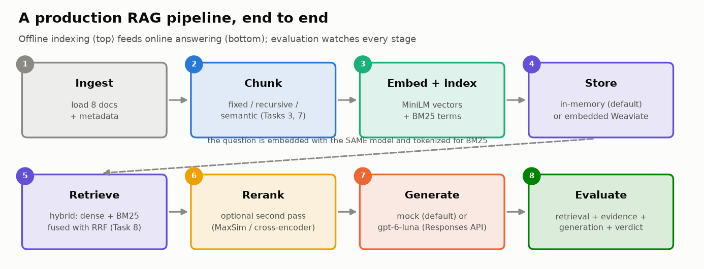
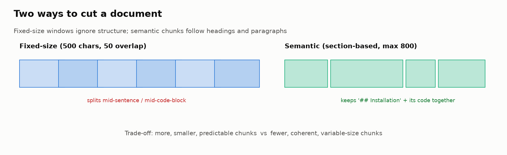
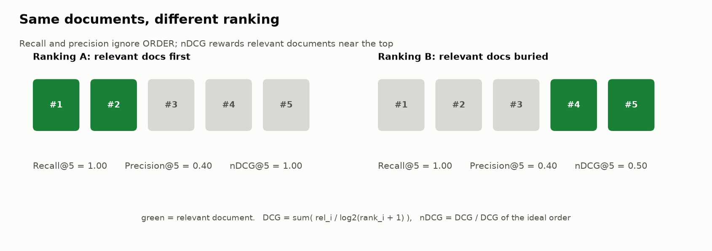
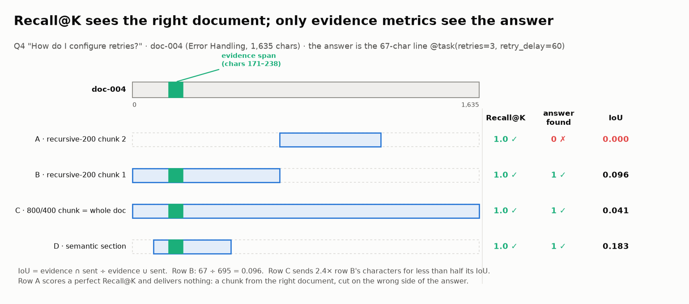
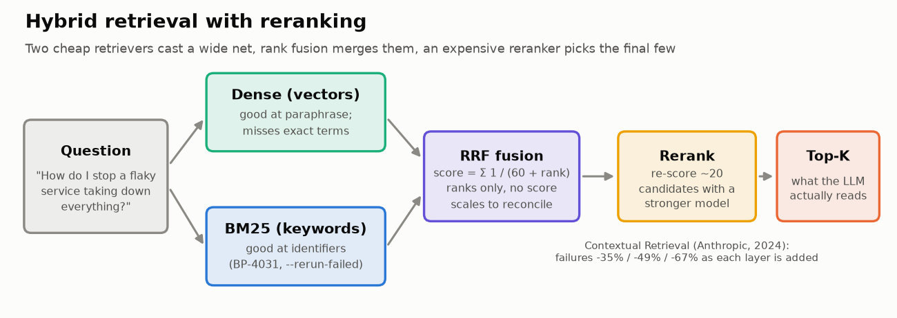
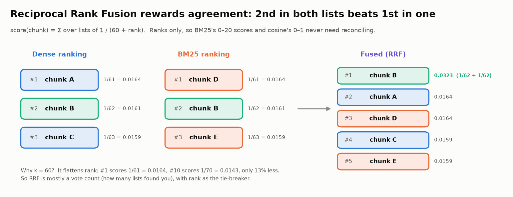
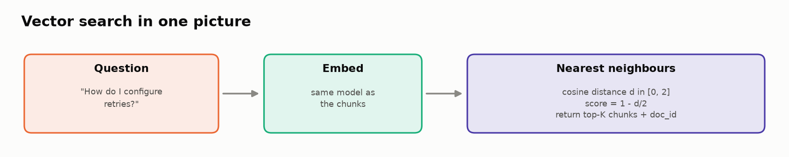

# 🏭 Module 04b: Building and Evaluating a Production-Grade RAG Pipeline

> **Lab:** [`labs/04b-production-rag-lab.ipynb`](../../labs/04b-production-rag-lab.ipynb) · **Supplemental lab after Module 04** · **Time:** 60–70 min · **Tools:** `sentence-transformers`, numpy/pandas/matplotlib; optional embedded Weaviate (v4 client) and OpenAI `gpt-6-luna` (Responses API) · **Keys needed:** none



---

> ### 🔗 Do I need to do Lab 04 first?
> **No.** Lab 04b has **no code dependency** on Lab 04: it builds its own corpus, index and metrics from scratch. Lab 04 evaluates a *pre-recorded* RAG system and goes deeper on faithfulness, correctness and abstention; Lab 04b *builds* a live pipeline and focuses on chunking, hybrid search, reranking and readiness.
>
> If you skip Lab 04, read **Key Concepts §3** below (and the lab's 📏 *Metrics primer*). If you did Lab 04, you'll notice 04b fixes its biggest limitation: here you have **corpus-level relevance labels** and **evidence spans**, so recall means what it says.

---

## 🧭 Overview

In Module 04 you evaluated a RAG system someone else ran. Here you **build one** and evaluate every design decision instead of trusting defaults:

1. 📂 Create a documentation corpus for a **fictional** product, *BrookPipe* (8 docs, including two realistic distractors: a 1.x→2.0 migration guide and an FAQ), plus a **14-question eval set** with ground truth, relevant doc IDs and the **exact evidence span** for each answer.
2. 📦 Implement **fixed-size, recursive and semantic** chunkers that record character offsets.
3. 🗄️ Store chunks behind a swappable adapter: **in-memory numpy + BM25** by default, **embedded Weaviate** optional.
4. 📊 Score retrieval at **document level** (Recall@K, Precision@K, nDCG, MRR) **and token level** (answer found, IoU, tokens sent).
5. 📐 Run a **chunk-size sweep** (8 configs) the way Chroma's 2024 chunking study did.
6. 🔀 Compare **dense, BM25, hybrid (RRF), context headers and reranking** with a retrieval-failure rate.
7. 🤖 Generate with a **mock** (default) or **`gpt-6-luna`** via the Responses API, and score faithfulness/relevancy next to retrieval.
8. 🎯 Render a production-readiness **verdict**.

---

## 💡 Why This Matters

The gap between a RAG demo and a RAG product is rarely the LLM. It's the **pipeline decisions** around it, and most of them ship as somebody else's defaults:

- How you cut documents decides what evidence *can* be retrieved, and how much padding every prompt pays for.
- Whether you search by meaning, by keyword, or both decides which questions you can answer at all.
- A reranker adds latency on every query. Is it earning it on *your* corpus?

In fintech and tax products, the cost of a wrong retrieval isn't a bad demo: it's an answer about a filing deadline or a fee that came from the wrong (or a stale) document. Every default in this lab is treated as a hypothesis to test.

---

## 🎯 Learning Objectives

After this module you will be able to:

1. **Build** a modular RAG pipeline: ingest → chunk → embed/index → store → retrieve → rerank → generate → evaluate.
2. **Evaluate chunking with token-level metrics** (evidence recall, IoU, tokens sent) and explain why document-level recall can't see the difference.
3. **Compare retrieval stacks** (dense, BM25, hybrid, context headers, reranking) with a retrieval-failure rate at the K you actually use.
4. **Use** a storage adapter, and embedded Weaviate's v4 API (collections, self-provided vectors, `near_vector`, `bm25`, `hybrid`).
5. **Generate** behind a `PROVIDER` switch with the OpenAI Responses API, and read generation metrics next to retrieval metrics.
6. **Explain** what RAGAS measures, how RAGAS 0.4 is called, and why this course treats it as optional.
7. **Make** a readiness decision from thresholds written down in advance.

---

## 📋 Prerequisites

- 🐍 Python: dataclasses, list comprehensions, functions.
- 🧮 The idea of an embedding (text → vector; similar meaning → close vectors). Module 02 explains it.
- 🔭 Module 01 recommended (for the observability next step). Module 04 helpful, **not required**.

---

## 🧩 Key Concepts

### 1. 🏗️ Offline indexing vs. online answering

| Pipeline | When it runs | Steps |
|---|---|---|
| **Indexing (offline)** | When documents change | ingest → chunk → embed + BM25-tokenize → store |
| **Answering (online)** | Every user question | embed/tokenize query → search → (rerank) → assemble context → generate |

> ⚠️ **The same embedding model must embed both documents and queries.** Mixing models puts them in different vector spaces, and similarity becomes meaningless.

### 2. 📦 Chunking strategies



| Strategy | How | 👍 | 👎 |
|---|---|---|---|
| **Fixed-size** (N tokens, M overlap) | Slide a window over the text | Predictable size | Cuts sentences and code blocks mid-way |
| **Recursive** | Try section breaks, then paragraphs, lines, sentences, words; cut finer only when a piece is too big | Respects structure at a controlled size | Slightly more code |
| **Semantic (sections)** | One chunk per `##` section, split only if too long | Coherent, self-contained | Very uneven sizes |

Sizes are in tokens, estimated as characters ÷ 4. **Overlap** repeats the end of one chunk at the start of the next, so a sentence on a boundary appears whole somewhere.

### 3. 📏 Two levels of retrieval metrics



**Document level.** Each retrieved chunk is mapped to its `doc_id`; a *relevant document* is one that contains the answer (`relevant_doc_ids`). (In Lab 04, "relevant" meant on-topic.)

| Metric | Definition | Reads as |
|---|---|---|
| **Recall@K** | relevant *documents* touched by the top-K chunks ÷ all relevant documents | "Did we reach the right documents?" |
| **Precision@K** | top-K *chunks* from a relevant document ÷ K | "How much of the context is on-topic?" |
| **nDCG@K** | DCG ÷ ideal DCG (ideal = as many relevant chunks as exist, ranked first) | "Is the good evidence ranked first?" |
| **MRR** | 1 ÷ rank of the first relevant chunk | "How far down is the first hit?" |

**Token (evidence) level.** Following Chroma's *Evaluating Chunking Strategies for Retrieval* (Jul 2024), label the exact text that answers each question and measure, in characters:

| Metric | Definition | Reads as |
|---|---|---|
| **Evidence recall** | evidence characters retrieved ÷ evidence characters | "Did the answer itself reach the LLM?" |
| **Answer found** | 1 if evidence recall ≥ 0.5; **retrieval failure rate** = 1 − answer found | Per question yes/no |
| **IoU** | evidence ∩ retrieved ÷ evidence ∪ retrieved | Punishes both missing and padding |
| **Tokens sent** | retrieved characters ÷ 4 | What each question costs |



Four chunks of the same document all score Recall@K = 1.0. Chunk A misses the answer entirely; chunk C (a whole-document chunk) holds it but buries it in padding. **IoU can't exceed evidence ÷ text sent**: with ~90-character answers and five ~460-character chunks, the ceiling is ≈ 0.04, so compare IoU across configs, never against 1.0.

> 🧠 **Why both?** In the lab, both chunkers score document Recall@5 = **1.00**, yet one gets the answer text to the LLM 93% of the time and the other 79%, with IoU 2.2× apart. On small corpora, touching the right *document* is easy; only evidence-level metrics can choose a chunker.

### 4. 📐 What the chunking research says, and what your corpus says

Chroma (2024) found **OpenAI's default file-search chunking (800 tokens, 400 overlap) scored lowest on most metrics (IoU 1.4)**, and a **recursive splitter at 200 tokens with no overlap was strong** (recall 88.1%, IoU 6.9). Removing overlap usually improved IoU and precision. Their caveat: a small, LLM-generated dataset.

The lab reproduces the headline: on BrookPipe, 800/400 has the **worst IoU** and sends 62% of the whole corpus per question; **recursive 200** is the cheapest config that finds the answer ≥ 90% of the time, at 48% of the default's tokens. One result *differs* from Chroma's average (overlap helped at 200 tokens), which is the point: **measure on your corpus**.

### 5. 🔀 Hybrid search, context headers and reranking



| Layer | Idea |
|---|---|
| **Dense** | cosine similarity of embeddings: good at paraphrase, can miss exact terms and get crowded out by similar-looking distractors |
| **BM25** | keyword scoring: good at identifiers (`BP-4031`, `--rerun-failed`), blind to paraphrase |
| **Hybrid (RRF)** | Reciprocal Rank Fusion: score = Σ 1 / (60 + rank). Uses ranks only, so BM25 and cosine scales never need reconciling. With k = 60, rank #1 scores only 13% more than rank #10, so RRF is mostly a vote count: 2nd in both lists beats 1st in one |
| **Context headers** | index each chunk with "doc title > section" prepended, the free, crude version of Anthropic's **Contextual Retrieval** (which has an LLM write that context) |
| **Rerank** | re-score ~20 candidates with a stronger model (the lab's offline `maxsim`, or a cross-encoder) |



**Published numbers (Anthropic, Sep 2024):** retrieval failure (1 − recall@20) went 5.7% → 3.7% with contextual embeddings (**−35%**), → 2.9% adding contextual BM25 (**−49%**), → 1.9% adding reranking (**−67%**). **The caution (Elastic BEIR, 2023):** hybrid beat BM25 by ~18% nDCG@10 but a strong learned retriever by only ~1.4%. Gains are relative to your baseline.

**What the lab shows** (failure rate at K = 2): dense 43% → hybrid 21% → hybrid + context headers 14%, and then the **reranker gave 7 points back**. With the optional cross-encoder, document-level MRR goes to a perfect 1.00 while failure@2 stays at 21%: it picks the right document's *wrong* chunk.

**Is any of it real?** All five stacks were scored on the same 14 questions, so compare them *paired*: only the questions where two stacks disagree carry information. Dense vs. hybrid + headers disagree on 6 questions (5 favor headers), an exact McNemar p ≈ 0.22; the reranker's "+7 points" is one question (p = 1.0). The lab's 🏆 Challenge 2 works this out and asks how many questions you'd need (27, for the headers result).

### 6. 🗄️ Vector stores, Weaviate and the adapter pattern



All database access goes through `recreate`, `insert`, `count`, `search(mode=dense|bm25|hybrid)`. The default backend is a ~60-line in-memory store (numpy cosine + BM25); embedded Weaviate is a switch away.

| Weaviate v4 concept | Lab code |
|---|---|
| Embedded mode | `weaviate.connect_to_embedded(...)` |
| Collections with typed properties, self-provided vectors | `client.collections.create(name, properties=[...], vector_config=Configure.Vectors.self_provided())` |
| Batch insert, then verify | `col.batch.fixed_size(100)` · `aggregate.over_all(total_count=True)` |
| Dense / keyword / hybrid search | `col.query.near_vector(...)` · `col.query.bm25(...)` · `col.query.hybrid(..., fusion_type=HybridFusion.RANKED)` |

> ⚠️ **Why Weaviate is optional (verified Nov 2026, client 4.24):** embedded mode downloads a ~150 MB server binary on first run, needs network access, and turns **read-only** when the disk is > 90% full ("store is read-only due to: resource pressure"). The adapter raises that threshold and falls back to in-memory if startup fails. Old v3 tutorials (`weaviate.Client(embedded_options=...)`, `client.schema`) no longer work.

### 7. ✍️ Generation: providers, metrics and RAGAS

- **`PROVIDER = "mock"`** (default): an extractive generator that copies the two context sentences most similar to the question, so it's **faithful by construction**. It abstains when no sentence shares a word with the question.
- **`PROVIDER = "openai"`**: `gpt-6-luna` via `client.responses.create(model=..., instructions=..., input=...)` → `.output_text`. It replaces `gpt-4o-mini` (shutdown 2027-01-14). No `temperature` is sent: temperature 0 never made outputs reproducible anyway.

The lab's **faithfulness** and **answer relevancy** are word-overlap versions of RAGAS metrics, averaged over *answered* questions; **abstentions are reported separately** (an abstention makes no claims, so it is neither faithful nor unfaithful).

**RAGAS today:** latest release **0.4.3 (Jan 2026)**, no activity since **Feb 2026**. The 0.4 API: metrics from `ragas.metrics.collections`, LLMs from `llm_factory("model", client=AsyncOpenAI())`, async `ascore(...)` returning `.value` and `.reason`; `evaluate()` is deprecated in favor of `@experiment`. Verified 2026-11-01: `ragas==0.4.3` only imports with `langchain-community<0.4`. Treat it as an optional reference, and validate any judge against human labels (Module 05).

### 8. 🎯 Long context vs. RAG

Why not paste the whole corpus into the prompt? In the lab that costs **~6× the input tokens** per question. And quality degrades too: Chroma's **Context Rot** study (Jul 2025, 18 models) found performance drops as input grows even on simple tasks, distractors hurt (four more than one), and on LongMemEval every model did better with a focused ~300-token prompt than the full ~113k-token one. It found **no notable needle-position effect**, so "lost in the middle" is not the main risk on recent models; similar-looking distractors are. Strangest of all: haystacks whose sentences were randomly shuffled beat coherent ones in all 18 models.

---

## 🧪 Example Walkthrough

```python
# Chunk two ways, index both
fixed_chunks    = fixed_size_chunking(DOCUMENTS)          # 125-token windows, 12 overlap
semantic_chunks = semantic_chunking(DOCUMENTS)            # one chunk per ## section
ingest_chunks(fixed_chunks, "FixedChunks")
ingest_chunks(semantic_chunks, "SemanticChunks")

# Score one question at both levels
q = EVALUATION_DATASET[3]                                 # "How do I configure retries for failed tasks?"
hits = retrieve(q["question"], "SemanticChunks", top_k=5)
compute_recall_at_k([h.doc_id for h in hits], q["relevant_doc_ids"])   # document level
evidence_metrics(hits, q["evidence_spans"])                            # {'ev_recall', 'ev_precision', 'iou', 'tokens_sent'}

# Compare retrieval stacks at a tight budget
retrieve(q["question"], "ProdChunks", 2, mode="hybrid")
retrieve_and_rerank(q["question"], "ProdChunksCtx", top_k=2, n_candidates=20)

# Generate + score
resp = rag_pipeline(q["question"])                        # best stack from Task 8, K_CONTEXT = 3
evaluate_faithfulness(resp.answer, resp.context_used)
```

**Verified results (default offline settings):**

| | Result |
|---|---|
| Fixed vs semantic, Recall@5 | 1.00 vs 1.00 |
| Fixed vs semantic, answer found / IoU | 93% / 0.037 vs 79% / 0.083 |
| Sweep recommendation | recursive 200 (93% found, ~771 tokens vs ~1,606 for 800/400) |
| Failure@2: dense → BM25 → hybrid → + headers → + rerank | 43% → 21% → 21% → 14% → 21% |
| Readiness | ⚠️ SHIP WITH CAUTION (answer found 0.86, faithfulness 0.96 on a mock, relevancy 0.67) |

---

## ⚠️ Common Mistakes or Misunderstandings

| ❌ Mistake | ✅ Instead |
|---|---|
| Choosing a chunker with document-level recall | Use evidence-level metrics (answer found, IoU) plus tokens sent |
| Accepting a tool's default chunk size | Sweep sizes and strategies on your own corpus |
| Adding a reranker because "best practice" | A/B it against the plain dense baseline, at the K you use |
| Comparing retrieval at a huge K on a small index | Use a K where failure is possible; report your real K too |
| Embedding queries with a different model than documents | Same model, same normalization, for both |
| Assuming batch inserts succeeded | Check `failed_objects` and verify the count |
| Scoring abstentions as "unfaithful" | Report abstentions separately (answered without evidence vs refused despite evidence) |
| Trusting faithfulness from an extractive generator | It's faithful by construction; run a real model before concluding |
| Copying a v3 Weaviate or `gpt-4o-mini` + Chat Completions tutorial | Weaviate v4 `client.collections`; OpenAI Responses API with `gpt-6-luna` |
| Using a real product's name in a test corpus | Fictional names avoid install collisions and parametric-knowledge leaks |
| Setting thresholds after seeing results | Write thresholds first |
| Reading IoU against 1.0 | IoU is capped at evidence ÷ text sent; compare configs at the same K |
| Celebrating a 7-point difference on 14 questions | One question = 7 points; use a paired test (McNemar) on the questions where systems disagree |
| Trusting a legacy doc because it is "relevant" | Filter by version/category metadata in the retriever; prompts don't reliably exclude stale context |

---

## 🚀 Before You Start the Lab

- ⏳ The first run downloads the embedding model (~90 MB). The default path needs nothing else.
- ⚙️ All switches live in one Task 1 config cell: `PROVIDER`, `USE_WEAVIATE`, `RERANKER`, `K_CONTEXT`.
- 🔑 Optional: add `OPENAI_API_KEY` to Colab Secrets and set `PROVIDER = "openai"` to generate with `gpt-6-luna`.
- 🏆 After Task 11, five challenges (🌶️ to 🌶️🌶️🌶️): break Recall@K, test whether the retrieval staircase is real, attack the pipeline with a stale "last year's rules" page and defend it, find answers that pass every generation gauge and are still wrong, and write a tax "faithful lie" that the faithfulness metric scores 1.00.
- 🧰 Long setup code (the corpus, the vector-store adapter, chart code, the mock generator) sits in collapsed cells that still run under **Run all**; expand them only if curious.
- 🤔 Before Task 7, predict which chunking config will have the **worst IoU**. Before Task 8, predict whether the reranker helps most.

---

## 🔑 Key Takeaways

1. 🎯 **Evaluate the evidence, not the document.** Answer found, IoU and tokens sent are what chunking decisions need.
2. 📐 **Defaults are hypotheses.** 800/400 chunking had the worst IoU here; measure, don't inherit.
3. 🔀 **Retrievers fail differently.** Dense wins paraphrases, BM25 wins exact terms; fusion and context headers are cheap first wins.
4. ⚖️ **Every layer is an A/B test.** The reranker gave points back on this corpus; published gains are relative to their baseline.
5. 📏 **Bigger context windows don't retire retrieval quality** (Context Rot).
6. ✍️ **Read generation metrics next to retrieval, per question**, and score abstentions separately.
7. 🔭 **Next production step:** trace retrieval and generation as separate observations (Module 01) and monitor them on live traffic (Module 08).

---

## 🧠 Self-Check

<details>
<summary>1. Why can Recall@5 be 1.00 for every chunking config while answer-found ranges from 71% to 100%?</summary>

Recall@5 asks whether a chunk from each relevant *document* appeared. With 8 documents and 5 slots that's easy. Answer-found asks whether the specific *answer text* was in those chunks, which depends on where the chunk boundaries fall.
</details>

<details>
<summary>2. Why did 800/400 chunking reach 100% answer-found and still get the worst IoU?</summary>

Its chunks are whole documents, so 5 chunks are most of the corpus (62% of it per question). The answer is always in there, buried in padding. At real scale those 5 slots would be filled with irrelevant documents.
</details>

<details>
<summary>3. Dense retrieval failed 43% of questions at K = 2. Why did BM25 halve that, and why does fusion help?</summary>

Distractor documents (migration guide, FAQ) are semantically similar to many questions and crowded dense search; BM25 matched the exact words of standard questions. BM25 failed every paraphrase that dense found, so fusing the two rankings keeps much of both.
</details>

<details>
<summary>4. The cross-encoder made document-level MRR perfect but didn't reduce failures. How?</summary>

It always put a chunk from the right *document* first, but not always the chunk that contains the answer. A metric you can see improved; the metric you need didn't.
</details>

<details>
<summary>5. Why are abstentions excluded from the faithfulness average?</summary>

An abstention makes no claims, so word-overlap "faithfulness" would score it near zero and punish the right behavior. Report abstentions on their own: refusals despite evidence (over-refusal) and answers without evidence (overconfidence).
</details>

---

## 📖 Glossary

**Chunk** · a retrievable unit of a document. **Overlap** · text shared between consecutive chunks. **Evidence span** · the exact text that answers a question. **Answer found / failure rate** · whether ≥ 50% of the evidence reached the LLM / 1 − that. **IoU** · evidence ∩ retrieved ÷ evidence ∪ retrieved. **Relevant document** · a document that contains the answer; document-level metrics ask whether any chunk from it was retrieved. **Hit rate** · share of questions with at least one relevant document in the top K (equal to Recall@K when each question has one). **Dense retrieval** · ranking chunks by embedding cosine similarity. **BM25** · classic keyword ranking function (sparse retrieval). **Hybrid search** · combining keyword and vector retrieval. **RRF** · Reciprocal Rank Fusion, Σ 1/(60 + rank). **Context headers / Contextual Retrieval** · indexing each chunk with context about where it came from. **Reranker** · a slower, stronger model that re-orders retrieved candidates. **Cross-encoder** · a model that reads query and passage together. **Vector database** · stores vectors and answers nearest-neighbour queries. **Embedded mode** · a database running inside your process. **Responses API** · OpenAI's recommended API for new projects. **Proxy metric** · a cheap stand-in that moves with the real metric without being it (the lab's word-overlap faithfulness and relevancy). **Over-refusal** · abstaining although the evidence was retrieved. **RAGAS** · an open-source RAG-evaluation library using LLM judges. **Context rot** · quality loss as input length and distractors grow. **Token** · the sub-word unit LLMs read and bill by (≈ 4 characters). **Bi-encoder** · embeds question and chunk separately (dense retrieval). **Parametric knowledge** · what an LLM memorized in training. **McNemar test** · a paired comparison of two systems that uses only the cases where they disagree.
