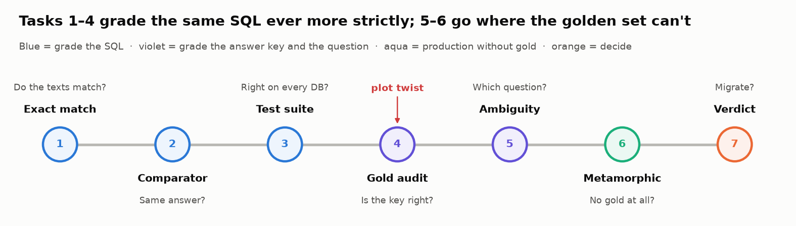
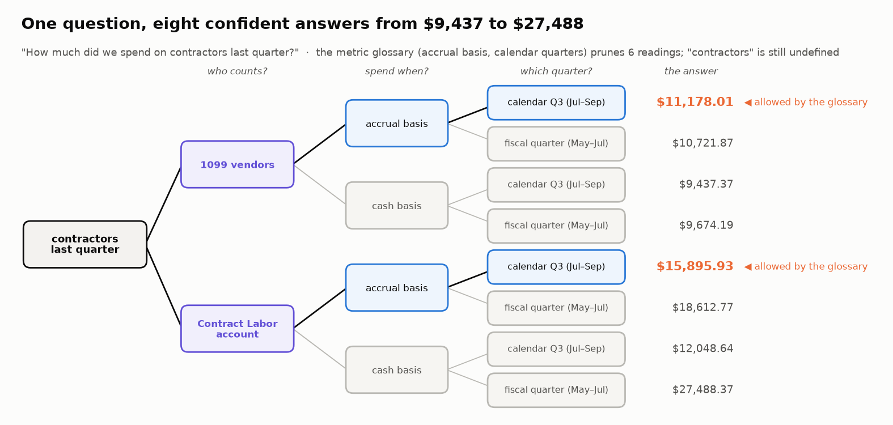
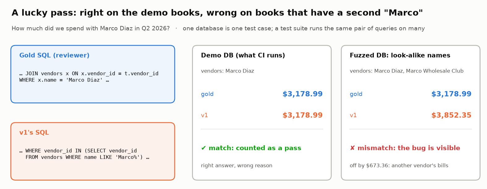

# 🧾 Module 04c: Ask Your Books: Evaluating Text-to-SQL Analytics

> **Lab:** [`labs/04c-text-to-sql-analytics-lab.ipynb`](../../labs/04c-text-to-sql-analytics-lab.ipynb) · **Supplemental lab after Module 04** · **Time:** 85–100 min · **Keys needed:** none (SQLite in memory, recorded model outputs); optional OpenAI / Anthropic key to let a real model write the SQL



---

## 🧭 Overview

Module 04 evaluated assistants that answer from **documents**. This module evaluates assistants that answer from **data**. In a **text-to-SQL** (also called **NL2SQL**) feature, a model turns a plain-English question into a SQL query, the query runs on the customer's own database, and the result becomes the answer. The model never makes up the number; the database computes it. That makes the SQL the thing to evaluate, and SQL is surprisingly hard to grade.

The lab is built around one decision. **Ledgerly Ask** (a fictional assistant inside fictional bookkeeping software) answers owners' questions about their books. The model behind the current version (**v1**) is being retired by its provider, so the team must migrate to **v2**. CI says v2 scores **64%** against v1's **80%** on the golden set and blocks the migration. You grade the same 50 questions five ways and watch the gap change sign:

| Task | Layer | The question it answers |
|---|---|---|
| 1 | Exact match | Do the SQL texts match? |
| 2 | Execution accuracy + a comparator you write | Do the results match? |
| 3 | Test-suite accuracy + a fuzzer you write | Do they match on *every* realistic database? |
| 4 | Gold audit | Is the answer key itself right? |
| 5 | Ambiguity | Does the question have more than one right answer? |
| 6 | Metamorphic checks + one you write | Can you catch wrong answers with no answer key at all? |
| 7 | Paired decision | Should you migrate, and with which guards? |

---

## 💡 Why This Matters

"Ask your data" features are now standard in accounting, tax and finance products. Intuit has said publicly that its QuickBooks assistant answers business-intelligence questions by querying the customer's real data rather than generating numbers with an LLM (VentureBeat, Oct 2025). The design is sound, but it moves the risk: a model that writes a slightly wrong `WHERE` clause produces a **precise, confident, wrong number**, and nobody re-checks a number that looks right.

The lab shows four ways a text-to-SQL score can mislead you, each with numbers from the run:

- **Exact match measures handwriting.** v1 matches the answer key's SQL text on 68% of questions, v2 on 6%, though both often return the same number.
- **One database hides bugs.** A query that forgets to exclude voided bills is "right" on demo data that has no voided bills. A suite of fuzzed databases removed 6 of v1's passes and 7 of v2's.
- **The answer key can be wrong, and biased.** 10 of 50 gold answers are wrong. Eight of them were v1's own drafts that a reviewer approved, so v1 "agrees" with them. Against the truth, v2 scores **80%** and v1 **56%**.
- **Some questions have several right answers.** "How much did we spend at Mercato last quarter?" has readings that differ by **4×**. v1 states which reading it used on 1 of 10 ambiguous questions.

The same problems appear in public benchmarks. A 2026 audit found annotation errors in over half of a popular text-to-SQL benchmark's dev examples. Correcting them moved agents up to 9 places on the leaderboard (Jin et al., 2026).

---

## 🎯 Learning Objectives

After this module you will be able to:

1. Explain why **exact match** on SQL text measures style, and why **execution accuracy** on one database measures luck as well as correctness.
2. Write and unit-test a **result-set comparator** (cents, row order, column order, errors).
3. Build a **test suite** of fuzzed databases and explain how it removes lucky passes, and how it amplifies a wrong answer key.
4. **Audit an answer key** against an independent source of truth, and recognize gold errors that are **correlated** with one model.
5. Grade **ambiguous** questions against a set of acceptable readings, and score whether the answer **states its reading**.
6. Write a **metamorphic** consistency check that finds bugs without gold, and name its blind spot.
7. Make a **paired**, evidence-based model-migration decision.

---

## 📋 Prerequisites

- ✅ Module 04 (retrieval, abstention) and Lab 03's idea that a comparator is part of the metric. Lab 05b's paired comparison helps in Task 7 (it is re-explained there).
- 🗄️ Reading basic SQL: `SELECT`, `WHERE`, `JOIN`, `GROUP BY`, `SUM`. You won't write queries from scratch.
- 📒 **No accounting background required.** Each bookkeeping term is defined below and in the lab's jargon decoder.

---

## 🧠 Key Concepts

### 1. Five ways to grade the same SQL

| Layer | Passes a prediction if… | What it can't tell you |
|---|---|---|
| **Exact match (EM)** | its SQL text equals the gold SQL text (after trimming case and spaces) | whether two *different* queries give the same answer |
| **Strict execution** | Python `==` on the two result sets is `True` | that `774.6800000000001` and `774.68` are the same money |
| **Execution accuracy (EX)** | the result sets match under a sensible **comparator**, on one database | whether the match is luck (the bug's trigger data isn't there) |
| **Test-suite accuracy** | results match on **every** database in a suite of varied databases | whether the gold itself is right |
| **Audited** | results match a trusted source of truth on every database | ambiguity: whether the question has one right answer |

### 2. The comparator is part of the metric

A comparator decides what "the same answer" means. Reasonable rules for money questions: numbers equal to the cent; column order ignored; row order ignored **unless** the question asks for a ranking ("top 3"); the same number of rows (returning every vendor's total isn't answering the question about one vendor); an error never matches. An **over-lenient** rule (pass if the gold's values appear anywhere in the prediction) inflates scores by passing exactly those return-everything answers.

### 3. Lucky passes and test suites

A **lucky pass** is a wrong query that returns the right number on the test database because the data that would expose the bug isn't there. **Test-suite accuracy** (Zhong, Yu & Klein, 2020) runs each prediction on several databases built to differ in exactly the ways that expose bugs. In this lab a **fuzzer** copies the books and injects one kind of edge case:

| Fuzzer | What it injects | Bug it exposes |
|---|---|---|
| `void_and_draft` | voided and unapproved copies of real entries | forgetting `status = 'posted'` |
| `last_day` | entries at 11 pm on the last day of each month | `txn_date BETWEEN '…-01' AND '…-30'` on a timestamp drops the last day |
| `credits` | vendor credits and customer refunds | adding credits instead of subtracting them |
| `sibling_vendors` | a second vendor whose name starts with the same word | `name LIKE 'Marco%'` |
| `no_vendor` | card expenses with no vendor on file | an inner `JOIN vendors` that silently drops them |
| `january_clock` | "today" moved to January | "last month = this month − 1" (month 0) |
| `jitter` | every amount redrawn | coincidences in the demo amounts |

A test suite is stricter in both directions. It also fails a *correct* prediction whenever the **gold** is wrong on some database, so it makes a bad answer key louder.

### 4. Auditing the answer key

Gold answers are written by someone, sometimes by the current model (a common shortcut: generate drafts, have a person approve them). To audit the key you need a source of truth that doesn't share its mistakes. In the lab that is the product's **report engine** (the existing, reconciled vendor and account reports). The dangerous case is **correlated** gold errors. When the incumbent drafted the key, its mistakes are in the key, so it is rewarded for repeating them and a better model is penalized for getting them right.

### 5. Ambiguity, readings and the metric glossary

A **reading** is one valid interpretation of a question. Bookkeeping questions are full of them:

- **"Contractors"**: the vendors you file a **1099-NEC** for (self-employed people paid for services), or the **Contract Labor** expense account (which may include a staffing agency, a corporation that gets no 1099)?
- **"Spend"**: **accrual basis** (count it when the bill arrives) or **cash basis** (count it when you pay)?
- **"Last quarter" / "this year"**: calendar, or **fiscal** (Harbor & Pine's fiscal year starts 1 February)?

A **metric glossary** (also called a semantic layer) writes the house definitions into the model's prompt and removes some readings. Grade the rest with a **reading set** (any acceptable reading passes) **plus disclosure** (the answer says which reading it used, or asks).



### 6. Metamorphic checks: testing without gold

A **metamorphic relation** connects several answers: a quarter's total must equal the sum of its three months, and two phrasings of a question must agree. A violation proves something is wrong, with no answer key, so you can run it on production traffic. Its blind spot is the **systematic** bug: a model that makes the same mistake everywhere satisfies the relation perfectly.

### 7. Deciding on paired evidence

Both models answered the same questions, so compare them question by question (Lab 05b). Only **discordant pairs** carry information: questions v2 fixed and questions it broke. The exact **McNemar test** asks whether the split could be a coin toss; a **Wilson interval** puts an error bar on each pass rate (about ±11 points on 50 questions).

---

## 🔍 Example Walkthrough

**The question:** *"How much did we spend with Marco Diaz in Q2 2026?"*

```sql
-- Gold (reviewer)
... JOIN vendors x ON x.vendor_id = t.vendor_id
WHERE x.name = 'Marco Diaz' AND t.status = 'posted' ...

-- v1
... WHERE vendor_id IN (SELECT vendor_id FROM vendors WHERE name LIKE 'Marco%') ...
```

On the demo books both return **$3,178.99**: execution accuracy says v1 passes. Exact match says it fails (different text). Neither is telling you the truth about v1.



Now add one realistic edge case: a second vendor whose name starts with "Marco". The gold still says $3,178.99; v1 says **$3,852.35**, because its `LIKE` picks up the other vendor's bills. The bug was always there; the demo data just never contained its trigger.

The lab then asks the same question of the **answer key**: on 10 of the 50 questions the gold itself fails this kind of test, and on 8 of those v1 wrote the gold.

---

## ⚠️ Common Mistakes or Misunderstandings

| Mistake | Why it's wrong | Do this instead |
|---|---|---|
| Gating on exact match | It rewards whoever writes like the answer key | Grade results, not text |
| Comparing results with `==` | Float noise and column order fail correct answers | Write and unit-test a comparator |
| "It passed on our test DB" | One database is one test case; missing edge cases mean invisible bugs | Fuzz the edge cases your data really has |
| Trusting a stricter metric blindly | Test-suite accuracy also amplifies a wrong gold | Audit the key before comparing models |
| Seeding the golden set with the current model's outputs | The key inherits that model's errors and favors it | Write golds independently, or audit against a trusted source |
| Single gold for ambiguous questions | It grades which reading the model guessed | Reading set + "states its reading" |
| Reading "consistent" as "correct" | Systematic bugs satisfy every relation | Metamorphic checks in production, fuzzed suites in CI |
| Comparing two pass rates side by side | Ignores that both models answered the same questions | Paired comparison: fixed vs broke, McNemar |

---

## 🚀 Before You Start the Lab

- Open the lab in Colab and use **Runtime → Run all** once; it finishes in seconds and needs no keys.
- Skim the **schema** and **metric glossary** in the Scenario section. Every bug in the lab is a violation of one glossary line.
- Three exercises have safe fallbacks: **2A** (comparator), **3A** (fuzzer), **6A** (metamorphic check). If you're short on time, read the hints and move on; later tasks still run.
- Make the 🔮 predictions *before* running each cell. The lab is designed so that at least two of them will be wrong.

---

## 🔑 Key Takeaways

1. **Grade answers, not SQL text.** Exact match rewards whoever writes like the answer key.
2. **The comparator is part of the metric.** Decide cents, column order, row order and errors on purpose, and unit-test it.
3. **One database is one test case.** Fuzz in voids, month-end timestamps, credits, look-alike names, missing vendors and a January clock.
4. **Audit the answer key before any model comparison.** A key drafted by the incumbent is biased toward the incumbent.
5. **Ambiguous questions need a reading set and a stated reading.** Measure the spread first; grow the glossary where it's large.
6. **No gold in production? Check relations.** They catch sporadic slips and miss systematic ones.
7. **Make migration calls on paired, audited evidence**, with the guards written into the verdict.

**Sources:** Kumar et al., *BookSQL* (NAACL 2024); Zhong, Yu & Klein, *Semantic Evaluation for Text-to-SQL with Distilled Test Suites* (EMNLP 2020); Jin, Choi, Zhu & Kang, *Pervasive Annotation Errors Break Text-to-SQL Benchmarks and Leaderboards* (arXiv 2601.08778, 2026); Saparina & Lapata, *AMBROSIA* (NeurIPS 2024); Pei et al., *ROSE* (ACL 2026); Snowflake Engineering, *Cortex Analyst: Evaluating Text-to-SQL Accuracy* (2024); VentureBeat, *Intuit learned to build AI agents for finance the hard way* (Oct 28, 2025).
