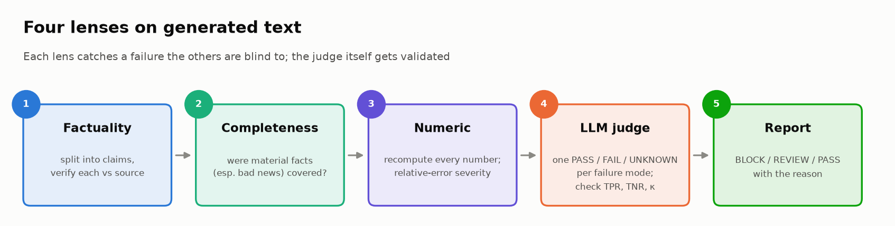
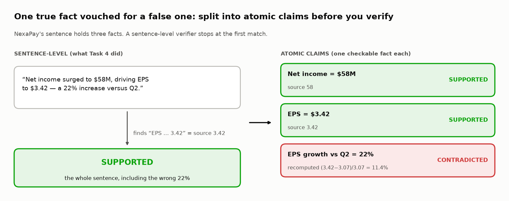
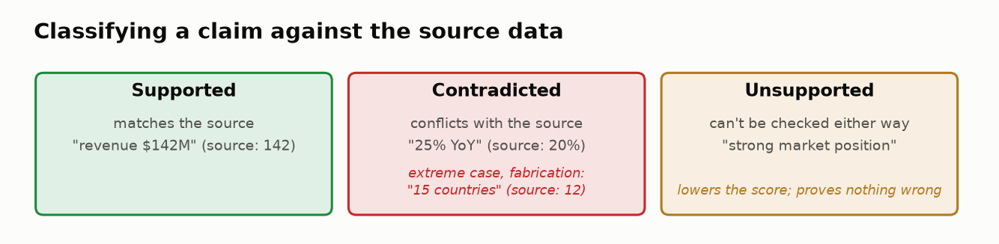
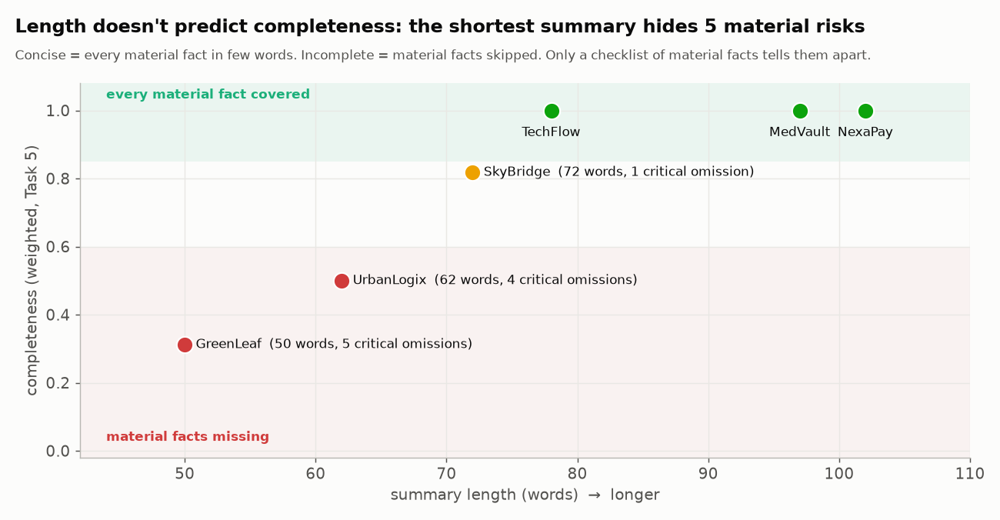
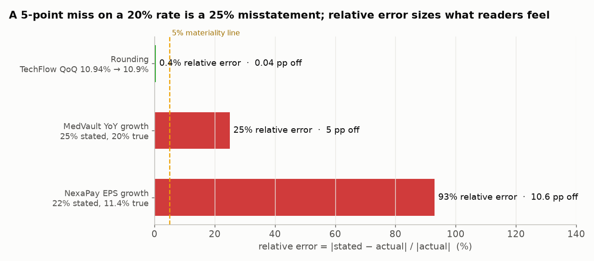
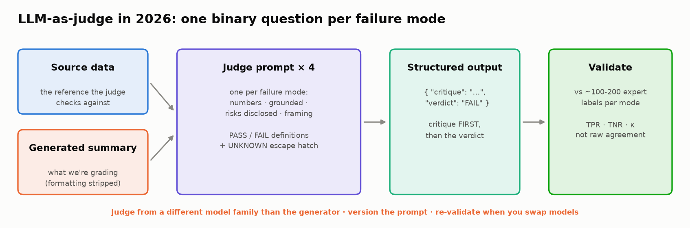
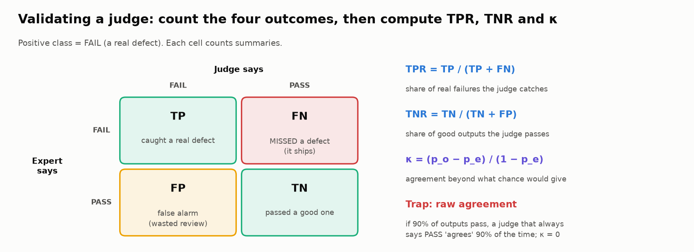
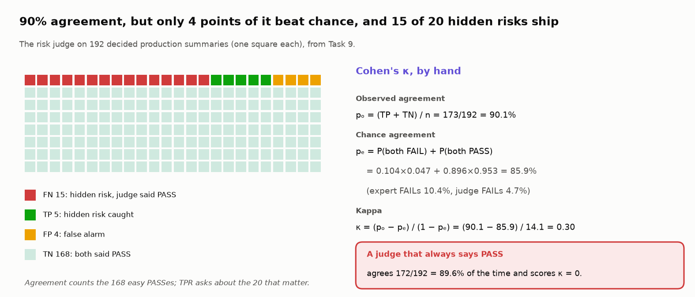

# ✍️ Module 05: Evaluating Generative Outputs

> **Lab:** [`labs/05-generative-outputs-lab.ipynb`](../../labs/05-generative-outputs-lab.ipynb) · **Time:** 60–75 min core (+45 min for the five challenges) · **Tools:** Python, `pandas`, `scikit-learn`, `pydantic` · **Keys needed:** none (a simulated judge runs offline; real OpenAI/Anthropic judges are optional)



---

## 🧭 Overview

Free-form text is the hardest output to evaluate: there's no schema, no single right answer, and the most dangerous errors are written in the most convincing prose.

In this module you'll evaluate LLM-written **quarterly earnings summaries** for six companies, sent to portfolio managers who make investment decisions from them. You'll build four complementary evaluators, **validate the LLM judge itself** against expert labels, and end with a decision: can the judge replace human review?

| Lens | Question | Catches |
|---|---|---|
| 🔍 **Factuality** | Is what it says true? | Fabricated and contradicted claims |
| ✅ **Completeness** | Does it say everything it should? | Material omissions, especially bad news |
| 🔢 **Numeric reasoning** | Is every number right? | Mis-calculated growth rates, invented figures |
| ⚖️ **LLM-as-judge** | Did failure X happen? One PASS/FAIL check per failure mode | Misleading framing, hidden risks, anything code can't check |

---

## 💡 Why This Matters

Two real-world-style incidents frame the lab:

- 📈 A summary said revenue grew **15%**; the data said **8%**.
- 🙈 A summary omitted a **debt covenant waiver**, a serious risk signal.

The first is a *distortion* (a real fact with a wrong number); the second is an *omission*. The same pair shows up in tax and bookkeeping: a refund explanation with the wrong amount, and a quarter-end summary that never mentions the unpaid estimated tax. In finance (and medicine, law, compliance), omissions can be just as harmful as false statements: a summary can be **100% factually accurate and still deeply misleading**. GreenLeaf Energy in the lab is exactly that: every stated fact checks out, yet it hides a net-income collapse, $220M of debt, a covenant waiver and a CEO departure behind phrases like "healthy margins".

> 🧠 **The core idea:** generative evaluation is **multi-dimensional by necessity**. No single score (BLEU, ROUGE, "rate it 1–10") captures "true, complete, numerically sound, and fairly framed". And an LLM judge is itself a model with error rates: **you have to measure how often it's wrong before you let it gate anything.**

---

## 🎯 Learning Objectives

After this module you will be able to:

1. **Decompose** generated text into atomic claims and verify each against source data.
2. **Distinguish** fabrication, distortion and conflation, and label claims as supported / contradicted / unsupported.
3. **Design** completeness criteria that weight critical (especially negative) facts more heavily.
4. **Verify** numbers using **relative error** and severity tiers.
5. **Write** an LLM-judge rubric as **binary PASS/FAIL checks, one per failure mode**, with critique-then-verdict, structured output and an `UNKNOWN` escape hatch.
6. **Validate** a judge against expert labels with **TPR, TNR and Cohen's κ**, and explain why raw agreement and correlation mislead on imbalanced data.
7. **Probe** a judge for position, verbosity and formatting bias, and apply a mitigation.
8. **Combine** layers into BLOCK / HUMAN REVIEW / PASS decisions with explicit reasons, and decide which checks can run without a human.

---

## 📋 Prerequisites

- ✅ Modules 01–02 (scores, evaluators, *unsupported claim* as a failure category).
- 📊 Basic financial vocabulary helps (revenue, net income, EPS, YoY/QoQ growth, margin), but the lab explains what matters.
- 🐍 Python strings and regex basics.
- 🧮 A confusion matrix (true/false positives and negatives) helps; the lab explains it.

---

## 🧩 Key Concepts

### 1. 🧬 Claim extraction: the unit of factuality

You can't verify a paragraph; you verify **claims**. Claim extraction splits text into atomic, checkable statements:

> "Revenue grew 8.5% YoY to $89M, and operating margin remained healthy at 12.4%."
> → ① revenue = $89M ② YoY growth = 8.5% ③ operating margin = 12.4% ④ *"healthy"* (a judgment, not a fact)



Why "atomic" matters: verify a whole sentence and the first true fact in it can vouch for a false one. In the lab, "EPS to $3.42 — a 22% increase" is stamped *supported* because $3.42 is right; the 22% (truly 11.4%) slips through.

The lab uses sentence splitting plus keyword/number matching. Production systems typically use an LLM to extract claims and an LLM or NLI model to verify each (the same idea as RAGAS faithfulness). SAFE (Google DeepMind, NeurIPS 2024) does this at scale with search: it agreed with crowd annotators on 72% of ~16k facts, and on a sample of 100 disagreements it was right 76% of the time, at over 20× lower cost than human annotation.

### 2. 🏷️ Claim labels and hallucination types



| Hallucination type | What happens | Example |
|---|---|---|
| **Fabrication** | Details that don't exist in the source | "15 new countries" (source: 12) |
| **Distortion** | A real fact with wrong details | "25% YoY growth" (source: 20%) |
| **Conflation** | Mixing periods or entities | Q2 numbers presented as Q3 |

Each claim gets one of three labels: **supported** (matches the source), **contradicted** (conflicts with it; a fabrication such as "15 countries" is the extreme case) or **unsupported** (can't be checked either way, e.g. opinion).

The lab's factuality score = (supported − 2 × contradicted − 2 × fabricated) ÷ all extracted claims: a false claim costs double. Note what that means for **unsupported** claims: they lower the score without being proven wrong. Decide deliberately how to treat them.

> 🔎 **Verified-run insight:** the lab's keyword verifier flags NexaPay's "15 countries" (contradicted) but marks MedVault's "25% YoY" and NexaPay's "22%" EPS growth as **supported**, because each sentence also contains a true fact (the FDA approval; EPS of $3.42) that the verifier matched instead. One verified fact vouched for a false one. That's why claims must be **atomic** (one checkable fact each), and why you layer evaluators: the numeric layer catches both.

### 3. ✅ Completeness: what's missing matters



Each summary comes with a list of **key facts** it should cover. Completeness = weighted coverage, with **critical facts weighted 2×**:

```
completeness = Σ weight(covered facts) / Σ weight(all key facts)
```

| Summary | Facts covered | Completeness | Critical omissions |
|---|---|---|---|
| TechFlow | 10 / 10 | 1.00 | 0 |
| **GreenLeaf** | 4 / 10 | **0.31** | **5** (net-income collapse, $220M debt, cash vs. debt, covenant waiver, CEO exit) |
| MedVault | 11 / 11 | 1.00 | 0 |
| **UrbanLogix** | 6 / 10 | **0.50** | **4** (widening loss, negative margin, debt, 15% layoffs) |
| NexaPay | 11 / 11 | 1.00 | 0 |
| SkyBridge | 9 / 10 | 0.82 | 1 ($340M debt) |

**Completeness ≠ length.** A concise summary covers all **material** facts efficiently; an incomplete one skips material facts to *look* clean. And the **negative-information rule**: omitting bad news should cost more than omitting good news, because one-sided summaries mislead decisions.

**Keyword coverage reads words, not meaning.** The lab's reference scorer counts a fact as covered when half its words appear anywhere, so it credits GreenLeaf with "revenue declined quarter-over-quarter" (the words *revenue* and *over*, from "year-over-year", are present). Honest completeness is 0.19, not 0.31. Production scorers need an **entailment** check: does the summary actually *state* the fact?

### 4. 🔢 Numeric reasoning



LLMs don't calculate; they predict plausible-looking numbers. So recompute every number from the source and compare with **relative error**:

```
relative_error = |stated − actual| / |actual|
```

| Tier (lab) | Meaning | Example |
|---|---|---|
| ✅ exact / within rounding | fine | 10.9% for 10.94% |
| ⚠️ minor | small, usually acceptable | 6.1% for 6.06% (0.7% rel.) |
| ❌ major | material misstatement | 25% for 20% (25% rel.); 22% for 11.4% (**93%** rel.) |
| 🔴 fabricated | number with no source | invented figures |

Why relative, not absolute? "5 percentage points" sounds small, but 25% vs. 20% overstates growth by a **quarter**, enough to change an investment thesis.

### 5. ⚖️ LLM-as-judge: one binary check per failure mode



An LLM judge reads the source, the summary and a rubric, and returns a verdict. The 2026 practice (Husain/Shankar evals FAQ, Sept 2026) is **not** "rate the quality 1–5". It is **one PASS/FAIL question per failure mode** you've actually observed, each asked in its own judge call:

| Check | FAIL when… | Blocking? |
|---|---|---|
| `numbers_correct` | a figure or derived figure differs from the source beyond rounding | ⛔ yes |
| `grounded` | a specific company detail contradicts the source or is absent from it | ⛔ yes |
| `risks_disclosed` | the source shows a material negative the summary doesn't mention | ⛔ yes |
| `balanced_framing` | upbeat wording describes declining or negative metrics | ✏️ no (to an editor) |

**Why binary beats 1–5.** A Likert scale needs a ship threshold, and decisions flip when you move it. In the lab, the old 1–5 judge at the usual ≥ 3.5 bar ships MedVault (a 25%-vs-20% misstatement averages out to "3.5"); at ≥ 3.25 NexaPay ships too. A binary check has no threshold, and every FAIL names its failure mode. HealthBench (OpenAI, 2025) applies the same idea at scale: 48,562 physician-written criteria, each graded met / not met.

Three design rules:

- **Critique, then verdict.** The structured-output schema puts a `critique` field (quote the evidence) *before* `verdict`, so the reasoning is written before the decision and you can audit it.
- **An `UNKNOWN` escape hatch.** When the source can't settle the question (MedVault's "among the best in the sector" can't be checked against company data), the judge says UNKNOWN and a human decides. Without that option, the schema forces a guess.
- **Give the judge the reference.** On JudgeBench (ICLR 2025), GPT-4o with a simple prompt judged hard correctness pairs at about chance (~50%). A judge can only verify what it can solve or look up.

Practical hygiene: use structured outputs (OpenAI `responses.parse(..., text_format=Model)`, Anthropic `messages.parse(..., output_format=Model)`), keep model IDs in one config cell, version the prompt, and **don't rely on `temperature=0`**: current Claude models reject sampling parameters, and temperature 0 was never deterministic anyway. Reproducibility comes from fixed test sets and validation, not from a setting.

### 6. 🧪 Meta-evaluation: validate the judge with TPR, TNR and κ



On the six curated summaries, the binary judge matched the expert on 22 of 23 decided verdicts (and last quarter's 1–5 judge correlated r ≈ 0.99 with the expert). Six hand-picked cases can't tell you how often a judge misses a *rare* failure, so the lab validates it on **200 expert-labeled production summaries**. Treat **FAIL as the positive class**:

- **TPR** (recall) = share of real failures the judge catches. A miss means a defect ships.
- **TNR** (specificity) = share of good outputs it passes. A miss means a wasted review.
- **Raw agreement** = share of verdicts where judge and expert match. On imbalanced data the majority class dominates it.
- **Cohen's κ** = agreement beyond chance: κ = (p_o − p_e) / (1 − p_e), where p_o is observed agreement and p_e the agreement the two raters' **base rates** (how often each says FAIL) would produce by luck. 1 = perfect, 0 = no better than chance (an always-PASS judge scores 0).

The plot twist from the verified run:

| Failure mode | Raw agreement | Always-PASS baseline | TPR | TNR | κ |
|---|---|---|---|---|---|
| numbers_correct | 96.5% | 85.0% | 86.7% | 98.2% | 0.86 |
| grounded | 97.9% | 91.7% | 75.0% | 100% | 0.85 |
| **risks_disclosed** | **90.1%** | **89.6%** | **25.0%** | 97.7% | **0.30** |
| balanced_framing | 94.0% | 88.0% | 70.8% | 97.2% | 0.71 |

The risk judge "agrees with the analysts 90% of the time", and a judge that **never reads the summary** scores 89.6%. Only 20 of 192 summaries hide a risk, so agreement is dominated by easy PASSes. It catches **5 of 20** hidden risks (95% CI roughly 11–47%: 20 FAIL labels is too few to be precise).



Worked: p_o = 173/192 = 90.1%; with the expert saying FAIL 10.4% of the time and the judge 4.7%, chance agreement is p_e = 0.104 × 0.047 + 0.896 × 0.953 = 85.9%; κ = (90.1 − 85.9) / (100 − 85.9) = **0.30**. Of the 90 points of agreement, the judge earned about 4.

**Same judge, different data.** Agreement and κ depend on how often failures occur; TPR and TNR don't. With this judge's TPR (25%) and TNR (97.7%), a rubber stamp that always says PASS out-agrees it whenever fewer than 8.5% of summaries hide a risk (the crossover is FPR / (TPR + FPR)). So a better summarizer makes a bad judge's agreement look *better*. Compare judges across datasets and quarters by TPR and TNR. The lab's 🎛️ dashboard lets you drag the failure rate and watch it happen.

> 📏 **Rules of thumb.** Report TPR, TNR and κ per failure mode, never raw agreement or correlation. Label 100–200 examples per mode, with roughly 30–50 FAILs in each of the dev and test splits. This course's bar for letting a judge gate a release-blocking mode on its own: κ ≥ 0.7 and TPR ≥ 0.8. And remember the ceiling: in HealthBench, model–physician agreement was about the same as physician–physician agreement (~55–75%), so measure two humans on a slice too.

**Then read the misses.** Slicing the risk judge's errors shows they aren't random: it caught 4 of 4 headline omissions (revenue fell) but only **1 of 16** omitted risk *events*, all listed last in the source. The framing judge caught 15 of 16 spin summaries in prose but only **2 of 8** in markdown. A specific blind spot suggests a specific fix ("list every event in the source first, then check each").

### 7. 🧲 Judge bias probes

A **bias probe** changes something that shouldn't matter and measures how far the judge moves. With pairwise judging of two summaries that contain identical facts, a fair judge picks each side 50% of the time:

| Probe | Change | 2026 evidence |
|---|---|---|
| Position | swap the order | Small for frontier judges (≤ 0.04 in a TMLR 2026 study) |
| Verbosity | pad one side with fluff | **Direction depends on the judge**: some prefer longer answers (+0.24 to +0.44), Claude Sonnet 4 preferred concise ones, GPT-4o was about neutral |
| Formatting | same words as markdown bullets + bold | **The dominant bias**, far exceeding position bias |

In the lab's simulation, markdown moved every judge 31–36 points while order moved them ≤ 5; stripping the formatting before judging removed the effect. **Normalize formatting, and re-run the probes whenever you change judge model or prompt.**

Other known biases: **self-preference** (judges favor their own model family; use a judge from a different family, or a panel). PoLL (Cohere, 2024) found a panel of three small judges from different families beat a single GPT-4 judge at over 7× lower cost; a panel only helps if its members fail *differently* (three copies of the same judge share one blind spot).

### 8. 📋 Combining into decisions

The combined report gives each summary BLOCK / HUMAN REVIEW / PASS and records **which layer caught it**. Verified result: **1 PASS (TechFlow), 5 BLOCK**:

| Company | Decision | Caught by |
|---|---|---|
| TechFlow | ✅ PASS | — |
| GreenLeaf | ⛔ BLOCK | completeness, judge |
| MedVault | ⛔ BLOCK | numeric, judge (judge said UNKNOWN on the sector claim) |
| UrbanLogix | ⛔ BLOCK | completeness, judge |
| NexaPay | ⛔ BLOCK | claims, numeric, judge |
| SkyBridge | ⛔ BLOCK | **completeness only**: the judge missed its $340M debt |

A judge-only gate would have shipped SkyBridge. The lab's final verdict on "replace analyst review with the judge" is **🛑 BLOCK**: automate `numbers_correct` (the only mode that clears the bar), keep the deterministic gates, keep humans on the rest, and route every UNKNOWN to a person. Regulators point the same way: the IRS Office of Professional Responsibility (June 2026) tells tax practitioners to validate AI output's factual assertions.

---

## 🧪 Example Walkthrough: GreenLeaf Energy

> "GreenLeaf Energy posted Q3 2025 revenue of $89M, growing 8.5% year-over-year. Operating margin remained healthy at 12.4%. EPS came in at $0.38. The company has $45M in cash…"

| Lens | Result | Why |
|---|---|---|
| 🔍 Factuality | 0.57: no contradictions | Every stated number is right |
| ✅ Completeness | **0.31**, 5 critical omissions | Hides the decline, debt, waiver, CEO exit |
| 🔢 Numeric | 4/4 correct | 8.5% YoY is right (8.54%) |
| ⚖️ Judge | numbers ✅ · grounded ✅ · **risks ⛔ · framing ⛔** | "Remained healthy" while income fell 59% |
| 📋 Decision | ⛔ **BLOCK** | Critical omissions (two layers agree) |

A factuality-only evaluator would have shipped it.

---

## ⚠️ Common Mistakes or Misunderstandings

| ❌ Mistake | ✅ Instead |
|---|---|
| "All the facts are right, so it's good." | Also check completeness and framing; omission can mislead. |
| Verifying whole sentences | Extract **atomic** claims; one true fact can vouch for a false one. |
| Treating all numeric errors equally | Use relative error and severity tiers. |
| "Rate the quality 1–5" as the judge prompt | One PASS/FAIL check per failure mode, critique first, `UNKNOWN` allowed. |
| Trusting a judge because agreement is 90% or correlation is 0.99 | Compute TPR, TNR and κ per mode; compare against an always-PASS baseline. |
| Validating a judge on a handful of curated examples | ~100–200 labels per mode, with enough FAILs (30–50 per split). |
| "Temperature 0 makes the judge deterministic." | It doesn't; validate the judge and fix the test set instead. |
| "Position bias is the big one." | In 2026 data, formatting/style bias dominates; verbosity bias depends on the judge. |
| Using the generator model as its own judge, unvalidated | Prefer a different family or a panel, and validate against human labels either way. |
| Averaging all dimensions into one score | Gate on blocking checks; report the pass-all rate and reasons. |

---

## 🚀 Before You Start the Lab

- 📖 Skim the **source data** for GreenLeaf before Task 3; the lab hinges on what the summary leaves out.
- ✍️ Tasks 5 and 7 are **design** tasks with no single right answer. Commit to your criteria *before* you see the reference implementation.
- 🔮 Fill in the **prediction card** in Task 1 (five numbers), and answer each task's **Predict** prompt before running it. Key Takeaways scores your card; the surprises are the point.
- 🧰 Collapsed cells (titled `🧰 …`) are plumbing: data, mock judges, chart code. They run under *Run all*; read the short cells instead, each of which marks the line that matters with `👀 Look at:`.
- 📘 Six **Concept** blocks define a term where the lab first leans on it (atomic claim, relative error, binary check, TPR/TNR, κ, bias probe); the glossary below backs them up.
- 🏦 Each task has an **In your world** line mapping it to tax, bookkeeping or credit work. Two of the five challenges are built that way: Challenge 1 (a bakery's bookkeeping summary) and Challenge 4 (a refund explanation's wrong number).
- 🏆 The lab ends with **five challenges**. Do 1 and 4 first (10 minutes each); 3 and 5 are the hard pair: fix the risk judge, then find what its perfect score never measured.
- 🔍 Keep a note of every place an automated layer **misses** something you can see, including the judge.

---

## 🔑 Key Takeaways

1. 🔍 **Factuality ≠ completeness.** GreenLeaf is accurate and misleading at the same time.
2. 🧬 **Verify atomic claims, not sentences**, and decide explicitly how to treat unsupported claims.
3. 🔢 **Recompute numbers in code; judge by relative error.** LLMs predict numbers, they don't calculate them.
4. ⚖️ **One binary check per failure mode** beats a 1–5 score: no thresholds, and every FAIL names its cause.
5. 🧪 **Judge the judge** with TPR, TNR and κ on enough labels; raw agreement can't tell a good judge from one that always says PASS.
6. 🧲 **Probe for bias**: formatting dominates in 2026 data; normalize it before judging.
7. 🧱 **Layer your evaluators** and automate only the modes your validation supports.

**Next:** Lab 05b asks whether your judge's pass rate is *real*: confidence intervals, correcting the rate for the judge's own errors, paired tests, and how many labels you need.

---

## 🧠 Self-Check

<details>
<summary>1. A summary has a factuality score of 1.0 and completeness of 0.3. What kind of failure is this?</summary>

An omission failure: everything stated is true, but material information (often negative) is missing. It's misleading by selection.
</details>

<details>
<summary>2. Stated growth 22%, actual 11.4%. Absolute and relative error?</summary>

Absolute: 10.6 percentage points. Relative: 10.6 / 11.4 ≈ 93%. The summary nearly doubles the real growth.
</details>

<details>
<summary>3. 90% of outputs pass. A judge agrees with the expert 90% of the time. What do you check next, and why?</summary>

Its TPR and κ. A judge that always says PASS would also agree 90% of the time (κ = 0, TPR = 0). Raw agreement on imbalanced data is dominated by the majority class.
</details>

<details>
<summary>4. Why give the judge an UNKNOWN option?</summary>

So it can abstain when the source can't settle the question, instead of being forced by the schema to guess. UNKNOWNs go to a human and are reported separately from TPR/TNR.
</details>

<details>
<summary>5. Why should a judge come from a different model family than the generator (or be a cross-family panel)?</summary>

To reduce self-preference bias: models tend to rate text in their own style more favorably. A panel helps only if its members have *different* blind spots; validate each member either way.
</details>

---

## 📖 Glossary

**Claim** · an atomic, checkable statement. **Fabrication / distortion / conflation** · invented, altered, or mixed-up facts. **Supported / contradicted / unsupported** · verified true / verified false / uncheckable. **Completeness** · weighted coverage of material facts. **Relative error** · |stated − actual| / |actual|. **Failure mode** · a specific, observable way an output goes wrong; each gets its own binary check. **Critique-then-verdict** · the judge writes its evidence before its decision. **UNKNOWN** · the judge's abstention when the source can't settle the question. **TPR / TNR** · share of real failures caught / share of good outputs passed. **Cohen's κ** · agreement beyond chance. **Bias probe** · a change that shouldn't matter (order, length, formatting), used to measure a judge's bias. **PoLL** · a panel of LLM judges from different families. **Meta-evaluation** · evaluating an evaluator. **Entailment** · whether a text actually states or implies a fact (word overlap can't tell "a waiver was obtained" from "no waiver was obtained"). **Base rate** · how often a rater says FAIL at all. **Percentage points (pp)** · the plain difference between two percentages (25% vs 20% = 5 pp, a 25% relative error). **Debt covenant waiver** · lenders agree not to enforce a loan condition the company broke: a distress signal. **QoQ / YoY / EPS** · vs last quarter / vs the same quarter last year / net income per share.
