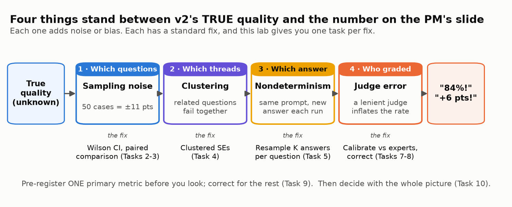
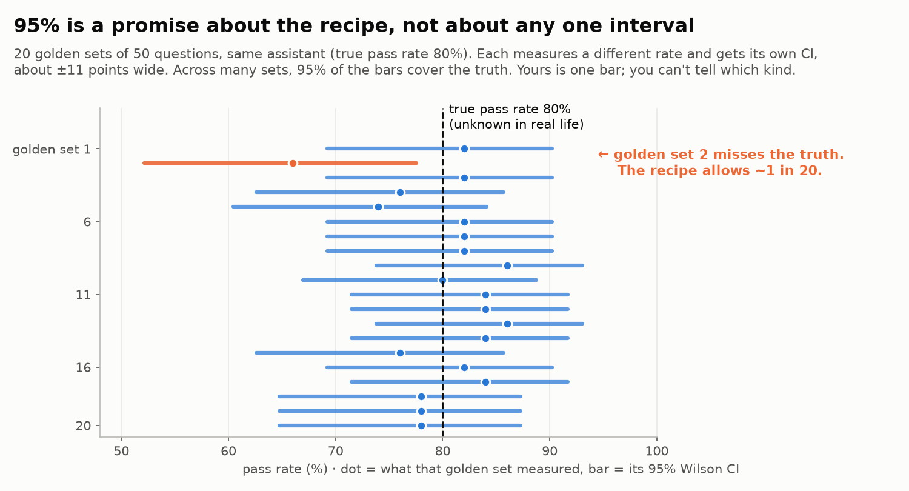
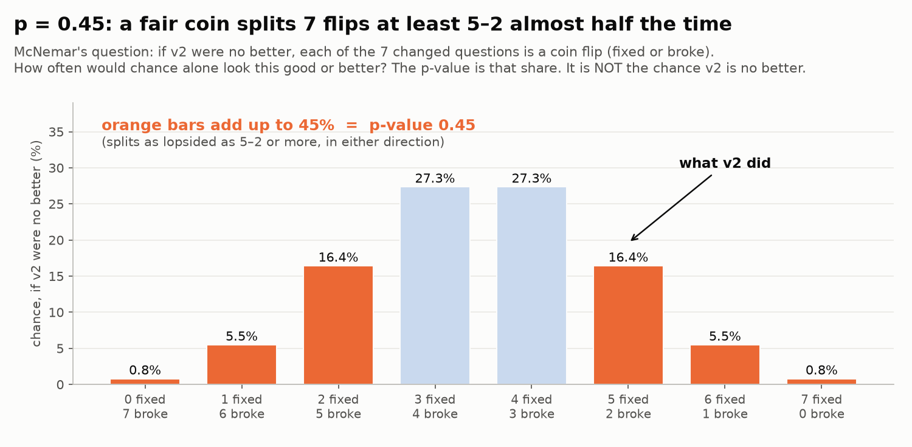
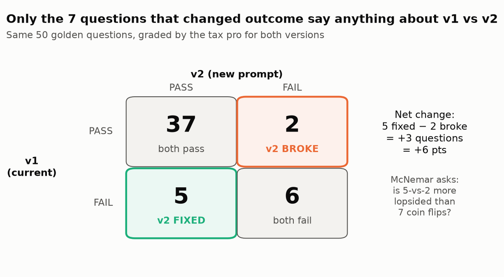
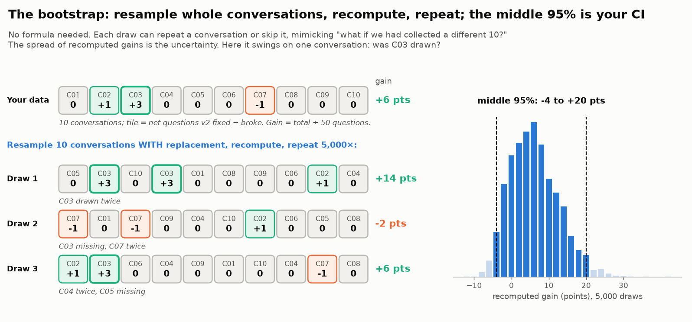
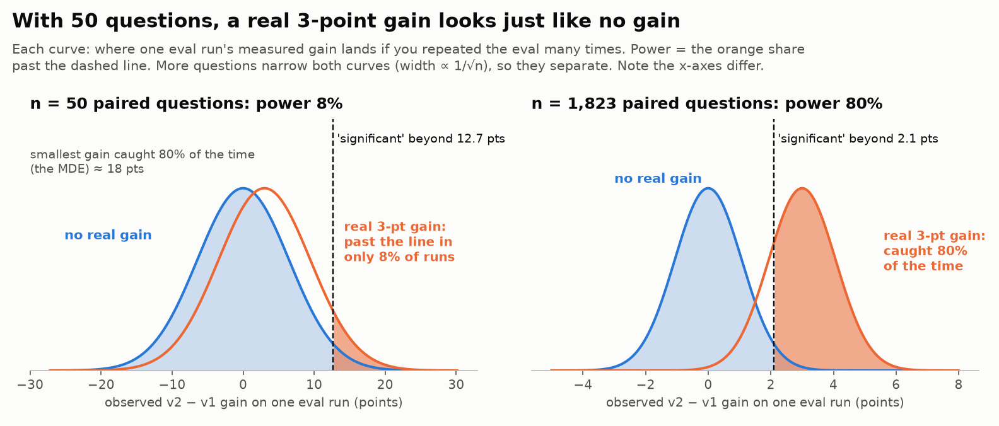
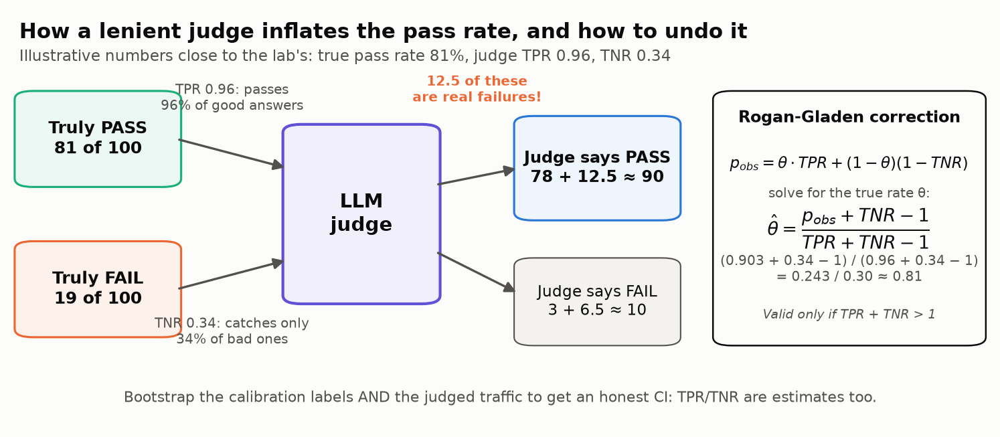

# 📏 Module 05b: Is It Really Better? Statistical Rigor and Judge Calibration for LLM Evals

> **Lab:** [`labs/05b-statistical-rigor-judge-calibration-lab.ipynb`](../../labs/05b-statistical-rigor-judge-calibration-lab.ipynb) · **Supplemental lab after Module 05** · **Time:** 70–85 min · **Keys needed:** none (seeded offline simulation); optional OpenAI / Anthropic key for the real-judge section



---

## 🧭 Overview

Module 05 taught you to grade generative outputs, including with an LLM judge. This module is about the **numbers those graders produce**: how much to trust a pass rate, a version-to-version comparison, and a judge-reported quality score.

The lab is built around one realistic decision. *Brightbook* (a fictional small-business accounting and tax suite) has an AI tax-help assistant. The PM posts:

> Prompt **v2** raises the pass rate on our 50-case golden set from **78% to 84%**, and the LLM judge says production quality is **90%**, above our 85% GA bar. Can we ship to everyone?

You take that message apart one source of error at a time:

| Part | Question | Tasks |
|---|---|---|
| A | Is the 6-point gain real? | Sampling noise, paired comparison, clustering, nondeterminism, sample size (1–6) |
| B | Can you trust the grader? | Judge calibration against a tax professional, judge-error correction (7–8) |
| C | Decide | Fake wins from many metrics and from peeking, policy-based verdict, eval report card (9–10) |

Because the data is simulated from fixed seeds, the lab can reveal the **true** answer at the end, so you can see whether your intervals caught it.

---

## 💡 Why This Matters

Most teams that ship LLM features compare prompt, model or fallback versions on golden sets of **50–200 cases**, and many let an LLM judge grade production traffic. Both habits produce numbers that look precise and aren't:

- On 50 cases, a single pass rate is about **±11 points** (95% CI). A "6-point improvement" can easily be noise.
- In the lab, the PM's entire +6 points is **5 questions fixed and 2 broken**, all of the net gain comes from **one conversation**, and re-running the same v2 on the same questions moves its score by **16 points**.
- A judge that agrees with the tax pro **85%** of the time catches only **12 of 35** real failures. A "judge" that always says PASS would score 82.5% agreement. Corrected for that, the judge's **90.1%** becomes **81.3%**: below the launch bar.

In a tax or accounting product, an inflated quality number isn't a rounding error. Wrong answers cost customers penalties and cost the company trust. The ship decision, the compliance report and the next roadmap all rest on these numbers.

---

## 🎯 Learning Objectives

After this module you will be able to:

1. Put a **Wilson confidence interval** on a pass rate and explain why small golden sets are noisy.
2. Compare two versions with a **paired** analysis (per-question differences, discordant pairs, McNemar test).
3. Compute **clustered standard errors** and an **effective sample size** when test cases share a conversation, document or customer.
4. Explain **nondeterminism** (temperature 0 is not deterministic) and reduce it by **resampling** answers per question.
5. Run a **sample-size (power) calculation** for the smallest change you care about.
6. Calibrate an LLM judge against expert labels with **TPR, TNR and Cohen's κ**, and benchmark it against **human-human agreement**.
7. **Correct a judge-reported pass rate** for judge error (Rogan-Gladen) with a **bootstrap** CI.
8. Control **multiple comparisons** (Holm) and **peeking**, and write a policy-based **eval report card** that supports a SHIP / BLOCK decision.

---

## 📋 Prerequisites

- ✅ Module 05 (LLM-as-judge, rubrics, meta-evaluation). Module 02's failure taxonomy helps.
- 🐍 Comfortable with Python, `numpy` arrays and `pandas` DataFrames.
- 📐 **No statistics background required.** Every concept below is explained from scratch, and the lab introduces each one right before you use it.

---

## 🧩 Key Concepts

### 1. 📏 A pass rate is an estimate: standard errors and Wilson intervals

Your golden set is a **sample** of the questions customers will ask. Draw a different 50 and you get a different pass rate. The **standard error** measures that wobble:

SE = √(p(1 − p) / n)  → for p = 0.80, n = 50: SE ≈ 0.057, so the 95% CI is about **±11 points**.

A **95% confidence interval** is a range built by a recipe that, across many golden sets, contains the true value 95% of the time. It covers sampling noise (which questions you drew), not grader bias (concepts 6–7). For small *n* or rates near 0% or 100%, use the **Wilson interval** rather than p ± 1.96·SE: it stays inside [0, 1] and its coverage is closer to 95%. The textbook formula gives a perfect 50/50 a CI of "100% to 100%"; Wilson says 92.9% to 100%. **Zero failures in 50 tests is still consistent with a ~6–7% failure rate** (rule of three: after 0 failures in *n*, the 95% upper bound is about 3/n).



| Golden set | Wilson 95% CI |
|---|---|
| v1: 39 / 50 = 78% | 64.8% – 87.2% |
| v2: 42 / 50 = 84% | 71.5% – 91.7% |

In the lab's simulation, when v2 is **exactly as good** as v1, **24%** of freshly built 50-case golden sets still show v2 winning by 6+ points.

> ⚠️ **Overlapping CIs are not a test.** The right comparison uses paired differences (next concept).

### 2. 🔗 Pair your comparisons

Both versions answered **the same** 50 questions. Use that:

- Compute each question's difference d = v2 − v1 (+1, 0 or −1). The SE of the mean difference is `std(d, ddof=1) / √n`. Shared difficulty (hard questions are hard for both) cancels out.
- Only **discordant pairs** carry information: questions v2 **fixed** (v1 FAIL → v2 PASS) and **broke** (v1 PASS → v2 FAIL).
- The **McNemar test** asks whether the fixed/broke split is more lopsided than coin flips. Its **p-value** is the chance of a split at least this lopsided if v2 were no better; it is not the chance that v2 is better.





In the lab: 5 fixed, 2 broke, McNemar **p = 0.45**. Pairing shrinks the standard error by **33%** (as good as **2.2×** more questions), but the paired CI is still **−4.3 to +16.3** points.

Formulas (Miller, 2024): unpaired SE = √(SE<sub>A</sub>² + SE<sub>B</sub>²); paired SE = √(SE<sub>A</sub>² + SE<sub>B</sub>² − 2·SE<sub>A</sub>·SE<sub>B</sub>·Corr). The more the two versions' scores correlate, the more pairing helps.

### 3. 🧺 Clustered questions: your effective n is smaller than your row count

The golden set is 10 conversations × 5 follow-up questions. If the assistant misreads the customer's situation in turn 1, the follow-ups fail together. A **clustered standard error** sums residuals *within each cluster* before squaring, so correlated questions can't pose as independent evidence. Two useful numbers:

- **SE inflation** = clustered SE / naive SE (lab: **2.0×**; Miller measured up to **3.05×** on the DROP benchmark).
- **Effective n** = n / inflation² (lab: 50 questions ≈ **12** independent ones).

An equivalent approach is the **cluster bootstrap**. A **bootstrap** resamples your data *with replacement* (an item can be drawn twice or not at all), recomputes the statistic, repeats thousands of times, and reads the CI off the middle 95%; the cluster version resamples whole conversations, not single questions.



 Always look at **which clusters drive a "win"**: in the lab, 100% of v2's net gain comes from one conversation.

### 4. 🎲 Nondeterminism: one answer per question is one roll of the dice

The same prompt and question can produce a correct answer on one run and a wrong one on the next. Temperature 0 does **not** fix this on hosted APIs: in Thinking Machines' 2025 experiment, 1,000 identical temperature-0 requests produced **80 distinct completions**, because server batch size varies with load.

In the lab, re-running the same v2 ten times on the same 50 questions gives scores from **76% to 92%**, 28 of 50 questions flip at least once, and the conversation that "produced" v2's gain turns out to be luck (v1 passes it 82% of the time on re-runs, v2 84%).

**Fix:** ask each question **K** times and average per question. Analyze the per-question averages. **Never treat the K × N answers as K × N independent cases.**

### 5. 🧮 Power analysis: size the eval before you build it

Pick the smallest change you'd act on (δ), a false-alarm rate (α = 0.05) and the chance of detecting a real change (power = 0.80). For a paired design (Miller, 2024):

**n = (z<sub>α/2</sub> + z<sub>β</sub>)² · Var(d) / δ²**  with z<sub>α/2</sub> = 1.96, z<sub>β</sub> = 0.84

where Var(d) = ω² + (σ²<sub>A</sub> + σ²<sub>B</sub>) / K. Here **σ²** is answer randomness within a question (it shrinks with K answers per question) and **ω²** is how much the true gain varies between questions. Miller's worked example (δ = 3 points, ω² = 1/9) needs **969 questions**. Read backwards, the same formula gives the **minimum detectable effect (MDE)** of a set of *n* questions: (z<sub>α/2</sub> + z<sub>β</sub>)·√(Var(d)/n).

| Design (lab's measured variance) | n for 3 pts | n for 5 pts | n for 10 pts | Smallest change n = 50 can detect |
|---|---|---|---|---|
| Unpaired (per version) | 2,669 | 961 | 241 | 22 pts |
| Paired, 1 answer per question | 1,823 | 656 | 164 | 18 pts |
| Paired, 5 answers per question | 437 | 157 | 40 | 9 pts |

Because n grows with 1/δ², halving the change you want to detect costs 4× the questions.



### 6. ⚖️ Judge calibration: TPR, TNR and κ, not raw agreement

Treat the judge as a classifier and the expert as ground truth. In this module **PASS is the positive class**:

| | Judge PASS | Judge FAIL |
|---|---|---|
| **Expert PASS** | TP | FN (too harsh) |
| **Expert FAIL** | FP (**lets a bad answer through**) | TN (catches it) |

- **TPR** = TP / (TP + FN): good answers passed.
- **TNR** = TN / (TN + FP): **bad answers caught**. In a tax product, the one that matters most.
- **Cohen's κ** = (agreement − p<sub>e</sub>) / (1 − p<sub>e</sub>), where p<sub>e</sub> is chance agreement from each rater's PASS rate. 0 = chance, 1 = perfect.

> ⚠️ Some teams make FAIL the positive class, which swaps the TPR/TNR names. State your convention.

> ⚠️ **κ can't tell which way a judge errs.** A lenient judge (TPR 0.96, TNR 0.34) and a harsh one (TPR 0.70, TNR 0.86) can share κ = 0.37 on the same labels; only TPR/TNR show that the lenient one lets 23 wrong tax answers through and the harsh one 5 (lab Challenge 2).

When most answers pass, raw agreement is dominated by easy PASS/PASS cases: with 82.5% expert PASS and 90.5% judge PASS, two raters who ignored the answers would agree 76% of the time by luck. Lab result: **85%** agreement, κ = **0.37**, TPR **0.96**, TNR **0.34**, while an always-PASS rubber stamp scores **82.5%** agreement. Two tax pros agree with κ = **0.79** on the same answers: that's the realistic ceiling (HealthBench found model-physician agreement about equal to physician-physician agreement). Practitioner guidance: one binary judge per failure mode, **100–200 labels** per failure mode, with roughly **30–50 PASS and 30–50 FAIL** examples in each of the dev and test splits.

### 7. 🔧 Correcting the judge's pass rate (Rogan-Gladen + bootstrap)

The judge's pass rate is a blend: true passes it caught plus failures it waved through. If the true pass rate is θ, the judge reports PASS on p<sub>obs</sub> = θ·TPR + (1 − θ)·(1 − TNR) of answers. Invert it:

**θ̂ = (p<sub>obs</sub> + TNR − 1) / (TPR + TNR − 1)**  (valid only if TPR + TNR > 1)



TPR and TNR are estimates too, so get the CI with a **bootstrap** that resamples both the expert-labeled calibration set and the judged production set. (The `judgy` Python package implements this; check your installed version's argument names.) Lab result: judge **90.1%** → corrected **81.3%**, bootstrap 95% CI **59%–93%**.

Two consequences:

- **The judge's own CI is precisely wrong.** ±1.3 points on 2,000 answers measures the judge, not the answers.
- **A weak judge hides change.** Observed change = true change × (TPR + TNR − 1), a quantity called Youden's J. With 0.30, a real 5-point regression looks like a 1.5-point blip. Improve the weaker of TPR and TNR first.

### 8. 🎯 Multiple comparisons

Test 10 metrics at p < 0.05 and the chance of at least one false alarm is 1 − 0.95¹⁰ ≈ **40%** (independent tests). Fixes: **Bonferroni** (compare each p to 0.05/10) or **Holm** (sort; multiply the smallest p by 10, the next by 9, …; never less powerful than Bonferroni). Better still: **pre-register one primary metric** and call the rest exploratory. In the lab, "asks for missing facts" looks like a win at p = 0.027; Holm-adjusted it's 0.27, and in the simulation it has no real effect. The lab's **p-hacking slot machine** manufactures such wins on demand: about 1 in 4 dashboards with *no* real change shows one.

**Peeking** is the same trap over time. Check a running no-difference test every day for 20 days, stop at the first p < 0.05, and the lab's simulation calls **20%** of tests "different" (4% if you look once). Fix the sample size in advance and look once, or use a sequential method built for repeated looks.

### 9. 📋 Decide with pre-written rules and a report card

Write the decision rule **before** looking at results, then let the evidence decide. A good report card states: the primary metric, the data (n, clusters, labels), each rate with its CI, the paired gain with its CI and fixed/broke counts, the smallest detectable change, the judge's TPR/TNR/κ, the corrected rate with its CI, how many secondary metrics were tested and survived correction, and the decision.

---

## 🧪 Example Walkthrough: the Brightbook decision (verified lab results)

| Step | What the PM saw | What the analysis shows |
|---|---|---|
| Pass rates | 78% → 84% | Wilson CIs 65–87% and 72–92%; 24% of do-nothing golden sets show a 6-pt "win" |
| Paired gain | +6 pts | 5 fixed, 2 broke; McNemar p = 0.45; paired CI −4.3 to +16.3 |
| Clustering | 50 cases | ≈ 12 effective cases; clustered paired CI **−7.1 to +19.1**; all net gain from conversation C03 |
| Re-runs | one run | Same v2 scores 76–92%; C03's "fix" disappears on re-runs |
| Sample size | "50 is plenty" | 50 cases detect only ~18-pt changes; 3 pts needs 1,823 paired questions (437 with 5 answers each) |
| Judge | "90%, above the bar" | κ 0.37, TNR 0.34; corrected **81.3%** (59–93%), below the 85% bar |
| Secondary metrics | "significantly better at asking for missing facts" | p = 0.027 → Holm 0.27; 24% of do-nothing dashboards show such a "win" |
| Monitoring | "let's check the A/B daily" | Daily peeks for 20 days: 20% false alarms vs 4% for one look |

**Policy verdict: 🛑 BLOCK.** The improvement isn't proven (v2 could be 7 points worse), the corrected quality is below the GA bar, and the secondary "win" is a false alarm. **Truth reveal (simulation only):** v2 really is **+2.0 points** better (about a third of the claim) and **81.3%** correct. Both of the learner's intervals contained the truth; both of the PM's point estimates missed it.

```python
# The core moves, in a few lines
d = v2 - v1                                              # per-question paired differences
se_paired = d.std(ddof=1) / math.sqrt(len(d))           # paired SE
n_needed = math.ceil((1.96 + 0.84) ** 2 * var_d / delta ** 2)   # power analysis
theta = (p_obs + tnr - 1) / (tpr + tnr - 1)              # Rogan-Gladen judge correction
```

---

## ⚠️ Common Mistakes or Misunderstandings

| ❌ Mistake | ✅ Instead |
|---|---|
| Reporting "84%" on 50 cases with no interval | "84% (95% CI 72–92%), n = 50" |
| Comparing two pass rates and their overlapping error bars | Paired differences, fixed/broke counts, McNemar or paired CI |
| Treating 50 questions from 10 conversations as 50 independent cases | Clustered SEs or cluster bootstrap; report effective n |
| Assuming temperature 0 makes runs reproducible | Resample K answers per question; average per question |
| Pooling K × N resampled answers as independent | Average within each question first |
| Building the golden set first, asking "is it big enough?" later | Power calculation first, sized for the smallest change you'd act on |
| "The judge agrees 85% of the time, so it's good" | TPR, TNR and κ against expert labels; compare with human-human κ |
| Putting the raw judge pass rate in a dashboard or compliance report | Rogan-Gladen corrected rate with a bootstrap CI |
| Using a judge's narrow Wilson CI as the uncertainty | Bootstrap over the calibration labels too |
| Testing 10 metrics and celebrating the one with p < 0.05 | One pre-registered primary metric; Holm for the rest |
| Checking a running test daily and stopping when it turns green | Fix n in advance (power analysis) and look once |
| Mixing up which class "TPR" refers to | State the convention (here: PASS is positive) |

---

## 🚀 Before You Start the Lab

- 🆓 Everything runs offline with no keys. Run the three setup cells first (imports, 🎨 Lab kit, 🧰 Lab harness).
- 🏆 Five 🌶️ challenge exercises at the end for those who want more: zero-failure bounds, same-κ judges, the delta-method SE, a failure queue that "improves" with no change, and an estimator that is 3.5× tighter until filing season changes the traffic.
- 🧰 Chart code, widget wiring and challenge checkers sit in collapsed 🧰 cells: they run with *Run All*, and the visible code is the statistics. Each new idea gets a short 📘 **Concept** block (what it is, what it can't tell you, an example) right before you use it.
- 🎛️ Two interactive cells: a **p-hacking slot machine** (Task 9) and a **judge slider** (Task 8). Both also draw a static view, so Run All works anywhere.
- 🧠 Four short exercises (3A paired CI, 6A sample size, 7A judge metrics, 8A deriving the judge correction). Each is followed by a ✅ check cell that falls back to a reference implementation if yours isn't ready, so **Run All always works**.
- 🔮 Task 1 asks you to lock in **five numeric predictions**; the lab scores them at the end. Each task also starts with a **Predict** prompt. Commit to a guess before running: the surprises are the point.
- 📝 Write down your own SHIP / BLOCK call in Task 1. You'll revisit it in Task 10.
- 🔌 The optional real-judge section uses `gpt-6-luna` (OpenAI Responses API) or `claude-haiku-5-5` (Anthropic) with structured outputs and no temperature. It's off by default (`PROVIDER = "mock"`).

---

## 🔑 Key Takeaways

1. 📏 **A pass rate without an interval is a rumor.** On 50 cases, ±11 points is normal.
2. 🔗 **Pair your comparisons** and report fixed / broke counts; the headline gain is usually a handful of questions.
3. 🧺 **Cluster** when cases share a conversation, document or customer. Effective n < row count.
4. 🎲 **One answer per question is one roll of the dice.** Resample; temperature 0 is not deterministic.
5. 🧮 **Size the eval before you build it.** About 1,000 paired questions to see 3 points; resampling cuts that substantially.
6. ⚖️ **Validate judges with TPR, TNR and κ** on enough FAIL examples; aim for human-human agreement, not 100%.
7. 🔧 **Correct the judge's pass rate** with a bootstrap CI before it reaches a dashboard or a compliance report.
8. 🎯 **Pre-register one primary metric**; Holm-correct the rest; don't stop a test the moment it turns green.
9. 📋 **Write the decision rule first**, then let the report card decide.

---

## 🧠 Self-Check

<details>
<summary>1. A golden set of 100 questions shows 80% pass. Roughly how wide is the 95% CI?</summary>

SE = √(0.8 × 0.2 / 100) = 0.04, so about ±7.8 points (roughly 72% to 88%).
</details>

<details>
<summary>2. v2 fixed 9 questions and broke 1 on the same 60 questions. What does McNemar test, and is it significant?</summary>

It tests whether a 9-vs-1 split of the 10 changed questions is more lopsided than fair coin flips. Two-sided exact p = 2 × P(X ≤ 1 | n = 10, p = 0.5) = 2 × 11/1024 ≈ 0.021, so yes at α = 0.05.
</details>

<details>
<summary>3. Clustering inflates your SE by 1.5×. What is the effective size of a 90-question golden set?</summary>

90 / 1.5² = 40 independent questions.
</details>

<details>
<summary>4. A judge has TPR 0.95 and TNR 0.60 and reports an 88% pass rate. What is the corrected rate?</summary>

(0.88 + 0.60 − 1) / (0.95 + 0.60 − 1) = 0.48 / 0.55 ≈ 87.3%.
</details>

<details>
<summary>5. Why can't you report the judge's Wilson CI on 2,000 answers as the uncertainty of the true pass rate?</summary>

It only reflects sampling of the 2,000 judged answers. It ignores the uncertainty in TPR and TNR, which come from a much smaller expert-labeled set and dominate the error, especially when TPR + TNR − 1 is small.
</details>

---

## 📖 Glossary

**Standard error (SE)** · how much an estimate would vary across samples. **Confidence interval (CI)** · a range whose recipe contains the true value in 95% of repeated samples. **Wilson interval** · a CI for proportions that behaves well for small n. **Paired comparison** · analysis of per-question differences on the same questions. **Discordant pairs** · questions whose outcome changed between versions. **McNemar test** · exact test on the fixed/broke split. **Clustered SE** · an SE that accounts for correlated cases within groups. **Effective n** · n / (SE inflation)². **Nondeterminism** · different outputs from identical inputs. **Power** · chance of detecting a real change of a given size. **δ** · the smallest change you want to detect. **MDE (minimum detectable effect)** · the smallest change a set of *n* questions can detect. **TPR / TNR** · share of expert-PASS answers the judge passes / expert-FAIL answers it fails. **Cohen's κ** · agreement corrected for chance. **Rogan-Gladen correction** · inverts judge error to estimate the true pass rate. **Bootstrap** · resampling the data many times to get a CI. **Holm correction** · step-down adjustment for testing many metrics. **Pre-registration** · naming the primary metric and decision rule before seeing results. **Rule of three** · after 0 failures in *n* tests, the 95% upper bound on the failure rate is about 3/n. **Delta method** · propagating input uncertainty through a formula via its derivatives. **Youden's J** · TPR + TNR − 1.
