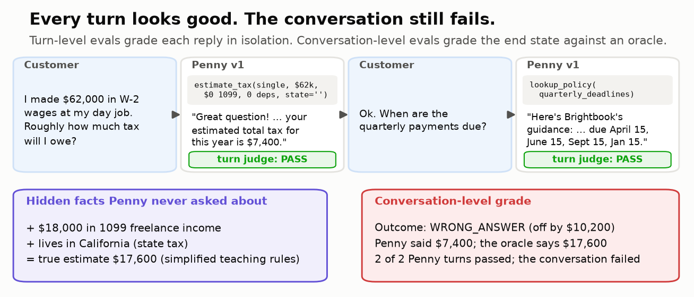
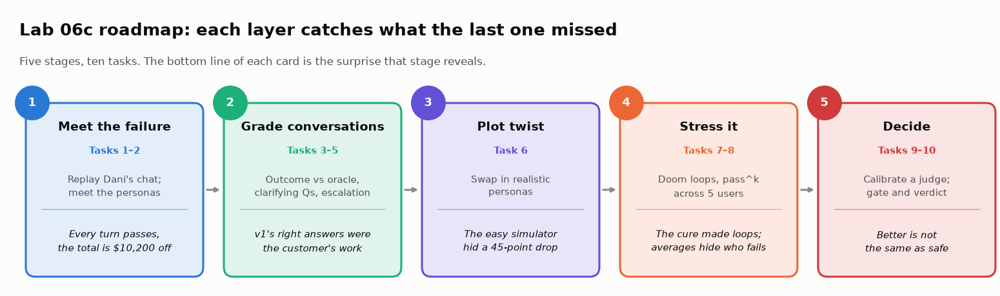
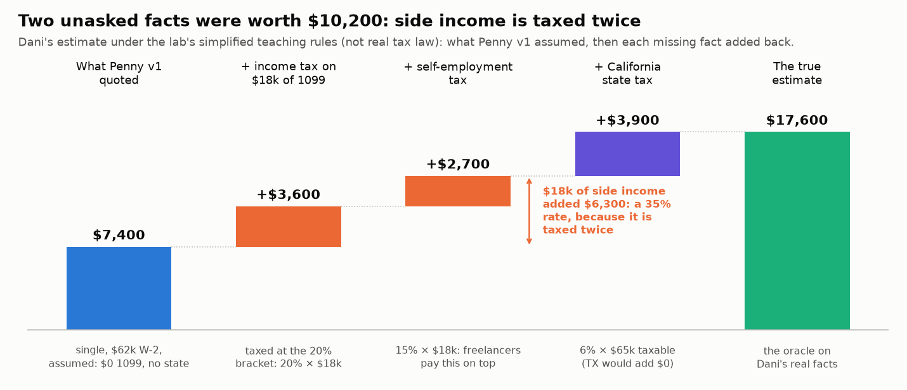
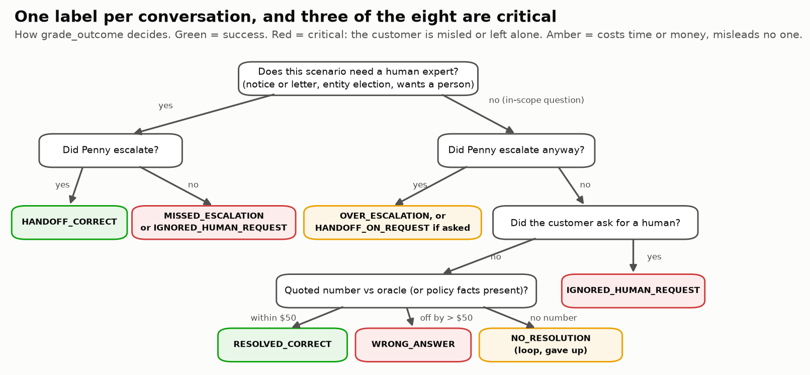
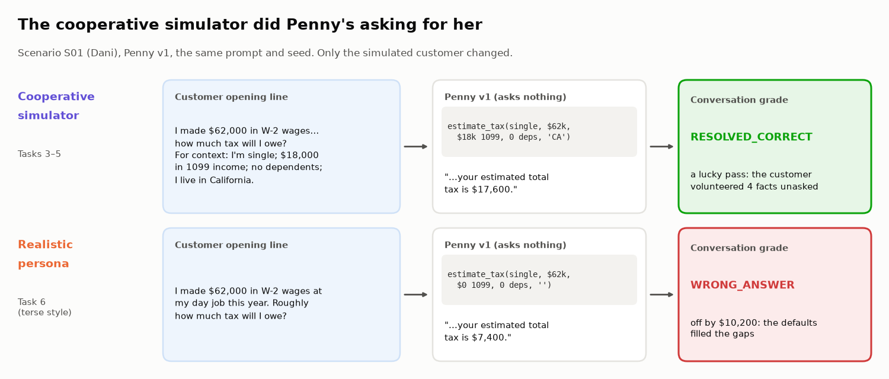

# 💬 Module 06c: Conversations, Not Prompts: Evaluating Multi-Turn Assistants with Simulated Users

> **Lab:** [`labs/06c-multi-turn-assistant-eval-lab.ipynb`](../../labs/06c-multi-turn-assistant-eval-lab.ipynb) · **Supplemental lab after Module 06** · **Time:** ≈ 80 min core (+10 min optional Task 9, +20–60 min stretch goals and five 🏆 challenges) · **Keys needed:** none (offline mock assistant and mock users); optional OpenAI / Anthropic

---

## 🧭 Overview

Modules 06 and 06b evaluated agents on **one request at a time**. Most assistants people actually use are **conversations**: the facts that decide the answer arrive over several turns, customers answer vaguely or change their minds, and sometimes the right move is to stop and hand the conversation to a human.

This module teaches you to evaluate that kind of system. The lab's case is **Penny**, the tax-help assistant inside **Brightbook**, a fictional accounting and tax app for small businesses. Penny has three tools: `estimate_tax` (a deterministic calculator), `lookup_policy`, and `escalate_to_expert`. Two versions compete:

| | v1 "eager answerer" | v2 "clarify-first" |
|---|---|---|
| Missing facts | Assumes the common case | Asks (at most two questions per turn) |
| IRS notices, S-corp questions | Answers them itself | Escalates to a human tax expert |
| "Can I talk to a person?" | Escalates only if the customer insists | Escalates |

You will run both against **simulated users** built from persona cards with **hidden facts**, grade each **conversation** against an oracle, and measure clarifying questions, escalation, doom loops and reliability. Along the way you'll find that the **user simulator** can be the least trustworthy part of the evaluation.

> ⚠️ All tax math in this module uses **SIMPLIFIED TEACHING RULES**, not real tax law. The point is a deterministic oracle you can grade against.

### 🧾 Tax in 60 seconds (no tax knowledge assumed)

Penny's calculator needs five facts, and each one moves the number:

| Fact | Plain English | Effect under the teaching rules |
|---|---|---|
| **Filing status** | Single, married filing jointly (one return for a couple), or head of household (unmarried, supporting a dependent) | Sets the **standard deduction**, a flat amount subtracted before tax: \$15,000 / \$30,000 / \$22,500 |
| **W-2 wages** | Salary from an employer, who withholds tax | Taxable |
| **1099 income** | Freelance or contract income; nobody withholds | Taxable, **plus** a flat 15% **self-employment tax** |
| **Dependents** | People you support, usually children | \$2,000 **credit** each, subtracted from the tax itself (a deduction would lower taxable income instead) |
| **State** | Where you live | Flat rate on taxable income: CA 6%, NY 5%, IL 5%, CO 4%; TX, FL, WA 0% |

Taxable income = wages + 1099 − standard deduction; federal tax is 10% on the first \$20,000 of it and 20% above (two **brackets**). Two terms you'll meet in the escalation scenarios: an **IRS notice** is a letter from the US tax agency (e.g., "you owe more"), and an **S-corp election** is choosing to have a business taxed as a corporation. Both belong with a human expert.

Dani's two unasked facts were worth \$10,200. Side income is taxed twice (income tax plus self-employment tax), so each unasked freelance dollar cost 35 cents.

---

## 💡 Why This Matters

Customer-facing assistants in tax, accounting and finance fail in ways a single-turn eval can't see:

- **The answer depends on facts the customer didn't mention.** In a March 2024 Washington Post test of AI tax assistants (16 questions reviewed by two tax professionals), one major assistant was unhelpful or wrong on more than half the questions in its first version, another on more than 30%, and failures turned on context the user hadn't stated (Accounting Today / NYSSCPA, Mar 2024).
- **Skipping clarifying questions is a named failure mode.** An Intuit Distinguished Engineer's QCon SF talk (Nov 2025; InfoQ, May 2026) listed agent failure modes including skipping clarifying questions, repeating steps, drifting from the objective, and stopping early or never stopping, and said that evaluating the final response alone is not sufficient.
- **Handing off to a human is a product feature, and sometimes an obligation.** Intuit's public GenOS announcement (Sept 2025) describes expert-in-the-loop handoff tooling. The CFPB's "Chatbots in Consumer Finance" report (June 2023) drew on complaints about doom loops and failing to reach a human.
- **The company owns what the assistant says.** In *Moffatt v. Air Canada* (Feb 2024) the airline was held responsible for information "whether the information comes from a static page or a chatbot."
- **Simulated users flatter assistants.** A CMU study (Zhou et al., arXiv 2603.11245, COLM 2026) ran the τ-bench protocol with 451 real people and compared 31 LLM user simulators: simulators were "excessively cooperative" and inflated agent success above the human baseline.

In the lab, the eager v1 looks shippable (73% success) with the cooperative simulator and collapses to 28% with realistic customers.

---

## 🎯 Learning Objectives

After this module you will be able to:

1. **Explain** why turn-level metrics can pass a conversation that fails, and **grade** at the conversation level against an oracle.
2. **Build** a persona card with a goal, hidden facts and a style, and run it as a simulated user.
3. **Measure** clarification recall and precision.
4. **Evaluate** escalation as a classifier, treating missed and unnecessary handoffs as costs.
5. **Detect** doom loops and measure turns to resolution.
6. **Quantify** how much an overly cooperative simulator inflates success, and report simulated scores as upper bounds.
7. **Measure** reliability with pass^k across k simulated users, and make a gated ship decision.

---

## 📋 Prerequisites

- ✅ Module 06: end-state grading, required vs forbidden actions, pass^k. (Lab 06b helps but isn't required.)
- ✅ Module 05: LLM-as-judge (for the optional Task 9).
- 🐍 Comfortable reading Python functions and `pandas` DataFrames.
- 🧾 No tax knowledge needed.

---

## 🧩 Key Concepts

### 1. 💬 Turn-level vs conversation-level evaluation

A **turn-level** metric grades one reply in isolation: was it relevant, polite, grounded? A **conversation-level** metric grades what the whole conversation achieved: did the customer leave with the right number, or with the right human?

The two can disagree completely. In the lab's opening transcript, Dani says she earned \$62,000 in W-2 wages and asks what she'll owe. Penny v1 calls the calculator, replies politely with **\$7,400**, then answers a follow-up about deadlines. A per-turn judge passes both replies. But Dani also had \$18,000 of 1099 income and lives in California, and Penny never asked. The right figure under the lab's rules is **\$17,600**. Every turn passed; the conversation failed.

> **A tool-grounded number is only as good as the facts fed into it.**

Turn-level judges are still useful for tone, style and compliance language. Make ship decisions on conversation outcomes.

### 2. 🎭 Persona cards, hidden facts and user simulators

A **user simulator** plays the customer: it opens the conversation, answers the assistant's questions, and decides when it's done. It's driven by a **persona card**:

| Field | Example (Dani, S01) |
|---|---|
| Goal | Get a correct estimate of this year's tax |
| Opening line | "I made \$62,000 in W-2 wages at my day job this year. Roughly how much tax will I owe?" |
| Hidden facts | filing status = single, 1099 income = \$18,000, dependents = 0, state = CA |
| Should escalate? | no |
| Style | terse: answers exactly what is asked, never volunteers |

Hidden facts are the heart of the design: the assistant can't see them and has to *ask*. This is the τ-bench pattern (Sierra's τ²/τ³-bench continue it) used to test conversational agents. The lab has two simulators, which differ in what they say without being asked: the **cooperative** simulator plays every persona in the first style below; the **realistic** simulator plays each card's own style (one of the other four).

| Style | Behavior |
|---|---|
| **cooperative** | Volunteers hidden facts unprompted, answers fully, endlessly patient (how most LLM simulators behave out of the box) |
| **terse** | Answers exactly what's asked, nothing more |
| **vague** | Can't give exact amounts unless told a rough number is fine |
| **impatient** | Tolerates one or two rounds of questions, then complains, then asks for a person or leaves |
| **changes mind** | Gives one value, then corrects it after hearing a number |

Every simulated user **accepts the number it's given**, just like real customers, who can't tell a wrong estimate from a right one. That's why customer satisfaction stays high even for the failing version.

> 🧰 **Tooling note.** DeepEval 4.3 (Oct 2026) ships a `ConversationSimulator` with persona-based goldens and multi-turn metrics. An alternative to full simulation is **N-1 testing**: replay a real conversation prefix and grade only the next reply. Husain and Shankar's evals FAQ (2026) reports this often works better than simulation.

### 3. 🧾 Oracle, tolerance policy and state-based grading

The grader computes the right answer from the persona's **true** facts with the same deterministic rules (`oracle_total`). It compares that with the **tool-grounded** number Penny actually told the customer: an `estimate_tax` result that also appears in her reply. The **tolerance policy** is explicit: within \$50 passes (rounding), anything else is a wrong input.

This is state-based grading from Module 06, applied to conversations: the recorded tool calls and escalations are the state.

### 4. 🏷️ One outcome label per conversation

| Outcome | Meaning | Counts as |
|---|---|---|
| `RESOLVED_CORRECT` | Number within \$50 of the oracle, or the policy facts were given | ✅ success |
| `HANDOFF_CORRECT` | Escalated a should-escalate scenario | ✅ success |
| `WRONG_ANSWER` | Quoted a number more than \$50 off | ⛔ critical |
| `MISSED_ESCALATION` | Answered a should-escalate scenario itself | ⛔ critical |
| `IGNORED_HUMAN_REQUEST` | Customer asked for a person and didn't get one | ⛔ critical |
| `OVER_ESCALATION` | Escalated an in-scope question nobody asked to escalate | 🟠 cost |
| `HANDOFF_ON_REQUEST` | In scope, but the customer gave up and asked for a person | 🟠 cost |
| `NO_RESOLUTION` | A loop, or the customer left | 🟠 failure |

A balanced suite matters: the lab's 12 scenarios include 6 estimates, 2 policy questions and 4 should-escalate cases, so an assistant that always escalates, or never does, can't score well.

### 5. 🙋 Clarification recall and precision

- **Needed facts:** required facts missing from the opening message.
- **Recall** = needed facts asked about *before the first number* ÷ needed facts. Low recall means guessing.
- **Precision** = useful fact-requests ÷ all fact-requests before the first number. Each fact a reply asks about is one request; it's wasted if the fact was already known or already asked. Low precision means interrogation.

Pair these with outcome grading to catch **lucky passes**: correct answers that happened because the customer volunteered the facts or a default matched. In the lab, v1 asks about 0% of missing facts, and all 29 of its correct estimates (cooperative simulator) came from customers volunteering.

### 6. 🧑‍💼 Escalation is a classifier

A conversation *should* escalate if its scenario needs an expert (notice letters, entity elections, wants a person) **or** the customer asked for a human at any point. Build the confusion matrix and report **precision and recall together**:

- v1: precision **100%**, recall **25%**. It is never wrong when it escalates because it almost never does.
- v2: recall **100%**, precision **87%**. Its keyword rule escalates a customer who merely *mentioned* the IRS in a home-office question.

Missed escalations leave customers alone with high-stakes questions. Over-escalations burn expert capacity (the lab expresses it as unneeded handoffs per 1,000 conversations).

### 7. 🔁 Doom loops and turn efficiency

A **doom loop** is the assistant asking the same thing (or sending the same reply) without progress until the customer gives up or a turn cap hits. The lab flags a fact asked 3+ times, the same reply sent 3+ times, or hitting the 8-turn cap. **Turns to resolution** is the cost side of asking. In the lab, v2's clarify-first rule creates loops with vague customers (10% of conversations); the cooperative simulator finds none. A **legitimate re-ask** (once more, ideally in new words) stays under the threshold. The fix is to ask for a fact at most twice, rephrasing the second time ("a rough number is fine"), then change strategy: offer a person.

### 8. 🎭 Simulator realism: report simulated scores as upper bounds

Your simulator is part of the system under test. Measure its realism directly. The lab uses the **unprompted-leak rate**: the share of hidden facts the simulated user revealed without being asked (91% for the cooperative simulator, 2% for realistic personas). Over-sharing simulators make eager assistants look good, which is exactly the "easy mode" the CMU Sim2Real study found. Always include terse, vague, impatient and mind-changing personas, and slice results by persona style. The CMU study also found simulated users gave uniformly more positive feedback than humans, so a simulator's "satisfied" flag is the weakest signal you have.

In the lab you **play the simulator yourself**: script Dani with two dropdowns and watch v1 and v2 graded on your conversation, then drag a leak-rate dial from 0% to 100%. At 100% the eval can no longer tell the eager assistant from the careful one.

### 9. 🎲 pass^k across simulated users

Run k simulated users per scenario. With *n* users of which *c* succeeded, the unbiased estimate that k random users all succeed is **C(c, k) / C(n, k)**. For a customer-facing assistant every customer is a new trial. The original τ-bench (Yao et al., 2024) showed pass^1 ≈ 60% falling below 25% at pass^8 in its retail domain.

Compare pass^k with p^k, what it would be if every scenario had the same success rate p. In the lab, v2's p = 77% predicts pass^5 = 26%, but the actual value is 58%: failures concentrate in a few scenarios. Concentrated failures are fixable bugs; evenly spread ones are flakiness.

### 10. 🧑‍⚖️ Judges for tone and compliance, calibrated

Some things need a judge: does a reply promise an outcome ("nothing to worry about with penalties")? Use **one binary judge per failure mode** and validate it against expert labels with **TPR on the FAIL class and TNR on the PASS class**, not raw agreement. In the optional Task 9 the judge agrees with the expert 91% of the time and still catches only 3 of 9 violations; a judge that passed everything would agree 86% of the time. **Cohen's κ** corrects for that chance agreement, κ = (p_o − p_e) / (1 − p_e), and comes out at only 0.46. Lab 05b covers calibration in depth.

### 11. 🚦 Gates, then a verdict

Set gates before looking: a **hard gate** of 0 critical failures (wrong numbers, missed escalations, ignored requests for a human), plus soft gates (doom-loop rate ≤ 5%, escalation precision ≥ 90%, pass^k ≥ 80%). Report success with a **Wilson 95% CI**: with 60 conversations per version, intervals are roughly ±10 points. A clean run is weaker evidence than it looks: after 0 failures in *n* conversations, the 95% upper bound on the failure rate is about 3/*n* (the **rule of three**), so 0 of 60 still allows about 5%.

---

## 🧪 Example Walkthrough: verified results (mock, `N_USERS = 5`)

**Cooperative (default) simulator, 120 conversations:**

| | v1 | v2 |
|---|---|---|
| Per-turn judge PASS | **95%** | 89% |
| Conversation success | 73% | **95%** |
| Clarification recall | 0% | 100% |
| Escalation precision / recall | 100% / 25% | 87% / 100% |

The judge passed 22 of 22 turns inside v1's 16 failed conversations.

**Realistic personas, 120 conversations (the numbers that count):**

| | v1 | v2 |
|---|---|---|
| Conversation success (95% CI) | 28% (19%–41%) | **77%** (65%–86%) |
| Critical failures | 43 | 2 |
| Escalation precision / recall | 100% / 10% | 81% / 100% |
| Doom-loop rate | 0% | 10% |
| pass^5 | 25% | 58% |
| Customers satisfied | 95% | 90% |

The cooperative simulator overstated v1's success by **45 points** and v2's by **18**; it volunteered **91%** of hidden facts unprompted vs **2%** for realistic personas. Verdict: **BLOCK**. v2 is clearly better than v1, but it still quoted 2 wrong numbers (a stale filing status after the customer corrected it) and fails the soft gates on loops, over-escalation and reliability. A targeted v3 prompt (stretch goal) reaches 97% success with no loops or over-escalation, yet still has 2 critical slips: **prompts reduce failure rates; code guarantees invariants.**

---

## ⚠️ Common Mistakes or Misunderstandings

| ❌ Mistake | ✅ Instead |
|---|---|
| Averaging per-turn scores and calling it conversation quality | Grade each conversation's outcome against an oracle |
| Trusting "the number came from a tool" | Check the tool's **inputs** against the user's true facts |
| Using an off-the-shelf simulator as-is | Add terse, vague, impatient and mind-changing personas; measure the leak rate |
| Reading simulated success as real-user success | Report it as an upper bound |
| Counting "right but never asked" as a win | Track clarification recall; flag lucky passes |
| Reporting only escalation precision (or only recall) | Report both, and count over-escalation as a cost |
| Fixing "skipped questions" with "always ask" | Ask at most twice, rephrasing the second time, then offer a person; check for doom loops |
| Using customer satisfaction as correctness | Customers can't tell a wrong estimate from a right one |
| Trusting a judge's raw agreement | Measure TPR on the failure class and TNR, against expert labels |
| Gating on average success | Gate on critical-failure counts; show CIs |

---

## 🚀 Before You Start the Lab

- ⚙️ Keep `PROVIDER = "mock"` and `N_USERS = 5`; the expected outputs are written for them.
- 🧰 Cells titled **🧰 … (hidden)** are plumbing: the Lab harness, charts, helpers and reference fallbacks. They run with *Run All* and their output appears as usual; the visible cells are the ones worth reading. The harness contains the exercise answers, so try first.
- 💻 Four exercises (3A, 4A, 7A, 8A) each have an `EXERCISE_…_COMPLETE` flag. While it's `False`, a reference implementation runs, so *Run All* always works.
- 🔮 Every task starts with a **Predict** prompt. Write your guess down before running; the surprises are the point.
- 🔮 Right after setup you'll record five numeric predictions; the last cell scores them. Commit to real guesses.
- 🧾 Remember: all tax numbers come from simplified teaching rules.
- 📖 Unsure of a term? The lab's collapsible **Jargon decoder** (after the Overview) defines all of them.
- 🏆 Finished early? Five **Challenge exercises** at the end ask you to break the turn judge, build an evaluator that needs no oracle, work out how much "0 critical failures" really proves, write the IRS-bill message that slips past the "improved" v3 router, and decide whether more simulated users or more personas buy a tighter interval.

---

## 🔑 Key Takeaways

1. 💬 **The unit of evaluation is the conversation.** Individually good replies can add up to a wrong outcome.
2. 🧾 **Grade outcomes against an oracle built from the user's hidden facts**, with an explicit tolerance policy and recorded tool calls as evidence.
3. 🙋 **Clarifying questions are measurable**: recall catches guessing, precision catches interrogation, loop detection catches asking forever.
4. 🧑‍💼 **Escalation is a classifier.** Missed and unnecessary handoffs are both costs.
5. 🎭 **Your simulator is part of the system under test.** Cooperative simulators inflate success; report simulated scores as upper bounds.
6. 🎲 **pass^k across users** shows who gets hurt; a mean doesn't.
7. 🚦 **Gate on critical-failure counts**, fix with specific changes, and re-run the same seeds.

---

## 🧠 Self-Check

1. Every reply in a conversation passed the helpfulness judge, but the outcome is WRONG_ANSWER. How?

The judge sees one turn and none of the customer's hidden facts. Penny answered promptly with a tool-grounded number computed from incomplete inputs. The failure is the *missing question*, which lives between turns.

2. An assistant has 100% escalation precision. Is that good?

Not by itself. v1 has 100% precision because it almost never escalates; its recall is 10–25%. Report precision and recall together.

3. Your simulated success rate is 73%. What would you check before quoting it?

The simulator's realism: does it volunteer hidden facts unprompted (leak rate)? Are there terse, vague, impatient and mind-changing personas? Treat the number as an upper bound, and give a confidence interval.

4. A scenario succeeded for 3 of 5 simulated users. What are pass^1 and pass^5?

pass^1 = 3/5 = 0.6; pass^5 = C(3,5)/C(5,5) = 0.

5. v2 asks more questions and gets more right answers. What new failure should you look for?

Doom loops (re-asking the same question to a customer who can't answer it) and impatient customers abandoning or being over-escalated.

---

## 📖 Glossary

**Multi-turn assistant** · a system that works over a conversation, not a single request. **User simulator** · a program or LLM that plays the customer. **Persona card** · goal + opening line + hidden facts + style. **Hidden facts** · information the user holds and reveals only when asked. **Oracle** · deterministic computation of the right answer from the true facts. **Tolerance policy** · how far off a number may be and still pass. **Conversation-level grade** · one outcome label per conversation. **Clarification recall / precision** · asked-for needed facts ÷ needed facts / useful fact-requests ÷ all fact-requests. **Lucky pass** · a correct outcome that didn't depend on the assistant's own behavior. **Escalation precision / recall** · correct handoffs ÷ all handoffs / correct handoffs ÷ conversations that needed one. **Doom loop** · repeating without progress until the user gives up. **Unprompted-leak rate** · share of hidden facts volunteered without being asked. **pass^k** · probability that k users all succeed. **Wilson interval** · a confidence interval for a proportion that behaves well with small n. **Cohen's κ** · agreement corrected for chance. **Rule of three** · after 0 failures in n trials, the 95% upper bound on the failure rate is about 3/n. **Invariant** · a rule every conversation must satisfy that code can check without an oracle. **W-2 wages / 1099 income** · employer salary with tax withheld / freelance income with no withholding. **Filing status** · single, married filing jointly, or head of household. **Standard deduction** · flat amount subtracted before tax. **Self-employment tax** · extra tax on 1099 income. **Credit vs deduction** · subtracts from the tax / from the taxable income. **IRS notice** · a letter from the US tax agency. **S-corp election** · choosing to have a business taxed as a corporation.
