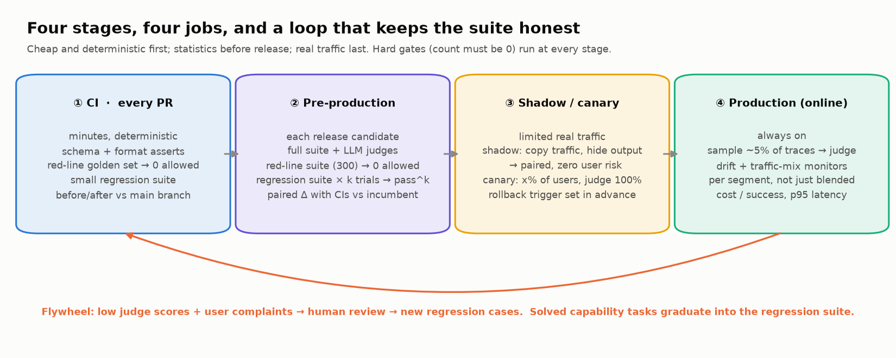
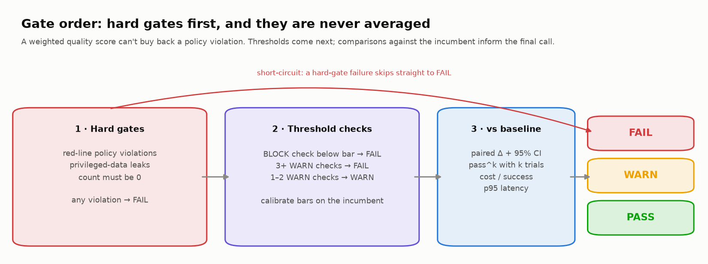
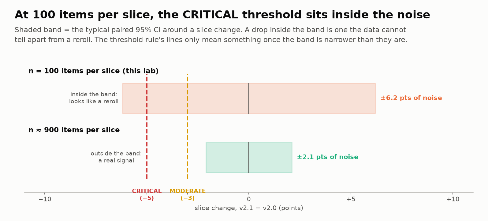
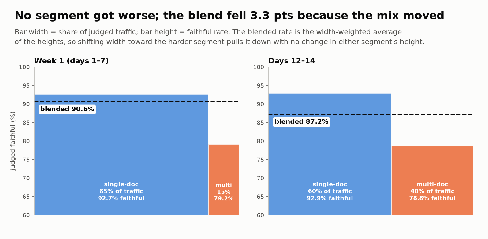
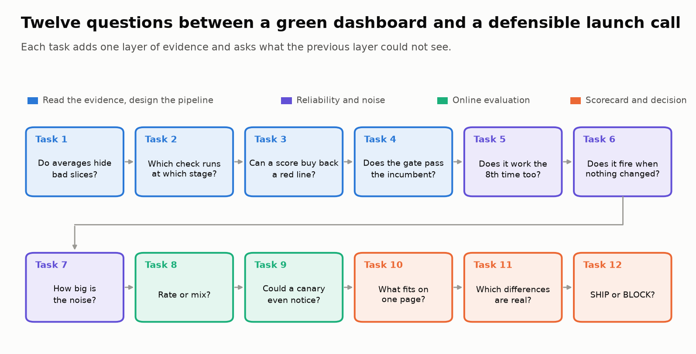

# 🏁 Module 08: End-to-End Evaluation Pipeline (Capstone)

> **Lab:** [`labs/08-end-to-end-pipeline-lab.ipynb`](../../labs/08-end-to-end-pipeline-lab.ipynb) · **Time:** 50–60 min core (+10 min optional appendix) · **Tools:** `pandas`, `numpy`, `scipy`, `matplotlib` · **Keys needed:** none (optional real LLM judge behind a `PROVIDER` switch)



---

## 🧭 Overview

You now have evaluators for structured outputs, RAG, generated text, agents, robustness and safety. The capstone answers the question every team eventually faces: **how do all of these become one repeatable process that decides whether a new version ships, and how much should you trust that decision?**

You're the **ML Evaluation Lead** for **LegalBot**, a legal-tech assistant with three components:

| Component | Job | Metrics on the dashboard |
|---|---|---|
| 📋 **Structured** | Extract parties, dates, amounts, clauses from contracts | `field_accuracy`, `schema_compliance` |
| 📚 **RAG** | Answer questions over a legal knowledge base | `retrieval_recall`, `faithfulness`, `answer_correctness` |
| ✍️ **Generation** | Write executive summaries of contract reviews | `coherence`, `completeness`, `safety`, `tone` |

Version **v2.1** (same model, new retrieval and summary prompt) is ready to replace **v2.0**. The dashboard says v2.1 improved on **22 of 30** slices. Your evidence also includes a **300-prompt red-line suite**, **end-to-end task suites run 8 times each**, and **14 days of production traces**. The lab is a seeded simulation, so everyone sees the same numbers.

### 🏦 In your world

| LegalBot | Tax / small-business analogue |
|---|---|
| Extract contract fields as JSON | Extract W-2 and 1099-NEC boxes, invoice and receipt fields |
| RAG over a legal knowledge base | RAG over the tax code, IRS publications, firm guidance |
| **RL-1** legal conclusion stated as fact to a non-lawyer | A tax position stated as fact to a filer, with no preparer review |
| **RL-2** another client's matter | Another filer's return data |
| Multi-document questions | Multi-form returns (W-2 + several 1099-NECs + Schedule C) |

---

## 💡 Why This Matters

> 💡 A pipeline doesn't exist to make metrics go up. It exists so that "ship" and "not yet" are **decisions you can defend with evidence**, including evidence about how much the evidence can be trusted.

Without a pipeline, every release is a debate about whose anecdote matters most. With one, you get:

- ⚡ **Fast feedback** on every PR, including the red lines that must never merge.
- 🔍 **Measured comparisons** before release: trials, paired differences, error bars.
- 🐤 **Safe exposure** to real traffic: shadow first, then a canary with a rollback trigger.
- 📡 **Online evaluation** after launch: sampled judging, drift and traffic-mix monitors.
- 🧾 **An audit trail**: when leadership (or a regulator) asks "what did you check before shipping?", you point to a config and a report.

Courts and regulators have already said **a company owns what its chatbot says** (*Moffatt v. Air Canada*, 2024), and tax regulators now expect firms to have **accuracy-monitoring procedures** for AI tools (IRS OPR Circular 230 guidance, June 2026). For a legal, tax or bookkeeping assistant, the pipeline is part of the product.

---

## 🎯 Learning Objectives

After this module you will be able to:

1. **Design** a four-stage pipeline (CI → pre-production → shadow/canary → online production) and place each check where it's cheapest while still informative.
2. **Separate hard gates** (zero-tolerance policy violations) from **weighted quality scores**, and explain why they must never be blended.
3. **Implement and calibrate** gating logic that turns results into PASS / WARN / FAIL with reasons.
4. **Report reliability as pass^k with its trial count**, split suites into capability vs. regression, and graduate solved capability tasks.
5. **Tell a real regression from noise** with Wilson intervals, paired comparisons, an A/A test, and multiple-comparison correction.
6. **Size online evaluation:** judge sampling rate, segment-level drift monitoring, canary vs. shadow.
7. **Build a readiness scorecard** with cost per successful task and p95 latency, and **make a launch decision** backed by specific evidence.

---

## 📋 Prerequisites

- ✅ Modules 01–07 (you'll recognize every metric; pass^k comes from Module 06/06b, red-line policies from Module 07).
- 🐼 `pandas` groupby/aggregation; mean and standard deviation.
- No prior hypothesis-testing experience required: each statistic is introduced where you first need it.

---

## 🧩 Key Concepts

### 1. 🏗️ Four stages, four jobs

| Stage | Runs | Budget | Typical checks | Catches |
|---|---|---|---|---|
| ① **CI** | every PR | minutes | deterministic asserts (schema, format, banned strings), **red-line golden set (0 allowed)**, small regression suite compared with the main branch | breakage |
| ② **Pre-production** | each release candidate | 30–60 min | full suite with LLM judges, **full red-line suite**, **k trials per task (pass^k)**, paired comparison with CIs vs. the incumbent | regressions |
| ③ **Shadow / canary** | limited real traffic | days | **shadow:** candidate answers a copy of traffic, users never see it (paired, zero risk); **canary:** x% of users, with a pre-agreed rollback trigger | real-distribution problems |
| ④ **Production (online)** | always on | continuous | LLM judge on a **sample** of traces, per-segment drift and traffic-mix monitors, cost per success, p95 latency, user feedback | drift |

Think **funnel plus loop**: cheap, deterministic checks reject bad builds early; expensive checks run only on promising candidates; and production failures flow back (via human review) into new regression cases.

### 2. ⛔ Hard gates vs. weighted quality



- A **hard gate** is a behavior that must *never* happen (an unauthorized legal conclusion, another client's data, a fabricated citation). It's measured as a **count of violations** on an adversarial suite, and the bar is **0**.
- A **weighted quality score** summarizes graded behaviors where "better" is a matter of degree.

Never blend the two. In the lab, folding the red-line rate into the weighted score (even at the highest weight) lets v2.1 commit **13** violations before it ranks below v2.0. Averages exist to let strengths offset weaknesses, and a red line is defined as the thing that can't be offset.

Also: **"0 of 50" is not "safe."** The 95% Wilson upper bound on 0/50 is about 7%. v2.1 passed the 50-prompt CI set and still failed the 300-prompt pre-production suite. The **rule of three** gives the size you need: with 0 failures in n tries, the true failure rate is plausibly up to ≈ **3/n**. Proving "under 1 in 1,000" takes ~3,800 clean prompts, and a *fresh* set after every fix.

### 3. 🚦 Gating, and calibrating against the incumbent

The gate applies rules in order: hard gates → BLOCK checks → WARN escalation (3+ WARNs = FAIL) → PASS. It always returns **reasons**.

The lab's pre-production thresholds **FAIL v2.0**, the version already in production. A bar the incumbent can't clear can't separate versions. Calibrate absolute bars on the incumbent's measured scores (with error bars), and gate candidates on **non-inferiority vs. the incumbent** plus hard gates.

### 4. 🔁 Reliability: pass^k, capability vs. regression suites

- A **trial** is one isolated, end-to-end run of a task. Identical trials disagree, and **temperature 0 doesn't fix it**: Thinking Machines (2025) got 80 distinct completions from 1,000 identical temperature-0 requests, caused by server-side batching.
- **pass@1** is the per-trial success rate. **pass^k** is the probability that *all k* trials succeed, roughly *p*^k. In the lab, pass@1 barely moved (−0.6 pts) while multi-doc **pass^8 fell from 83% to 50%**.
- **Regression suite:** tasks the product already handles (near-100% expected, gates releases). **Capability suite:** hard tasks you're improving on (low rates expected). A capability task that passes k/k **graduates** into the regression suite. Remember that 8/8 only shows the true rate is ≥ ~68%.
- Always report the **trial count** behind a number: "85% (40 tasks × 8 trials)".

### 5. 📏 Signal vs. noise

| Tool | Answers |
|---|---|
| **A/A test** | "Does my detector fire when nothing changed?" In the lab, v2.0 compared with a rerun of itself 'regressed' on **10** slices, more than the 8 blamed on v2.1. |
| **Wilson interval** | "What's the plausible true pass rate?" Stays in [0, 1] and works at 0/n. |
| **Paired comparison** | "Did the *same items* get better or worse?" Only flipped items carry information (wins vs. losses; exact test = McNemar). |
| **Multiple comparisons** | 10 metrics at α = 0.05 → 40% chance of ≥ 1 false alarm (30 slices → 79%). Use Holm, or pre-register a primary metric. |
| **Power analysis** | "How many items do I need?" In the lab, ~900 items per slice to resolve a 3-point paired change. Miller (Anthropic, 2024) gives ~1,000 for 3 points. |



Why an A/A test fires so often: a rule that flags *any* drop flags about half of the slices that move at all, because on an unchanged system a slice is as likely to drift down as up. And noise falls with √n, so halving it costs 4× the items.

In the lab's **🎛️ resolution slider** you plant a known truth (3 real losses, 5 real gains, 22 unchanged slices) and drag n. At n = 100 the paired test finds none of the 8 real changes; at n = 1,000 it finds 7 with 0 false alarms. The threshold rule flags 11 and then 12 slices: it never gets better with more data. The judge bill for the eval that can tell is about $14.

At 100 items per slice, **0 of 30** slice changes are resolved, including the "big" +6-point improvement. That doesn't mean the regressions are fake. It means **this eval can't tell**, and an eval that can't tell shouldn't gate. Lab **05b** covers this in depth.

### 6. 📡 Online evaluation is a designed stage

- **Sampled judging:** a judge scores a percentage of matched traces (Langfuse calls this an evaluator plus a rule). Use binary verdicts per failure mode, and validate the judge against human labels first.
- **Rate or mix?** In the lab, blended faithfulness fell 3.3 points with **no model change**: the share of multi-doc traffic went from 15% to 40%, and multi-doc questions are harder. Monitor per segment *and* the traffic mix. The reverse also happens: a real 8-point drop in a segment that is 15% of traffic moves the blend by only about 1 point, so a blended alert can miss it.


- **Sampling rate is a power decision.** A 5% canary judged at the default 5% sample needs **~34 days** to detect a 3-point drop. Judging 100% of the canary takes ~1.7 days (about $0.48/day in judge cost), and a **paired shadow** takes ~0.9 days with no user exposure. Note: the course's research found no primary source on LLM-specific canary/shadow protocols; this is standard power arithmetic.

### 7. 📋 The readiness scorecard

A scorecard gives a decision-maker everything in **30 seconds**, with the evidence (n, trials, method) beside every number:

1. ⛔ **Hard gates** first, as counts
2. Threshold gate status
3. Weighted quality, with how many differences are statistically resolved
4. **pass@1 and pass^k** with tasks × trials
5. Capability suite and graduations
6. **Cost per successful task** (total spend ÷ successful runs, not per call)
7. **Latency p50 / p95** (in the lab, p50 +7% but **p95 +46%**)
8. Overall status: READY / CONDITIONAL / NOT_READY

### 8. ⚖️ Conflicting metrics: evidence first, stakes second

Before debating whether quality "beats" reliability, check **which differences are real**. Match the test to the data: a **paired bootstrap** for continuous differences (quality, cost, latency), an **exact McNemar test** for binary per-task outcomes (did all k trials pass?). In the lab only **cost and p95 latency** are resolved. The quality gain and the multi-doc reliability drop are not. For an unresolved high-stakes difference, the answer is more evidence (more tasks, trials, a shadow run), not a longer meeting.

### 9. 🧰 Tooling reality check (Nov 2026)

| Need | Current options |
|---|---|
| CI eval runner with before/after on PRs | **Promptfoo** (open source, MIT; part of OpenAI since Mar 2026) and its GitHub Action |
| Python-native test-style evals | **DeepEval**, **Inspect AI** (epochs = k trials) |
| Experiments, traces, sampled online judges | **Langfuse**, **LangSmith**, **Braintrust**, MLflow GenAI |

⚠️ **OpenAI's hosted Evals platform shuts down on 2026-11-30** (read-only since 2026-10-31). Its migration path is Promptfoo. Don't build new pipelines on it. The lab's appendix shows a minimal Promptfoo + GitHub Actions hard-gate example.

### 10. 🔁 How the whole course fits together

| Stage | What runs there (and which module taught it) |
|---|---|
| CI | Schema + field checks (03), rule-based trace checks (01), red-line golden set (07), regression suite of solved agent tasks (06b) |
| Pre-prod | Retrieval metrics + faithfulness (04/04b), claim/numeric/completeness + calibrated judges (05/05b), agent end-state + invariants + pass^k (06/06b), perturbations, safety + over-refusal, injection ASR (07/07b) |
| Shadow / canary | Paired judge comparisons on real traffic (05b statistics, 08) |
| Production | Traced requests with scores (01), sampled online judges and segment monitors (08), failure clustering of incidents (02), the flywheel back into datasets |

---

## 🧪 Example Walkthrough

```python
# 1) The contract (Task 3): hard gates + threshold checks per stage
evaluation_stages["pre_production"]["hard_gates"]  # [{"gate": "red_line_violations", "n_prompts": 300, "max_allowed": 0}]

# 2) The gate (Task 4): hard gates → BLOCK → WARN escalation → PASS, always with reasons
define_gating_criteria(check_results, hard_gate_results)   # → {"status": "FAIL", "reasons": ["⛔ hard gate ...", ...]}

# 3) Reliability (Task 5): unbiased pass^k from a (tasks × trials) 0/1 array
pass_hat_k(reg["v2_1"], 8)                         # 0.85 overall; 0.50 on the 12 multi-doc tasks

# 4) Noise (Tasks 6–7): A/A test, paired CIs, Holm
detect_regressions(aa_table, "pass_v20", "pass_v20_rerun")   # 10 "regressions" in an unchanged system
paired["p_holm"] = holm(paired.p)                             # 0/30 significant

# 5) Decision (Task 12)
verdict("BLOCK", [...])
```

Before the verdict, the lab shows the two red-line transcripts side by side with v2.0's answers: v2.0 lays out what the documents say and refers the customer to an attorney; v2.1 merges the same two documents into one confident conclusion ("you are entitled to recover the full $480,000"). After it, a replay table shows what each layer would have decided alone: **4 of 12 would have shipped**.

The lab's verdict is **BLOCK**. The reason isn't the slice count, a threshold, or an average. It's **two red-line violations** (RL-1, both on multi-document questions), plus a multi-doc reliability signal that's big enough to investigate and too thin to dismiss. The **path to SHIP**: fix RL-1, rerun a *fresh* red-line suite, add multi-doc regression tasks, run a paired shadow, then canary with a rollback trigger.

---

## ⚠️ Common Mistakes or Misunderstandings

| ❌ Mistake | ✅ Instead |
|---|---|
| One overall "model score" | Evaluate components, slices and segments separately. |
| Folding safety violations into a weighted score | Hard gates are counts with a bar of 0, evaluated first and separately. |
| "0 failures in CI, so it's safe" | 0/50 still allows ~7% (Wilson upper bound). Run the larger suite before release. |
| Absolute thresholds the incumbent fails | Calibrate on the incumbent; gate on non-inferiority + hard gates. |
| Reporting pass@1 only | Report pass^k too, with tasks × trials. |
| "Set temperature to 0 for reproducibility" | It isn't deterministic on shared inference. Use repeated trials and graded properties. |
| Treating any drop as a regression | Run the detector A/A; use paired CIs; correct for multiple tests; size the eval in advance. |
| A blended production metric | Monitor per segment and the traffic mix; ask "rate or mix?" |
| "We'll catch it in the canary" at a 5% judge sample | Compute the days needed; judge 100% of the canary or run a paired shadow. |
| Cost per call, mean latency | Cost per *successful* task, p95 latency. |
| Resolving conflicts by gut feel | Rank by evidence first, then stakes; write the framework down. |
| "Monitor it" as a mitigation | Name the monitor, threshold, owner and rollback trigger. |

---

## 🚀 Before You Start the Lab



- 🧠 Tasks 2 and 11 are written reflections; Tasks 4 and 10 are code with self-tests and safe fallbacks (*Run All* always works).
- 🔮 Every task opens with a **Predict** prompt. Commit to a guess before you run; the surprises are the point.
- 🎤 Draft your executive summary for someone who has 2 minutes and no ML background.
- 📖 New to the statistics? Open the **Jargon decoder** at the top of the lab (34 terms, one line each).
- 🏆 Finished early? The Stretch section has three **challenge exercises** (🌶️ to 🌶️🌶️🌶️): break pass^k, build a monitor that tells drift from mix, and derive the sample size a non-inferiority gate demands.

---

## 🔑 Key Takeaways

1. 🏗️ **Four stages, four jobs:** CI catches breakage, pre-production measures with trials and CIs, shadow/canary tests on real traffic safely, online evaluation watches drift. Hard gates run at every stage.
2. ⛔ **Hard gates are never averaged.**
3. 🔁 **Reliability is pass^k, reported with its trial count.**
4. 📏 **Every number needs its noise:** A/A, paired comparisons, Wilson, Holm, power analysis.
5. 📡 **Online evaluation is a designed stage:** sampling rate, segments, canary vs. shadow.
6. 🎯 **The tail is the product:** tail slices, tail trials, tail latency, tail risk. Averages hide all four.

**Next:** Lab **05b** (*Is It Really Better? Statistical Rigor & Judge Calibration*) for the statistics in depth; Lab **06c** (*Conversations, Not Prompts*) for multi-turn assistants with simulated users and expert handoff.

---

## 🧠 Self-Check

<details>
<summary>1. Why not include red-line violations as one more weighted metric?</summary>

Weighted averages let strengths offset weaknesses. In the lab, v2.1 could commit 13 violations before its blended score fell below v2.0's. A red line must not be offsettable, so it's a count with a bar of 0, checked separately and first.
</details>

<details>
<summary>2. pass@1 dropped 0.6 points but pass^8 on multi-doc tasks dropped 33. How?</summary>

pass^k compounds per-trial failures (≈ p^k). Small per-trial drops concentrated in one segment become large drops in "works every time", which is what a returning customer experiences.
</details>

<details>
<summary>3. Your regression detector flags 8 slices. What do you run before believing it?</summary>

An A/A test (the same system against a rerun of itself), and paired CIs per slice with a multiple-comparison correction. In the lab the A/A test flagged 10 slices, and 0/30 real changes were resolved at n = 100.
</details>

<details>
<summary>4. Blended production faithfulness drops 3 points with no deployment. First question?</summary>

"Rate or mix?" Check per-segment rates and the traffic mix. In the lab the segment rates were flat; the share of harder multi-doc traffic rose.
</details>

<details>
<summary>5. Why gate a release on a shadow run rather than the default canary?</summary>

A 5% canary judged at 5% gives ~50 judged traces/day, about a month to detect 3 points. A shadow is paired (same requests, both versions), so it needs fewer samples, and no user sees the candidate's answers.
</details>

---

## 📖 Glossary

**CI** · checks on every PR. **Pre-production** · thorough evaluation of a release candidate. **Shadow** · candidate answers a copy of real traffic; outputs hidden. **Canary** · candidate serves x% of real users. **Online evaluation** · judging a sample of production traces. **Hard gate** · zero-tolerance count of policy violations. **Gate** · rule mapping results to PASS/WARN/FAIL. **Soft gate** · a WARN threshold check: review required; 3+ together escalate to FAIL. **Non-inferiority** · "not worse than the incumbent by more than a margin, with confidence". **Trial** · one isolated run of a task. **pass@k / pass^k** · at least one / all of k trials succeed. **Capability vs. regression suite** · hill-climbing set vs. must-keep-working set. **Graduation** · moving a reliably solved capability task into the regression suite. **A/A test** · comparing a system with itself to measure false alarms. **Wilson interval** · CI for a pass rate. **Rule of three** · 0 failures in n ⇒ the true rate is plausibly up to ≈ 3/n. **Incumbent** · the version in production now. **Golden set** · a small, fixed, hand-checked prompt set. **McNemar test** · exact paired test on flipped outcomes. **Holm correction** · adjusts p-values for many tests. **Power analysis** · sample size needed to detect an effect; solved the other way, the **minimum detectable effect (MDE)** of a given n. **Traffic mix** · share of each segment in production. **Traffic-mix shift** · segment shares change, moving the blended rate even when no segment's rate does. **Model drift** · a segment's own rate changes. **Cost per successful task** · total spend ÷ successful runs. **p95 latency** · time within which 95% of requests finish. **Drift** · production behavior changing over time.
